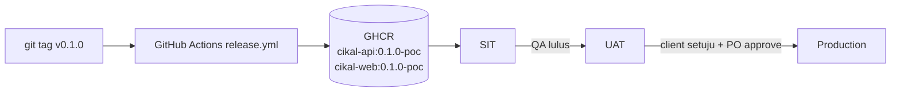
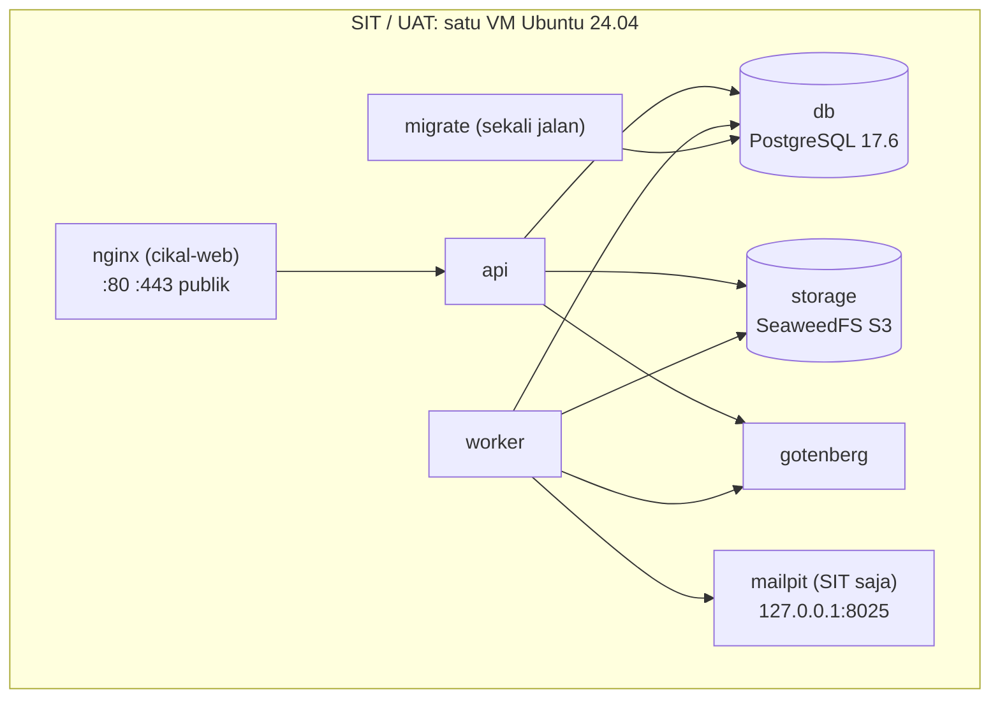
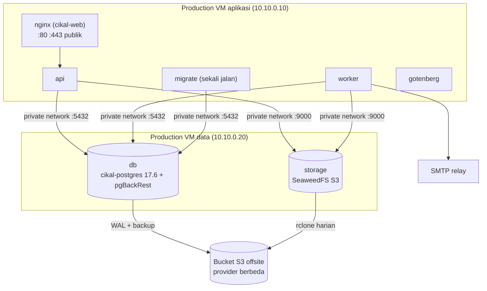

# Cikal LOS: Deployment Plan

**Version:** 0.1  
**Date:** 2026-10-22  
**Author:** Tech Lead PPU  
**Status:** Draft  
**Phase:** POC  

Runbook pemasangan, rilis, rollback, reset data, dan debugging Cikal LOS di lingkungan SIT, UAT, dan production yang saat ini di-hosting PPU. Paket dan perintah yang sama berlaku untuk instalasi on-premise di server client kelak; perbedaannya hanya pada nilai `.env`, sertifikat, dan storage (lihat 2.6).

Status Draft: sebagian artefak yang dipanggil runbook ini belum ada di repo. Daftarnya ada di 2.5 beserta kartu yang membuatnya. Runbook ini menjadi kontrak untuk artefak tersebut; setiap penyimpangan saat implementasi wajib memperbarui dokumen ini di PR yang sama.

Keputusan arsitektur yang dirujuk: [technical-specs/02-system-architecture.md](technical-specs/02-system-architecture.md) 2.6, [technical-specs/06-data-model.md](technical-specs/06-data-model.md) 6.12, [technical-specs/07-security.md](technical-specs/07-security.md) 7.8, [technical-specs/11-environment-configuration.md](technical-specs/11-environment-configuration.md), [api-specs/27-system.md](api-specs/27-system.md).

## Daftar Isi

1. [Lingkungan](#1-lingkungan)
2. [Infrastruktur](#2-infrastruktur)
3. [Instalasi Awal](#3-instalasi-awal)
4. [Memperbarui ke Rilis Baru](#4-memperbarui-ke-rilis-baru)
5. [Rollback](#5-rollback)
6. [Reset State Database](#6-reset-state-database)
7. [Inspeksi dan Debugging Database](#7-inspeksi-dan-debugging-database)
8. [Temuan untuk Spesifikasi dan Kartu](#8-temuan-untuk-spesifikasi-dan-kartu)

---

## 1. Lingkungan

| Lingkungan | Host / URL | Tujuan | Topologi | Siapa deploy | Reset data |
|---|---|---|---|---|---|
| `dev` | Laptop engineer, `http://localhost:5173` | Pengembangan | `deploy/compose/docker-compose.dev.yml` + `pnpm dev` | Engineer sendiri | Bebas, seed `dev` |
| `test` | GitHub Actions | CI per PR | Testcontainers per job | Otomatis | Tidak perlu; database baru setiap job |
| `sit` | `https://cikal-sit.example.id` | Uji integrasi oleh QA PPU | 1 VM | TL | Bebas oleh QA, seed `qa` |
| `uat` | `https://cikal-uat.example.id` | Uji penerimaan client | 1 VM | TL, setelah QA lulus SIT | Hanya dengan izin PO dan PIC client, seed `qa` |
| `production` | `https://cikal.example.id` | Operasional | 2 VM (aplikasi + data) | TL, dengan persetujuan PO tertulis | **Dilarang** |

Domain `example.id` adalah placeholder. Nilai asli diisi di variabel `DOMAIN` pada `.env` tiap VM saat VM disediakan; tidak ada nama domain yang ditulis di image.

Alur rilis: tag git `vX.Y.Z` memicu build image sekali di GitHub Actions. Image dengan digest yang sama dipasang berurutan di SIT, UAT, lalu production. Tidak ada build ulang per lingkungan.



---

## 2. Infrastruktur

### 2.1 Topologi





IP `10.10.0.10` dan `10.10.0.20` adalah contoh. Ganti dengan IP privat asli di `.env` dan aturan firewall.

### 2.2 Komponen

| Service compose | Image | VM | Port | Keterangan |
|---|---|---|---|---|
| `nginx` | `ghcr.io/pt-perkasa-pilar-utama/cikal-web` | Tunggal / aplikasi | 80, 443 publik | SPA statis, proxy `/api` ke `api:3000`, TLS, header keamanan |
| `api` | `ghcr.io/pt-perkasa-pilar-utama/cikal-api` | Tunggal / aplikasi | internal 3000 | `PROCESS_ROLE=api` |
| `worker` | `ghcr.io/pt-perkasa-pilar-utama/cikal-api` | Tunggal / aplikasi | tidak ada | `PROCESS_ROLE=worker`, konsumen pg-boss |
| `migrate` | `ghcr.io/pt-perkasa-pilar-utama/cikal-api` | Tunggal / aplikasi | tidak ada | Entrypoint runner `platform/migrate`; sekali jalan; `api` dan `worker` menunggu selesai (`service_completed_successfully`) |
| `gotenberg` | `gotenberg/gotenberg:8.20.1` | Tunggal / aplikasi | internal 3000 | Konversi PDF |
| `db` | Tunggal: `postgres:17.6-alpine`; production: `ghcr.io/pt-perkasa-pilar-utama/cikal-postgres:17.6` | Tunggal / data | Tunggal: tidak dipublikasi; data: `10.10.0.20:5432` | Role `cikal_owner` (pemilik skema) dan `cikal_app` (tanpa `BYPASSRLS`) dibuat skrip `initdb` |
| `storage` | `chrislusf/seaweedfs:3.97` | Tunggal / data | Tunggal: tidak dipublikasi; data: `10.10.0.20:9000` | S3-compatible, Apache 2.0; `-filer.encryptVolumeData` wajib (tech 07 §7.7, ADR-005) |
| `storage-init` | `chrislusf/seaweedfs:3.97` | Tunggal / data | tidak ada | Membuat bucket `${S3_BUCKET}`, lalu berhenti |
| `mailpit` | `axllent/mailpit:v1.27` | SIT | `127.0.0.1:8025` | Profil compose `mailpit`; email tidak pernah keluar |
| `certbot` | `certbot/certbot:v3.3.0` | Tunggal / aplikasi | tidak ada | Profil compose `tools`; terbit dan perpanjang sertifikat |
| `objects-backup` | `rclone/rclone:1.68.2` | Data (production) | tidak ada | Profil compose `tools`; salin bucket ke offsite |

Satu image `cikal-api` dipakai tiga service; perannya ditentukan `PROCESS_ROLE` dan entrypoint. Image berbasis `gcr.io/distroless/nodejs22`, tanpa shell, sehingga semua operasi database lewat runner (`migrate`) atau container `db`, bukan `docker compose exec api sh`.

### 2.3 Batas jaringan

| VM | Masuk yang diizinkan | Ditutup |
|---|---|---|
| Tunggal (SIT, UAT) | 22 dari CIDR admin PPU; 80 dan 443 dari mana saja | Semua port lain. `db` dan `storage` tidak dipublikasi ke host |
| Production aplikasi | 22 dari CIDR admin PPU; 80 dan 443 dari mana saja | Semua port lain |
| Production data | 22 dari CIDR admin PPU; 5432 dan 9000 hanya dari `10.10.0.10` lewat antarmuka privat | Semua port lain, termasuk seluruh IP publik |

Docker menulis aturan iptables sendiri untuk port yang dipublikasi, sehingga aturan `ufw` tidak berlaku untuk port container. Karena itu VM data mengikat port ke IP privat saja (`10.10.0.20:5432`) **dan** memasang aturan `DOCKER-USER` (3.1 langkah 5).

`GET /api/health/ready` dijawab hanya untuk jaringan internal atau request dengan `Authorization: Bearer <monitoring_token>` ([api-specs/27-system.md](api-specs/27-system.md) 27.2).

### 2.4 Tata letak file di setiap VM

```text
/opt/cikal/                     owner cikal:cikal, mode 750
├── docker-compose.yml          salinan deploy/compose/docker-compose.{single,app,data}.yml dari tag rilis
├── .env                        mode 600; berisi password DB di DATABASE_URL
├── releases.log                riwayat digest yang pernah dipasang (untuk rollback)
├── license.json                file lisensi bertanda tangan dari tools/license-cli (VM tunggal dan aplikasi)
├── secrets/                    mode 700; isi mode 644 (lihat 3.4)
├── initdb/                     skrip pembuatan role, hanya VM tunggal dan data
├── nginx/
│   ├── available/              http.conf.template, https.conf.template dari deploy/nginx
│   ├── templates/              template aktif (default.conf.template)
│   └── dhparam.pem
└── backups/                    pg_dump UAT dan dump manual
```

### 2.5 Artefak yang diasumsikan runbook

| Artefak | Isi | Kartu | Status |
|---|---|---|---|
| `apps/api/Dockerfile` | Image `cikal-api` distroless per manifest | TL-S6-01 | Belum ada |
| `apps/web/Dockerfile` | Image `cikal-web`: nginx 1.28 + hasil `vite build` | TL-S6-01 | Belum ada |
| `.github/workflows/release.yml` | Build dan push dua image saat tag `v*`, tulis digest di job summary | TL-S6-01 | Belum ada |
| `deploy/compose/docker-compose.single.yml`, `docker-compose.app.yml`, `docker-compose.data.yml` | Service di 2.2, log rotation, healthcheck | TL-S6-01 | Belum ada |
| `deploy/compose/env/{sit,uat,production-app,production-data}.env.example` | Isi 3.5 | TL-S6-01 | Belum ada |
| `deploy/compose/initdb/10-roles.sh` | Membuat `cikal_owner` dan `cikal_app` dari file secret | TL-S1-02 | Ada |
| `deploy/nginx/{http,https}.conf.template` | Proxy, ACME webroot, TLS, header keamanan | TL-S6-01 | Belum ada |
| `deploy/postgres/Dockerfile` | `postgres:17.6` + pgBackRest, `archive_mode=on`, `archive_timeout=300` | TL-S6-01 | Belum ada |
| Runner `platform/migrate` dengan subperintah `migrate`, `seed --seed=base\|dev\|qa`, `reset --seed=dev\|qa`, `create-admin` | Satu entrypoint untuk semua operasi skema dan data | TL-S1-02, TL-S6-01 | Ada, kecuali `create-admin` (8, F-02) |
| `POST /api/admin/reset-state` lengkap | Drop, migrasi, seed, kosongkan bucket, sinyal `cikal_ops` | TL-S1-02, TL-S1-03 | Ada; butuh sesi role QA dan header CSRF |
| `tools/license-cli` | `keygen`, `issue`, `verify` file lisensi Ed25519 (3.11) | TL-S2-02 | Ada |
| `deploy/license/ppu-license-public-key.pem` dan build image dengan `--license-key` kunci itu | Kunci publik PPU tertanam di image rilis | TL-S6-01 | Belum ada (8, F-09) |
| Pemasangan `license.json` saat instalasi (`LICENSE_FILE`, `create-admin`) | Lisensi pertama company tanpa lewat halaman License | TL-S6-01 | Belum ada (8, F-09) |

### 2.6 Perbedaan untuk on-premise client

| Bagian | Hosting PPU | On-premise client |
|---|---|---|
| Sertifikat | Let's Encrypt (3.7) | Sertifikat dari client di-mount ke path yang sama (`/etc/letsencrypt/live/${DOMAIN}/`); langkah certbot dilewati |
| Object storage | SeaweedFS di compose | `S3_ENDPOINT` ke storage client; service `storage` dan `storage-init` tidak dijalankan. Client mengonfirmasi default encryption bucket atau grid aktif sebelum go-live (tech 07 §7.7) |
| PostgreSQL | Container di VM data | Container di VM data, atau server client (isi `DATABASE_URL`, `DATABASE_MIGRATION_URL`) |
| SMTP | Relay transaksional PPU | SMTP client |
| Registry | VM menarik dari GHCR | Bila VM client tanpa internet: `docker save` di laptop TL, salin, `docker load` |

---

## 3. Instalasi Awal

### Konvensi perintah

- Perintah di VM dijalankan sebagai user `cikal` di folder `/opt/cikal`, kecuali diawali `sudo`.
- Alias SSH di `~/.ssh/config` laptop TL: `cikal-sit`, `cikal-uat`, `cikal-prod-app`, `cikal-prod-data`.
- Blok yang memakai variabel `.env` (contoh `$DOMAIN`) memuat `.env` dulu:

```bash
cd /opt/cikal && set -a && . ./.env && set +a
```

- Untuk production, setiap langkah diberi label **[VM aplikasi]** atau **[VM data]**. Tanpa label berarti VM tunggal (SIT/UAT).

### 3.1 Prasyarat host

Spesifikasi awal, ditinjau setelah uji beban:

| VM | vCPU | RAM | Disk |
|---|---|---|---|
| SIT, UAT | 4 | 8 GB | 100 GB SSD |
| Production aplikasi | 4 | 8 GB | 50 GB SSD |
| Production data | 4 | 16 GB | 200 GB SSD |

Jalankan di setiap VM:

```bash
# 1. Paket dasar
sudo apt-get update
sudo apt-get install -y ca-certificates curl ufw jq iptables-persistent

# 2. Docker Engine dan Compose plugin dari repo resmi Docker
sudo install -m 0755 -d /etc/apt/keyrings
sudo curl -fsSL https://download.docker.com/linux/ubuntu/gpg -o /etc/apt/keyrings/docker.asc
sudo chmod a+r /etc/apt/keyrings/docker.asc
echo "deb [arch=$(dpkg --print-architecture) signed-by=/etc/apt/keyrings/docker.asc] https://download.docker.com/linux/ubuntu $(. /etc/os-release && echo "$VERSION_CODENAME") stable" | sudo tee /etc/apt/sources.list.d/docker.list > /dev/null
sudo apt-get update
sudo apt-get install -y docker-ce docker-ce-cli containerd.io docker-buildx-plugin docker-compose-plugin

# 3. Rotasi log semua container: 50 MB x 5 file
echo '{"log-driver":"json-file","log-opts":{"max-size":"50m","max-file":"5"}}' | sudo tee /etc/docker/daemon.json
sudo systemctl restart docker

# 4. User operasional dan folder aplikasi
sudo adduser --disabled-password --gecos "" cikal
sudo usermod -aG docker cikal
sudo install -d -o cikal -g cikal -m 750 /opt/cikal
sudo install -d -o cikal -g cikal -m 700 /home/cikal/.ssh
sudo cp ~/.ssh/authorized_keys /home/cikal/.ssh/authorized_keys
sudo chown cikal:cikal /home/cikal/.ssh/authorized_keys
```

Firewall. Ganti `ADMIN_CIDR` dengan IP kantor atau bastion PPU.

```bash
# 5a. VM tunggal dan VM aplikasi
ADMIN_CIDR=203.0.113.0/28
sudo ufw default deny incoming
sudo ufw default allow outgoing
sudo ufw allow from "$ADMIN_CIDR" to any port 22 proto tcp
sudo ufw allow 80/tcp
sudo ufw allow 443/tcp
sudo ufw enable
```

```bash
# 5b. [VM data] SSH dari admin; 5432 dan 9000 hanya dari VM aplikasi lewat antarmuka privat
ADMIN_CIDR=203.0.113.0/28
APP_VM_IP=10.10.0.10
PRIV_IF=eth1   # cek dengan: ip -br addr
sudo ufw default deny incoming
sudo ufw default allow outgoing
sudo ufw allow from "$ADMIN_CIDR" to any port 22 proto tcp
sudo ufw enable
# Docker melewati ufw untuk port container; saring di chain DOCKER-USER
sudo iptables -I DOCKER-USER -i "$PRIV_IF" -p tcp -m multiport --dports 5432,9000 ! -s "$APP_VM_IP" -j DROP
sudo netfilter-persistent save
```

### 3.2 Menyalin file deploy dari tag rilis

Dari laptop TL, pada checkout tag yang akan dipasang:

```bash
# 1. Checkout tag rilis
git fetch --tags && git checkout v0.1.0

# 2a. SIT (UAT sama, ganti host dan file env)
scp deploy/compose/docker-compose.single.yml cikal-sit:/opt/cikal/docker-compose.yml
scp deploy/compose/env/sit.env.example cikal-sit:/opt/cikal/.env
scp -r deploy/compose/initdb cikal-sit:/opt/cikal/initdb
scp -r deploy/nginx cikal-sit:/opt/cikal/nginx-src

# 2b. Production
scp deploy/compose/docker-compose.app.yml cikal-prod-app:/opt/cikal/docker-compose.yml
scp deploy/compose/env/production-app.env.example cikal-prod-app:/opt/cikal/.env
scp -r deploy/nginx cikal-prod-app:/opt/cikal/nginx-src
scp deploy/compose/docker-compose.data.yml cikal-prod-data:/opt/cikal/docker-compose.yml
scp deploy/compose/env/production-data.env.example cikal-prod-data:/opt/cikal/.env
scp -r deploy/compose/initdb cikal-prod-data:/opt/cikal/initdb

# 3. File lisensi dari tools/license-cli (VM tunggal dan VM aplikasi)
scp license.json cikal-sit:/opt/cikal/license.json
```

Di VM tunggal dan VM aplikasi, susun folder nginx:

```bash
cd /opt/cikal
mkdir -p nginx/available nginx/templates backups
cp nginx-src/*.conf.template nginx/available/ && rm -r nginx-src
chmod 600 .env
```

### 3.3 Autentikasi registry

Token GitHub klasik dengan scope `read:packages` saja, milik akun deploy PPU, disimpan di password manager. VM hanya menarik image, tidak pernah push.

```bash
read -rs GHCR_TOKEN   # tempel token, tidak tampil dan tidak masuk history
printf '%s' "$GHCR_TOKEN" | docker login ghcr.io -u ppu-deploy --password-stdin
unset GHCR_TOKEN
```

Ganti `ppu-deploy` dengan nama akun GitHub pemilik token. Kredensial tersimpan di `/home/cikal/.docker/config.json`.

### 3.4 Secret

Secret dibuat di VM, tidak pernah lewat git atau chat. Setelah dibuat, salin isi item bertanda "Simpan" ke vault password manager tim, satu entri per lingkungan.

Jalankan `pnpm dev:secrets` untuk membuat kunci dev tanpa menimpa file yang sudah ada. API, worker, seed, dan reset wajib memakai file kunci yang sama. Nilai file adalah Base64 standar dari 32 byte acak, bukan passphrase. Runner `migrate` tidak membaca kunci.

**Kehilangan `cikal_master_key` berarti data terenkripsi (rahasia integrasi, kunci tenant) tidak bisa dibaca lagi, termasuk dari backup.** Simpan salinannya sebelum aplikasi pertama kali jalan.

```bash
cd /opt/cikal
umask 077
mkdir -p secrets && chmod 700 secrets

# 1. Password dan token acak. Hex agar aman di URL koneksi tanpa escape.
for f in db_postgres_password db_owner_password db_app_password s3_access_key s3_secret_key monitoring_token reset_token seed_user_password; do
  openssl rand -hex 24 > "secrets/$f"
done

# 2. Kunci utama envelope encryption
openssl rand -base64 32 > secrets/cikal_master_key

# 3. Konfigurasi identitas SeaweedFS dari kunci S3 di atas
printf '{"identities":[{"name":"cikal","credentials":[{"accessKey":"%s","secretKey":"%s"}],"actions":["Admin","Read","Write","List","Tagging"]}]}\n' \
  "$(cat secrets/s3_access_key)" "$(cat secrets/s3_secret_key)" > secrets/s3.json

# 4. Secret dari pihak luar. SIT: biarkan kosong (Mailpit dan adapter simulasi).
read -rs SMTP_PASSWORD && printf '%s' "$SMTP_PASSWORD" > secrets/smtp_password && unset SMTP_PASSWORD
read -rs OKSARA_KEY && printf '%s' "$OKSARA_KEY" > secrets/oksara_key && unset OKSARA_KEY

# 5. Production: reset dan akun seed tidak ada, hapus keduanya
#    rm secrets/reset_token secrets/seed_user_password

# 6. Container berjalan sebagai user non-root dan harus bisa membaca file;
#    folder 700 tetap menutup akses user host lain.
chmod 644 secrets/*
```

| File | Simpan di vault | VM tunggal | Production aplikasi | Production data |
|---|---|---|---|---|
| `db_postgres_password` | Ya | ada | | ada |
| `db_owner_password`, `db_app_password` | Ya | ada | ada (untuk `.env`) | ada (untuk `initdb`) |
| `s3_access_key`, `s3_secret_key` | Ya | ada | ada | ada |
| `s3.json` | Tidak (dibangkitkan ulang) | ada | | ada |
| `cikal_master_key` | **Wajib** | ada | ada | |
| `monitoring_token` | Ya | ada | ada | |
| `reset_token` | Ya | ada | **tidak ada** | |
| `seed_user_password` | Ya (password akun seed `dev`/`qa`) | ada | **tidak ada** | |
| `smtp_password`, `oksara_key` | Ya | ada | ada | |
| `pgbackrest.conf`, `rclone.conf` | Ya | | | ada (3.9) |

Production: buat secret DB dan S3 di **[VM data]**, lalu salin ke VM aplikasi lewat laptop TL tanpa menyimpannya di laptop:

```bash
for f in db_owner_password db_app_password s3_access_key s3_secret_key; do
  scp -3 "cikal-prod-data:/opt/cikal/secrets/$f" "cikal-prod-app:/opt/cikal/secrets/$f"
done
```

Buat `cikal_master_key`, `monitoring_token`, `smtp_password`, dan `oksara_key` langsung di **[VM aplikasi]** dengan perintah 2 dan 4 di atas.

### 3.5 Environment variable

Isi `.env` lengkap untuk SIT. File contoh per lingkungan ada di `deploy/compose/env/`. Variabel didefinisikan di [technical-specs/11-environment-configuration.md](technical-specs/11-environment-configuration.md) 11.2; aplikasi menolak start dengan pesan `Invalid environment configuration` bila ada yang salah.

```dotenv
# Image rilis, selalu dengan digest (VP-02). Diisi dari job summary release.yml.
CIKAL_API_IMAGE=ghcr.io/pt-perkasa-pilar-utama/cikal-api:0.1.0-poc@sha256:<digest>
CIKAL_WEB_IMAGE=ghcr.io/pt-perkasa-pilar-utama/cikal-web:0.1.0-poc@sha256:<digest>

# Compose dan nginx
DOMAIN=cikal-sit.example.id                 # nama host publik
ACME_EMAIL=ops@example.id                   # kontak Let's Encrypt untuk peringatan kedaluwarsa
COMPOSE_PROFILES=mailpit                    # SIT saja; kosongkan di UAT dan production

# Aplikasi (PROCESS_ROLE diisi per service di compose, bukan di sini)
APP_ENV=sit
APP_VERSION=0.1.0
PUBLIC_BASE_URL=https://cikal-sit.example.id
LOG_LEVEL=info

# Database: api/worker memakai role tanpa BYPASSRLS; migrate dan reset memakai pemilik skema
DATABASE_URL=postgres://cikal_app:__DB_APP_PASSWORD__@db:5432/cikal
DATABASE_MIGRATION_URL=postgres://cikal_owner:__DB_OWNER_PASSWORD__@db:5432/cikal
DATABASE_POOL_MAX=20

# Object storage
S3_ENDPOINT=http://storage:9000
S3_REGION=us-east-1
S3_BUCKET=cikal-sit
S3_FORCE_PATH_STYLE=true
S3_ACCESS_KEY_FILE=/run/secrets/s3_access_key
S3_SECRET_KEY_FILE=/run/secrets/s3_secret_key

# Layanan internal dan kunci
GOTENBERG_URL=http://gotenberg:3000
MASTER_KEY_FILE=/run/secrets/cikal_master_key # Base64 32 byte; wajib pada api, worker, seed, dan reset
LICENSE_FILE=/etc/cikal/license.json
SESSION_COOKIE_SECURE=true
MONITORING_TOKEN_FILE=/run/secrets/monitoring_token

# Email
SMTP_HOST=mailpit
SMTP_PORT=1025
SMTP_USER=
SMTP_PASSWORD_FILE=/run/secrets/smtp_password
SMTP_FROM=no-reply@example.id

# Integrasi
REGION_API_URL=https://oksara.senar.id
REGION_API_KEY_FILE=/run/secrets/oksara_key
ALLOW_SIMULATION_ADAPTERS=true
WORKER_CONCURRENCY=5

# Reset state (hapus keempat baris ini di production)
ENABLE_RESET_API=true
RESET_API_TOKEN_FILE=/run/secrets/reset_token
DEFAULT_RESET_SEED=qa
SEED_USER_PASSWORD_FILE=/run/secrets/seed_user_password
```

Isi password DB dari file secret:

```bash
cd /opt/cikal
sed -i "s|__DB_APP_PASSWORD__|$(cat secrets/db_app_password)|; s|__DB_OWNER_PASSWORD__|$(cat secrets/db_owner_password)|" .env
chmod 600 .env
```

Nilai yang berbeda per lingkungan:

| Variabel | sit | uat | production (VM aplikasi) |
|---|---|---|---|
| `DOMAIN`, `PUBLIC_BASE_URL` | `cikal-sit.example.id` | `cikal-uat.example.id` | `cikal.example.id` |
| `COMPOSE_PROFILES` | `mailpit` | kosong | kosong |
| `APP_ENV` | `sit` | `uat` | `production` |
| Host di `DATABASE_URL`, `DATABASE_MIGRATION_URL` | `db` | `db` | `10.10.0.20` |
| `S3_ENDPOINT` | `http://storage:9000` | `http://storage:9000` | `http://10.10.0.20:9000` |
| `S3_BUCKET` | `cikal-sit` | `cikal-uat` | `cikal-prod` |
| `SMTP_HOST`, `SMTP_PORT`, `SMTP_USER` | `mailpit`, `1025`, kosong | relay, `587`, akun relay | relay, `587`, akun relay |
| `ALLOW_SIMULATION_ADAPTERS` | `true` | `true` | `false` |
| `ENABLE_RESET_API`, `RESET_API_TOKEN_FILE`, `DEFAULT_RESET_SEED` | ada, `qa` | ada, `qa` | **tidak ada**; start ditolak bila `ENABLE_RESET_API=true` |

`.env` VM data production hanya berisi:

```dotenv
CIKAL_POSTGRES_IMAGE=ghcr.io/pt-perkasa-pilar-utama/cikal-postgres:17.6@sha256:<digest>
PRIVATE_IP=10.10.0.20          # port db dan storage hanya diikat ke IP ini
S3_BUCKET=cikal-prod
```

### 3.6 Menjalankan service, migrasi, dan seed

**SIT dan UAT (VM tunggal)**

```bash
cd /opt/cikal

# 1. Tarik semua image sesuai digest di .env
docker compose pull

# 2. Data store. Volume db kosong menjalankan initdb/10-roles.sh (role cikal_owner, cikal_app).
docker compose up -d db storage
docker compose run --rm storage-init

# 3. Migrasi semua modul berlisensi ke versi terbaru (runner platform/migrate)
docker compose run --rm migrate

# 4. Seed: base + qa (SIT dan UAT)
docker compose run --rm migrate seed --seed=qa

# 5. Template nginx HTTP sementara untuk penerbitan sertifikat (3.7)
cp nginx/available/http.conf.template nginx/templates/default.conf.template

# 6. Semua service. migrate jalan lagi lebih dulu dan selesai tanpa perubahan.
docker compose up -d
docker compose ps
```

**Production**

```bash
# 1. [VM data] Data store dan bucket
cd /opt/cikal
docker compose pull
docker compose up -d db storage
docker compose run --rm storage-init

# 2. [VM data] Inisialisasi pgBackRest (3.9 harus selesai lebih dulu)
docker compose exec db pgbackrest --stanza=cikal stanza-create
docker compose exec db pgbackrest --stanza=cikal check
```

```bash
# 3. [VM aplikasi] Pastikan VM data terjangkau lewat jaringan privat
docker run --rm postgres:17.6-alpine pg_isready -h 10.10.0.20 -p 5432
curl -s -o /dev/null -w '%{http_code}\n' http://10.10.0.20:9000/   # 403 berarti SeaweedFS menjawab

# 4. [VM aplikasi] Migrasi dan seed base (tanpa user dan data uji)
cd /opt/cikal
docker compose pull
docker compose run --rm migrate
docker compose run --rm migrate seed --seed=base

# 5. [VM aplikasi] Admin pertama. Password sekali pakai dicetak ke terminal:
#    simpan di vault, wajib diganti saat login pertama. Company diambil dari license.json.
docker compose run --rm migrate create-admin --username admin

# 6. [VM aplikasi] Template HTTP sementara, lalu semua service
cp nginx/available/http.conf.template nginx/templates/default.conf.template
docker compose up -d
docker compose ps
```

```bash
# 7. [VM data] Backup penuh pertama setelah instalasi
docker compose exec db pgbackrest --stanza=cikal --type=full backup
```

### 3.7 Reverse proxy dan TLS

DNS record A untuk `$DOMAIN` harus sudah mengarah ke IP publik VM tunggal atau VM aplikasi. Penerbitan sertifikat berarti menyetujui syarat layanan Let's Encrypt atas nama PPU.

```bash
cd /opt/cikal && set -a && . ./.env && set +a

# 1. Cek nginx HTTP menjawab dan webroot ACME tersedia
curl -fsS "http://$DOMAIN/api/health/live"

# 2. Terbitkan sertifikat lewat webroot yang dibagi dengan nginx
docker compose run --rm certbot certonly --webroot -w /var/www/certbot \
  -d "$DOMAIN" --email "$ACME_EMAIL" --agree-tos --no-eff-email

# 3. Parameter Diffie-Hellman
openssl dhparam -out nginx/dhparam.pem 2048

# 4. Ganti ke konfigurasi HTTPS (port 80 tetap melayani ACME dan redirect ke HTTPS)
cp nginx/available/https.conf.template nginx/templates/default.conf.template

# 5. Terapkan. Template diproses saat container start, jadi recreate.
docker compose up -d --force-recreate nginx

# 6. Verifikasi
curl -fsS "https://$DOMAIN/api/health/live"
curl -sI "http://$DOMAIN/" | grep -i '^location: https://'
curl -sI "https://$DOMAIN/" | grep -i -E '^(strict-transport-security|x-content-type-options|content-security-policy|referrer-policy):'
echo | openssl s_client -connect "$DOMAIN:443" -servername "$DOMAIN" 2>/dev/null | openssl x509 -noout -subject -enddate
```

Perpanjangan otomatis. Tambahkan lewat `crontab -e` user `cikal`:

```cron
# Perpanjang sertifikat bila sisa < 30 hari, lalu muat ulang nginx
17 3 * * * cd /opt/cikal && docker compose run --rm certbot renew --quiet && docker compose exec -T nginx nginx -s reload
```

Uji jalur perpanjangan tanpa mengganti sertifikat:

```bash
docker compose run --rm certbot renew --dry-run
```

### 3.8 Verifikasi instalasi

```bash
cd /opt/cikal && set -a && . ./.env && set +a

# 1. Semua service running/healthy; migrate dan storage-init exited (0)
docker compose ps -a

# 2. Kesiapan dan status setiap dependensi; harus "ok" atau "degraded", HTTP 200
curl -fsS -H "Authorization: Bearer $(cat secrets/monitoring_token)" "https://$DOMAIN/api/health/ready" | jq

# 3. Production: rute reset tidak ada (404), bukan 401/403
curl -s -o /dev/null -w '%{http_code}\n' -X POST "https://$DOMAIN/api/admin/reset-state"
```

Lalu login di browser: SIT/UAT dengan akun seed `qa.01`, production dengan akun admin dari 3.6.

Catat rilis pertama untuk rollback:

```bash
printf '%s %s %s\n' "$(date -Is)" "$CIKAL_API_IMAGE" "$CIKAL_WEB_IMAGE" >> releases.log
```

SIT: buka Mailpit lewat tunnel SSH dari laptop, lalu akses `http://localhost:8025`:

```bash
ssh -N -L 8025:127.0.0.1:8025 cikal-sit
```

### 3.9 Backup

| Lingkungan | Data | Cara | Jadwal | Simpan | Lokasi |
|---|---|---|---|---|---|
| SIT | Tidak di-backup | | | | Data bisa dibuat ulang dengan reset |
| UAT | PostgreSQL | `pg_dump -Fc` | Harian 01:00, dan sebelum setiap reset | 7 hari | `/opt/cikal/backups` di VM UAT |
| Production | PostgreSQL | pgBackRest: full mingguan, diff harian, arsip WAL berkelanjutan (`archive_timeout=300`) | Minggu 01:00 full, Senin s.d. Sabtu 01:00 diff | 30 hari, point-in-time | Bucket S3 offsite, terenkripsi `aes-256-cbc` |
| Production | Object storage | `rclone sync` dengan `--backup-dir` | Harian 02:30 | Folder harian objek terhapus | Bucket S3 offsite |

Target: RPO 1 jam, RTO 4 jam, retensi 30 hari, uji pemulihan tiap kuartal (NF-21 s.d. NF-23).

**[VM data]** Konfigurasi pgBackRest. Kunci bucket offsite dari provider S3 lain; `repo1-cipher-pass` dibuat sekali dan wajib disimpan di vault (tanpa itu backup tidak bisa dipulihkan).

```bash
cd /opt/cikal
read -rs OFFSITE_KEY && read -rs OFFSITE_SECRET
cat > secrets/pgbackrest.conf <<EOF
[global]
repo1-type=s3
repo1-s3-endpoint=s3.offsite.example.id
repo1-s3-region=id-jkt-1
repo1-s3-bucket=cikal-backup-prod
repo1-s3-key=$OFFSITE_KEY
repo1-s3-key-secret=$OFFSITE_SECRET
repo1-path=/pgbackrest
repo1-retention-full-type=time
repo1-retention-full=30
repo1-cipher-type=aes-256-cbc
repo1-cipher-pass=$(openssl rand -base64 48)
compress-type=zst
start-fast=y

[cikal]
pg1-path=/var/lib/postgresql/data
EOF
cat > secrets/rclone.conf <<EOF
[seaweed]
type = s3
provider = SeaweedFS
endpoint = http://storage:9000
access_key_id = $(cat secrets/s3_access_key)
secret_access_key = $(cat secrets/s3_secret_key)

[offsite]
type = s3
provider = Other
endpoint = https://s3.offsite.example.id
access_key_id = $OFFSITE_KEY
secret_access_key = $OFFSITE_SECRET
EOF
unset OFFSITE_KEY OFFSITE_SECRET
chmod 644 secrets/pgbackrest.conf secrets/rclone.conf
```

Ganti `s3.offsite.example.id`, region, dan nama bucket dengan nilai provider offsite. Simpan isi kedua file ke vault.

Jadwal (`crontab -e` user `cikal`):

```cron
# [VM data] production
0 1 * * 0   cd /opt/cikal && docker compose exec -T db pgbackrest --stanza=cikal --type=full backup
0 1 * * 1-6 cd /opt/cikal && docker compose exec -T db pgbackrest --stanza=cikal --type=diff backup
30 2 * * *  cd /opt/cikal && docker compose run --rm objects-backup

# [VM UAT]
0 1 * * * cd /opt/cikal && docker compose exec -T db pg_dump -U postgres -Fc cikal > backups/cikal-uat-$(date +\%F).dump && find backups -name 'cikal-uat-*.dump' -mtime +7 -delete
```

Cek kesehatan backup production:

```bash
# [VM data] daftar backup, rentang WAL, dan status arsip
docker compose exec db pgbackrest --stanza=cikal info
docker compose exec db psql -U postgres -c "SELECT archived_count, last_archived_time, failed_count, last_failed_time FROM pg_stat_archiver;"
```

### 3.10 Monitoring

Uptime Kuma berjalan di VM monitoring PPU (di luar VM yang dipantau):

```bash
docker run -d --restart=unless-stopped --name uptime-kuma -p 3001:3001 -v uptime-kuma:/app/data louislam/uptime-kuma:1.23.16
```

Monitor per lingkungan:

| Monitor | Tipe | URL | Pengaturan |
|---|---|---|---|
| `cikal-<env> ready` | HTTP(s) | `https://<DOMAIN>/api/health/ready` | Interval 60 detik; header `{"Authorization":"Bearer <isi monitoring_token>"}`; status diterima 200; notifikasi sertifikat kedaluwarsa aktif |
| `cikal-<env> live` | HTTP(s) | `https://<DOMAIN>/api/health/live` | Interval 60 detik |

Notifikasi ke grup chat tim (Telegram atau Slack). `ready` gagal dengan `live` tetap hidup berarti aplikasi berjalan tetapi database atau storage tidak terjangkau; mulai dari 7.9.

### 3.11 Lisensi

Kontrol lisensi: [technical-specs/07-security.md](technical-specs/07-security.md) 7.6. Perintah dijalankan TL di laptop, dari root repo, setelah CLI di-build:

```bash
pnpm --filter @cikal/license-cli build
```

Pasangan kunci PPU dibuat sekali. Kunci privat disimpan di password manager tim dan salinan lokal dihapus; kunci publik di-commit sebagai `deploy/license/ppu-license-public-key.pem` dan dipakai build image rilis (TL-S6-01):

```bash
node tools/license-cli/dist/cli.js keygen --out ~/cikal-license-keys
```

Menerbitkan file lisensi satu company, lalu memeriksanya dengan kunci publik:

```bash
node tools/license-cli/dist/cli.js issue --key ~/cikal-license-keys/license-signing-key.pem --number PPU-LIC-2026-0001 \
  --company 001 --deployment ON_PREMISE --modules CORE,M06,M07,M08,M09,M10,M11,M15 \
  --valid-from 2026-10-21 --valid-to 2027-12-31 --out license.json
```

```bash
node tools/license-cli/dist/cli.js verify --public-key deploy/license/ppu-license-public-key.pem --file license.json
```

Super User memasang file itu lewat halaman "License" (`POST /api/v1/license`, [api-specs/04-tenancy-license.md](api-specs/04-tenancy-license.md) 4.2). Setiap file baru butuh nomor lisensi baru: nomor yang pernah dipasang ditolak.

Kunci dev (`deploy/license/dev-license-public-key.pem`) hanya dipercaya build dev dan CI. Kunci privatnya tidak disimpan. Lisensi company 001 di seed `dev` dan `qa` (`apps/api/src/modules/core/tenancy/seed/dev-license.ts`) ditandatangani kunci itu. Menerbitkan ulang lisensi dev:

1. `keygen --out <folder sementara>`, lalu salin `license-public-key.pem` ke `deploy/license/dev-license-public-key.pem`.
2. `issue` dengan kunci privat baru, lalu salin isi file ke `dev-license.ts`.
3. Hapus folder sementara berisi kunci privat.
4. `pnpm check`: uji `license-verification.spec.ts` gagal bila kunci dan lisensi dev tidak cocok.

---

## 4. Memperbarui ke Rilis Baru

### 4.1 Membangun rilis

```bash
# Laptop TL, di main yang sudah lulus CI
git tag v0.1.1 && git push origin v0.1.1
```

`release.yml` membangun `cikal-api:0.1.1-poc` dan `cikal-web:0.1.1-poc` dari manifest `deploy/manifests/poc.json` dan menulis kedua digest di job summary. Cek ulang digest dari VM mana pun:

```bash
docker buildx imagetools inspect ghcr.io/pt-perkasa-pilar-utama/cikal-api:0.1.1-poc | grep -m1 Digest
docker buildx imagetools inspect ghcr.io/pt-perkasa-pilar-utama/cikal-web:0.1.1-poc | grep -m1 Digest
```

Release notes wajib menyatakan apakah rilis membawa migrasi, dan menandai migrasi destruktif (hapus kolom/tabel, ubah tipe) secara eksplisit. Aturan migrasi: hanya maju, pola expand/contract. Kolom baru nullable atau berdefault; penghapusan kolom baru dilakukan satu rilis setelah kode berhenti memakainya.

Urutan: SIT, lalu UAT setelah QA lulus SIT, lalu production setelah client menyetujui UAT dan PO memberi persetujuan tertulis. Production di jendela pemeliharaan yang disepakati PO; downtime sekitar satu menit.

Bila rilis mengubah file compose, template nginx, atau contoh env, salin ulang file itu dari tag baru (3.2) dan tambahkan variabel baru ke `.env` sebelum langkah di bawah.

### 4.2 Rilis tanpa perubahan skema

```bash
cd /opt/cikal

# 1. Ganti digest image dan versi
sed -i 's|^CIKAL_API_IMAGE=.*|CIKAL_API_IMAGE=ghcr.io/pt-perkasa-pilar-utama/cikal-api:0.1.1-poc@sha256:<digest-api>|' .env
sed -i 's|^CIKAL_WEB_IMAGE=.*|CIKAL_WEB_IMAGE=ghcr.io/pt-perkasa-pilar-utama/cikal-web:0.1.1-poc@sha256:<digest-web>|' .env
sed -i 's|^APP_VERSION=.*|APP_VERSION=0.1.1|' .env

# 2. Tarik dan terapkan. migrate jalan lebih dulu dan selesai tanpa perubahan.
docker compose pull
docker compose up -d

# 3. Verifikasi (3.8 langkah 1 dan 2); "version" di respons ready harus 0.1.1
set -a && . ./.env && set +a
curl -fsS -H "Authorization: Bearer $(cat secrets/monitoring_token)" "https://$DOMAIN/api/health/ready" | jq '.status, .version'

# 4. Catat untuk rollback
printf '%s %s %s\n' "$(date -Is)" "$CIKAL_API_IMAGE" "$CIKAL_WEB_IMAGE" >> releases.log
```

Production: semua langkah di **[VM aplikasi]**.

### 4.3 Rilis dengan perubahan skema

Migrasi dijalankan dengan image baru sebelum `api` dan `worker` baru menyala.

```bash
cd /opt/cikal

# 1. Backup dulu.
#    UAT:
docker compose exec -T db pg_dump -U postgres -Fc cikal > backups/cikal-uat-pre-0.1.1.dump
#    Production [VM data]: diff backup, lalu catat waktu sebagai target PITR bila perlu rollback
#    docker compose exec db pgbackrest --stanza=cikal --type=diff backup && date -Is

# 2. Ganti digest dan versi di .env (sama dengan 4.2 langkah 1), lalu tarik image
docker compose pull

# 3. Hentikan penulis agar tidak ada write yang bersaing dengan migrasi
docker compose stop api worker

# 4. Migrasi dengan image baru; gagal berarti berhenti di sini (4.5)
docker compose run --rm migrate

# 5. Nyalakan versi baru
docker compose up -d

# 6. Verifikasi; dependencies.database.migration menunjukkan migrasi terakhir
set -a && . ./.env && set +a
curl -fsS -H "Authorization: Bearer $(cat secrets/monitoring_token)" "https://$DOMAIN/api/health/ready" | jq '.version, .dependencies.database'

# 7. Catat
printf '%s %s %s\n' "$(date -Is)" "$CIKAL_API_IMAGE" "$CIKAL_WEB_IMAGE" >> releases.log
```

Production: langkah 1 bagian pgBackRest di **[VM data]**; langkah 2 s.d. 7 di **[VM aplikasi]**. Container `migrate` di VM aplikasi menjangkau database di VM data lewat `DATABASE_MIGRATION_URL`.

### 4.4 Mengunci versi

- `.env` selalu memuat `image:tag@sha256:digest`. Dengan digest, Docker memakai digest dan mengabaikan tag, sehingga tag yang ditimpa tidak mengubah apa yang terpasang.
- Tidak pernah memakai `:latest` atau tag tanpa digest.
- `releases.log` adalah sumber kebenaran digest yang pernah terpasang di VM itu.

Cek digest yang benar-benar berjalan:

```bash
docker compose images
docker inspect --format '{{index .RepoDigests 0}}' "$(docker compose ps -q api)"
```

### 4.5 Gangguan saat update

| Gejala | Cek | Penanganan |
|---|---|---|
| `api` restart terus (crash loop) | `docker compose logs --tail=100 api` | Pesan `Invalid environment configuration` menyebut variabel yang kurang atau salah; perbaiki `.env`, lalu `docker compose up -d` |
| `api` dan `worker` tidak start, `migrate` exited (1) | `docker compose logs migrate` | Migrasi per modul berjalan dalam transaksi, jadi modul yang gagal tidak setengah terpasang. Jangan ubah ledger `__migrations` manual. Kembalikan digest lama (5.1) dan perbaiki lewat rilis baru |
| Versi di `ready` masih lama | `docker compose images` | `docker compose pull && docker compose up -d --force-recreate api worker nginx` |
| `pull` gagal `denied` atau `unauthorized` | `docker login ghcr.io` | Token kedaluwarsa atau scope salah; ulangi 3.3 |
| `pull` gagal `manifest unknown` | Digest di `.env` | Salin ulang digest dari job summary; pastikan tag sudah selesai dibangun |
| 502 dari nginx | `docker compose ps api` | `api` belum healthy atau gagal start; lihat baris pertama |
| Variabel baru di rilis belum terisi | Release notes, `deploy/compose/env/*.env.example` | Tambahkan ke `.env`, `docker compose up -d` |
| Sertifikat kedaluwarsa | `openssl s_client` di 3.7 | `docker compose run --rm certbot renew --force-renewal`, lalu reload nginx |

---

## 5. Rollback

### 5.1 Kembali ke image sebelumnya

Karena migrasi hanya maju dan mengikuti pola expand/contract, image lama tetap berjalan di atas skema baru. Rollback biasa cukup mengganti digest.

```bash
cd /opt/cikal

# 1. Lihat rilis sebelumnya
tail -n 3 releases.log

# 2. Kembalikan kedua digest dan versi dari baris sebelumnya
sed -i 's|^CIKAL_API_IMAGE=.*|CIKAL_API_IMAGE=<digest-api-sebelumnya>|' .env
sed -i 's|^CIKAL_WEB_IMAGE=.*|CIKAL_WEB_IMAGE=<digest-web-sebelumnya>|' .env
sed -i 's|^APP_VERSION=.*|APP_VERSION=0.1.0|' .env

# 3. Terapkan. migrate versi lama tidak menemukan migrasi baru untuk dijalankan dan selesai.
docker compose pull
docker compose up -d

# 4. Verifikasi (3.8) dan catat
set -a && . ./.env && set +a
printf '%s %s %s ROLLBACK\n' "$(date -Is)" "$CIKAL_API_IMAGE" "$CIKAL_WEB_IMAGE" >> releases.log
```

### 5.2 Rollback database

Hanya untuk rilis dengan migrasi destruktif, atau bila data rusak oleh rilis. **Semua data yang masuk setelah titik pemulihan hilang.** Wajib persetujuan PO; production juga memberi tahu PIC client.

**Production, point-in-time restore:**

```bash
# 1. [VM aplikasi] Hentikan penulis
cd /opt/cikal && docker compose stop api worker

# 2. [VM data] Pulihkan ke waktu sebelum migrasi (dari catatan 4.3 langkah 1).
#    Menimpa seluruh isi database.
cd /opt/cikal
docker compose stop db
docker compose run --rm --no-deps --entrypoint pgbackrest db \
  --stanza=cikal --delta --type=time "--target=2026-11-05 13:55:00+07" --target-action=promote restore
docker compose up -d db

# 3. [VM aplikasi] Kembalikan image (5.1 langkah 2 dan 3)
```

```bash
# 4. [VM data] Backup penuh baru, karena timeline WAL berganti setelah restore
docker compose exec db pgbackrest --stanza=cikal --type=full backup
```

**UAT, dari dump:**

```bash
cd /opt/cikal
docker compose stop api worker
# Menimpa seluruh isi database cikal dengan dump
docker compose exec -T db pg_restore -U postgres -d cikal --clean --if-exists < backups/cikal-uat-pre-0.1.1.dump
# Kembalikan image (5.1), lalu
docker compose up -d
```

### 5.3 Kontak

| Peran | Nama | Kanal | Kapan dihubungi |
|---|---|---|---|
| Tech Lead PPU | (isi) | (isi) | Semua rilis, rollback, insiden |
| Product Owner PPU | (isi) | (isi) | Persetujuan rilis production, rollback database, reset UAT |
| PIC client | (isi) | (isi) | Rilis UAT dan production, reset UAT, rollback database production |

---

## 6. Reset State Database

### 6.1 Lingkungan yang boleh reset

| Lingkungan | Reset | Seed | Siapa memicu | Syarat |
|---|---|---|---|---|
| `dev` | Ya | `dev` | Engineer | Tidak ada |
| `test` | Tidak perlu | `qa` | CI | Database Testcontainers baru setiap job |
| `sit` | Ya | `qa` | QA | Tidak ada |
| `uat` | Ya | `qa` | QA atau TL | Izin tertulis PO dan PIC client; `pg_dump` dulu |
| `production` | **Tidak** | | | **Reset dilarang di production.** Rute `POST /api/admin/reset-state` tidak didaftarkan sehingga dijawab 404; konfigurasi menolak start bila `ENABLE_RESET_API=true`; runner `reset` menolak jalan bila `APP_ENV=production` |

Reset hanya ada di lingkungan VM tunggal, sehingga semua langkah reset berjalan di satu host.

### 6.2 Arti "keadaan awal"

Permintaan QA "kembalikan data ke keadaan awal" berarti persis:

1. Skema semua modul berlisensi pada migrasi terakhir di image yang terpasang.
2. Seed `base` ditambah seed terpilih (`qa` atau `dev`) sudah diterapkan.
3. Bucket lingkungan kosong.
4. Antrean pg-boss kosong, tanpa sesi login; semua pengguna login ulang dengan akun seed.

### 6.3 Reset lewat API (jalur utama)

Butuh akun seed dengan menu `QA-RESET` UPDATE, cookie sesi dan CSRF, serta `X-Reset-Token` ([api-specs/27-system.md](api-specs/27-system.md) 27.4). Jalankan di VM agar token tidak keluar dari host. UAT: lakukan `pg_dump` di 6.4 langkah 2 lebih dulu.

```bash
cd /opt/cikal && set -a && . ./.env && set +a

# 1. Login sebagai akun QA seed; password dari vault
read -rs QA_PASSWORD
printf '{"username":"qa.01","password":"%s"}' "$QA_PASSWORD" | \
  curl -fsS -c /tmp/cikal.jar -H 'Content-Type: application/json' --data @- "https://$DOMAIN/api/v1/auth/login" > /dev/null
unset QA_PASSWORD

# 2. Ambil token CSRF dari cookie cikal_csrf
CSRF=$(awk '$6 == "cikal_csrf" { print $7 }' /tmp/cikal.jar)

# 3. Reset ke seed qa (menghapus semua data aplikasi dan isi bucket lingkungan ini)
curl -fsS -b /tmp/cikal.jar \
  -H "X-CSRF-Token: $CSRF" \
  -H "X-Reset-Token: $(cat secrets/reset_token)" \
  -H 'Content-Type: application/json' \
  -d '{"seed":"qa"}' \
  "https://$DOMAIN/api/admin/reset-state" | jq

# 4. Bersihkan cookie
rm -f /tmp/cikal.jar
```

Respons 200 memuat `seed`, `durationMs`, `migrationsApplied`, `tenantsSeeded`, dan `bucketObjectsDeleted`. `409 RESET_IN_PROGRESS` berarti reset lain sedang berjalan; tunggu lalu ulangi. Setelah itu lanjutkan verifikasi di 6.4 langkah 6.

### 6.4 Reset manual (cadangan saat aplikasi mati)

```bash
cd /opt/cikal

# 1. Hentikan api dan worker: tidak ada write yang bersaing, pool koneksi lama dibuang
docker compose stop api worker

# 2. UAT saja: backup dulu, karena langkah 3 menghapus semua data aplikasi
docker compose exec -T db pg_dump -U postgres -Fc cikal > backups/cikal-uat-pre-reset-$(date +%F-%H%M).dump

# 3. Wipe, migrasi ulang, dan seed dalam satu perintah runner, urutan sama dengan API:
#    DROP semua skema aplikasi dan pgboss (pakai DATABASE_MIGRATION_URL),
#    migrasi per modul berlisensi, seed base + qa, kosongkan bucket ${S3_BUCKET}.
docker compose run --rm migrate reset --seed=qa

# 4. Nyalakan kembali; proses baru berarti cache memori dan pool kosong
docker compose up -d

# 5. Bila sebelumnya ada sesi QA di browser, login ulang dengan akun seed
```

```bash
# 6. Verifikasi: ready ok, migrasi terakhir terisi, dan baris seed yang diketahui ada
set -a && . ./.env && set +a
curl -fsS -H "Authorization: Bearer $(cat secrets/monitoring_token)" "https://$DOMAIN/api/health/ready" | jq '.status, .dependencies.database.migration'
docker compose exec db psql -U postgres -d cikal -c "SELECT username FROM iam.users WHERE username = 'qa';"
docker compose exec db psql -U postgres -d cikal -c "SELECT count(*) AS applications FROM application.applications;"
```

Hasil yang diharapkan: status `ok` atau `degraded`, satu baris `qa`, dan jumlah pengajuan sama dengan isi seed `qa`.

### 6.5 Memilih seed

| Seed | Isi | Dipakai di |
|---|---|---|
| `base` | Menu, role standar, parameter sistem default; tanpa user dan tanpa data nasabah. Data wilayah diisi Maker lewat "Sync Region Data" setelah deploy pertama | Production, dan dasar seed lain |
| `dev` | `base` + company 001, satu user per role, produk KTA, rute, level approval, model scoring, matrix, 15 baris data wilayah simulasi | `dev` |
| `qa` | `base` + data `dev` + data uji kartu wiring dan skenario MRTM | `test`, `sit`, `uat` |

- Lokasi: `apps/api/src/modules/<area>/<modul>/seed/{base,dev,qa}`; hanya modul berlisensi yang ikut ke image.
- Pilihan: flag `--seed=` pada runner, field `seed` pada API, atau default `DEFAULT_RESET_SEED`.
- Semua seed idempoten (`INSERT ... ON CONFLICT DO NOTHING`) dan di-commit ([technical-specs/06-data-model.md](technical-specs/06-data-model.md) 6.12, MS-07).
- Password akun seed `dev` dan `qa` disimpan di vault tim, satu entri per lingkungan, dan dibaca runner serta reset dari `SEED_USER_PASSWORD_FILE` (`secrets/seed_user_password`). Seed hanya menyimpan hash Argon2id-nya.

---

## 7. Inspeksi dan Debugging Database

VM tunggal: semua perintah di VM itu. Production: perintah `psql` di **[VM data]**; log aplikasi di **[VM aplikasi]**. Untuk reset, lihat bagian 6; perintahnya tidak diulang di sini.

### 7.1 Sesi interaktif

```bash
cd /opt/cikal
docker compose exec db psql -U postgres -d cikal
```

```sql
-- Mulai setiap sesi investigasi dengan mode baca saja
SET default_transaction_read_only = on;
```

Superuser `postgres` melewati Row-Level Security, sehingga data semua tenant terlihat. Untuk melihat data seperti yang dilihat aplikasi satu tenant:

```sql
SET ROLE cikal_app;
SET app.tenant_id = '<uuid tenant>';
```

Dari VM aplikasi production bila VM data tidak bisa diakses SSH (meminta password `cikal_owner` dari vault):

```bash
docker run --rm -it postgres:17.6-alpine psql "postgres://cikal_owner@10.10.0.20:5432/cikal"
```

### 7.2 Query sekali jalan

```bash
docker compose exec db psql -U postgres -d cikal -c "SELECT now(), version();"
```

```sql
-- Koneksi per user dan state
SELECT usename, application_name, state, count(*)
FROM pg_stat_activity WHERE datname = 'cikal' GROUP BY 1, 2, 3 ORDER BY 4 DESC;

-- Query yang berjalan lebih dari 30 detik
SELECT pid, now() - query_start AS duration, state, left(query, 120) AS query
FROM pg_stat_activity
WHERE state <> 'idle' AND now() - query_start > interval '30 seconds';

-- Siapa memblokir siapa
SELECT pid, pg_blocking_pids(pid) AS blocked_by, left(query, 120) AS query
FROM pg_stat_activity WHERE cardinality(pg_blocking_pids(pid)) > 0;
```

### 7.3 Kesehatan dan ukuran

```sql
SELECT pg_size_pretty(pg_database_size('cikal'));

-- Sepuluh tabel terbesar
SELECT schemaname, relname, pg_size_pretty(pg_total_relation_size(relid)) AS size
FROM pg_statio_user_tables ORDER BY pg_total_relation_size(relid) DESC LIMIT 10;

-- Ukuran per skema modul
SELECT n.nspname, pg_size_pretty(sum(pg_total_relation_size(c.oid))) AS size
FROM pg_class c JOIN pg_namespace n ON n.oid = c.relnamespace
WHERE c.relkind = 'r' AND n.nspname NOT IN ('pg_catalog', 'information_schema')
GROUP BY 1 ORDER BY sum(pg_total_relation_size(c.oid)) DESC;
```

### 7.4 Inspeksi migrasi

Setiap skema modul punya ledger `__migrations` sendiri (MS-04).

```sql
-- Skema yang punya ledger
SELECT n.nspname FROM pg_class c JOIN pg_namespace n ON n.oid = c.relnamespace
WHERE c.relname = '__migrations' ORDER BY 1;

-- Lima migrasi terakhir satu modul
SELECT id, hash, to_timestamp(created_at / 1000) AS migration_time
FROM iam.__migrations ORDER BY id DESC LIMIT 5;
```

Migrasi terakhir keseluruhan juga tampil di `dependencies.database.migration` pada respons `/api/health/ready`.

### 7.5 Antrean pg-boss

```sql
-- Job per antrean dan state
SELECT name, state, count(*) FROM pgboss.job GROUP BY 1, 2 ORDER BY 1, 2;

-- Job gagal satu jam terakhir
SELECT name, id, completed_on, output
FROM pgboss.job WHERE state = 'failed' AND completed_on > now() - interval '1 hour'
ORDER BY completed_on DESC;
```

### 7.6 Pintasan inspeksi data

```sql
-- Pengajuan berdasarkan Loan ID
SELECT id, tenant_id, status, current_step, submitted_at
FROM application.applications WHERE loan_id = '20102026KTA0000013';

-- Riwayat proses pengajuan, termasuk recontest
SELECT recontest_number, status, started_at, ended_at
FROM orchestrator.process_instances WHERE application_id = '<uuid pengajuan>'
ORDER BY recontest_number;

-- User yang sedang terkunci
SELECT username, failed_login_count, locked_until
FROM iam.users WHERE locked_until > now();
```

### 7.7 Dump dan restore

```bash
# Dump manual (tidak mengubah data)
docker compose exec -T db pg_dump -U postgres -Fc cikal > backups/cikal-$(date +%F-%H%M).dump

# Restore ke database terpisah untuk inspeksi; database cikal tidak tersentuh
docker compose exec db createdb -U postgres cikal_inspect
docker compose exec -T db pg_restore -U postgres -d cikal_inspect --no-owner < backups/<file>.dump

# Hapus database inspeksi setelah selesai
docker compose exec db dropdb -U postgres cikal_inspect
```

Restore ke database `cikal` sendiri menimpa data; ikuti 5.2. Production memakai pgBackRest (5.2), bukan dump.

### 7.8 Log

```bash
# Ikuti log api dan worker
docker compose logs -f --tail=200 api worker

# Hanya error (pino level 50 ke atas) satu jam terakhir
docker compose logs --no-log-prefix --since=1h api worker | jq -c 'select(.level >= 50)'

# Satu request berdasarkan correlation ID dari respons error atau header x-correlation-id
docker compose logs --no-log-prefix api worker | grep '<correlation-id>'

# Log migrasi dan database
docker compose logs migrate
docker compose logs --tail=200 db
```

### 7.9 Ukuran container dan image

```bash
docker system df
docker compose images
sudo du -sh /var/lib/docker/volumes/cikal_*

# Hapus image tak terpakai lebih tua dari 30 hari. Image rilis sebelumnya ikut terhapus;
# rollback tetap bisa karena image ditarik ulang dari GHCR.
docker image prune -a --filter "until=720h"
```

### 7.10 Pemulihan gangguan umum

| Gejala | Cek | Penanganan |
|---|---|---|
| `ready` 503, `database` `down` | `docker compose ps db`; production: `pg_isready -h 10.10.0.20` dari VM aplikasi | Nyalakan `db`. Bila database sudah naik tetapi `ready` tetap `down` lebih dari 30 detik: `docker compose restart api worker` untuk membuang pool lama |
| `ready` 503, `objectStorage` `down` | `docker compose logs --tail=100 storage` | `docker compose restart storage`; cek ruang disk volume storage |
| Disk VM data penuh, folder `pg_wal` membesar | `SELECT * FROM pg_stat_archiver;` dan `pgbackrest --stanza=cikal check` | Arsip WAL gagal (kredensial atau koneksi offsite). Perbaiki `secrets/pgbackrest.conf`, jalankan `check` sampai lulus; WAL lama dibersihkan otomatis setelah terarsip |
| `too many connections` | 7.2 koneksi per user | Kurangi `DATABASE_POOL_MAX` atau cari koneksi bocor di log; `api` + `worker` + `migrate` dengan pool 20 masih di bawah `max_connections` 100 |
| Antrean menumpuk, `queue.pending` naik terus | 7.5 | `docker compose logs worker`; `docker compose restart worker` bila konsumen macet |
| Login semua user gagal setelah restore | Sesi lama tidak cocok | Normal; pengguna login ulang |
| Setelah reset, aplikasi masih menampilkan data lama | `docker compose ps api` (waktu start) | Reset manual tanpa langkah 6.4 nomor 4; jalankan `docker compose up -d --force-recreate api worker` |

---

## 8. Temuan untuk Spesifikasi dan Kartu

| ID | Temuan | Tindak lanjut |
|---|---|---|
| F-01 | MS-03 menyebut runner migrasi membaca `DATABASE_URL`, berbeda dengan 11.2 | Diperbaiki di [technical-specs/06-data-model.md](technical-specs/06-data-model.md) 6.12: runner memakai `DATABASE_MIGRATION_URL` |
| F-02 | Runner butuh subperintah `seed --seed=base`, `reset --seed=dev\|qa` (menolak di production), dan `create-admin`; seed `dev` dan `qa` dibangun di atas `base` | `seed` berlapis dan `reset` selesai di TL-S1-02 (tech 06 6.12 MS-05, MS-07 diperbarui). `create-admin` menunggu tabel `iam` dari BE-S1-01; masuk TL-S6-01 |
| F-03 | Role `cikal_app` harus mendapat `USAGE` dan hak tabel di setiap skema yang dibuat `cikal_owner` | Selesai di TL-S1-02: runner memberi `GRANT` dan `ALTER DEFAULT PRIVILEGES` setelah migrasi per skema (MS-05) |
| F-04 | Artefak server di 2.5 (dua Dockerfile, tiga file compose, contoh env, template nginx, image `cikal-postgres`, `release.yml`) melebihi estimasi TL-S6-01 (2.5d) | Pecah menjadi kartu baru di Sprint 6 atau tambah estimasi lewat `/task-breakdown` |
| F-05 | Koneksi production VM aplikasi ke PostgreSQL dan SeaweedFS lewat jaringan privat tanpa TLS; tech ref bagian 13 meminta semua koneksi memakai TLS | Putuskan: aktifkan TLS PostgreSQL (`sslmode=verify-full`) dan HTTPS SeaweedFS, atau terima jaringan privat sebagai batas untuk POC dan catat sebagai ADR |
| F-06 | SIT dan UAT publik; `POST /api/admin/reset-state` terjangkau internet walau dilindungi sesi, role `QA-RESET`, dan token | Rekomendasi: template nginx membatasi `location /api/admin/` ke CIDR kantor PPU |
| F-07 | Tech 02 2.6 menyebut sertifikat dari bank; hosting PPU memakai Let's Encrypt | Perbarui tabel container 2.6 agar mencakup kedua model (lihat 2.6 dokumen ini) |
| F-08 | Admin dari `create-admin` wajib ganti password saat login pertama; belum ada AC-nya | Bawa ke `/grooming` sebagai AC baru US-01 |
| F-09 | Image rilis dipromosikan SIT, UAT, lalu production, jadi image SIT dan UAT mempercayai kunci PPU, bukan kunci dev. Lisensi dev di seed `qa` tidak berlaku di sana, dan reset menghapus lisensi yang dipasang | TL-S6-01: build rilis dengan `--license-key deploy/license/ppu-license-public-key.pem`, lalu pasang `license.json` (`LICENSE_FILE`) saat instalasi dan setelah setiap reset |
| F-10 | AC-100.01 dan AC-100.02 menyebut halaman "License" (daftar modul, masa berlaku, pesan "License file is invalid"); belum ada kartu frontend untuk layar itu | Tambah kartu layar License (FE) lewat `/task-breakdown`; API-nya selesai di TL-S2-02 |
