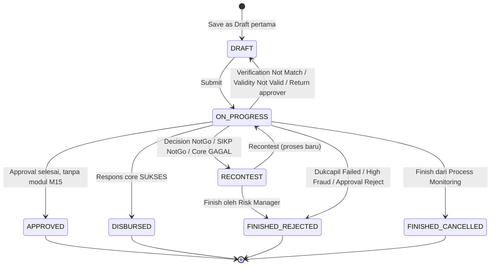

# Cikal: Business Data Dictionary

**Version:** 0.1  
**Date:** 2026-10-21  
**Author:** Fahrudin  
**Status:** Draft  

Struktur data per modul Cikal (CORE dan M01 sampai M15, lihat `Docs/cikal-tech-reference.md` bagian 3). Disusun dari entity LOS OutSystems 11 (gambar entity di `Docs/Reverse Engineering OS11/Tech_Docs/`), daftar field di Doc BA LOS Versi 1, dan Doc BA Cikal.

## Cara membaca

- **Nama atribut** ditulis dalam bahasa Inggris `camelCase` untuk Cikal. Nama AS-IS ditulis di kolom Definisi bila berbeda, contoh "(AS-IS: `UsiaMinimum`)".
- **Tipe** adalah tipe bisnis, bukan tipe database: Teks, Angka, Desimal, Uang, Persen, Tanggal, Tanggal-waktu, Ya/Tidak, Pilihan, Referensi, File, JSON.
- **Pilihan (ParamType X)** berarti nilai diambil dari General Parameter dengan `paramType` = X. Daftar ParamType ada di entity General Parameter.
- **Wajib**: Ya, Tidak, atau Kondisional (syarat ditulis).
- **Sumber**: Input user, Sistem (dihitung atau dibentuk sistem), Integrasi (dari sistem eksternal), Referensi (dipilih dari master).
- **Aturan** merujuk AC, MRTM, atau asumsi di Doc BA Cikal.
- **Sensitivitas**: PII (data pribadi), Finansial, Rahasia (kredensial), Internal.
- Penanda **[Konfirmasi]** berarti atribut disimpulkan dari layar atau alur, bukan dari gambar entity AS-IS. Atribut ini tetap dibangun sesuai definisi yang tertulis; konfirmasi hanya bisa mengubah detailnya.
- Struktur tabel fisik (indeks, tipe kolom, normalisasi) ditentukan tim engineer.

## Atribut standar

Atribut berikut ada di **setiap entity** dan tidak diulang di tabel masing-masing, kecuali disebut lain.

| Atribut | Definisi | Tipe | Wajib | Sumber | Sensitivitas |
|---|---|---|---|---|---|
| id | Identitas unik record | Teks/Angka | Ya | Sistem | Internal |
| tenantId | Company pemilik data (AS-IS: `Company` / `CompanyCode`) | Referensi Company | Ya | Sistem dari sesi user | Internal |
| currencyCode | Mata uang dalam company, bila entity bergantung mata uang (AS-IS: `CurrencyCode`) | Referensi Currency | Kondisional | Sistem dari sesi user | Internal |
| isActive | Data aktif atau nonaktif (khusus master data) | Ya/Tidak | Ya untuk master | Input user | Internal |
| createdAt, createdBy | Waktu dan pembuat record | Tanggal-waktu, Referensi User | Ya | Sistem | Internal |
| updatedAt, updatedBy | Waktu dan pengubah terakhir | Tanggal-waktu, Referensi User | Ya | Sistem | Internal |

## Ringkasan entity per modul

| Modul | Entity |
|---|---|
| CORE: Identity & Access | User, Role, Menu, RoleAccess, UserAccess, LoginAttempt, PasswordResetToken |
| CORE: Tenant & License | Company, License, ModuleEntitlement |
| CORE: Organization | Regional, Branch, SubBranch, Currency, CurrencyRate |
| CORE: Master Data | GeneralParameter, Province, City, District, SubDistrict, ZipCode, DocumentTemplate, Insurance, InsuranceRate, SystemParameterDefinition, SystemParameterValue |
| CORE: Product & Route | Product, SubProduct, ProductRoute, ProductRouteVersion, ProductRouteStep, DocumentChecklist, DocumentChecklistItem |
| CORE: Change Request & Audit | ChangeRequest, AuditLog |
| CORE: Notification | EmailTemplate, NotificationLog |
| CORE: Document | DocumentFile, GeneratedDocument, Sp3kCounter |
| CORE: Application | Application, ApplicationPersonal, ApplicationAddress, ApplicationSpouse, ApplicationOccupation, ApplicationBusiness, ApplicationCollateral, ApplicationDocument, ApplicationEmergencyContact, LoanIdCounter |
| CORE: Orchestrator & Task | ProcessInstance, StepExecution, HumanTask |
| CORE: Integration Registry | IntegrationProvider, IntegrationConfig, IntegrationCallLog |
| CORE: Verification | DocumentVerification |
| CORE: Approval | ApprovalLevel, ApprovalHierarchy, ApplicationApproval, Financing, Installment |
| CORE: Calculation | FormulaDefinition, FormulaVersion, FormulaVariable, FormulaTestCase, FormulaExecutionLog, HolidayCalendar |
| M01 Mobile Sales | Device |
| M02 API Mitra | PartnerClient, PartnerToken |
| M03 Bulk Upload | UploadFile, UploadRowResult |
| M04 OCR KTP | OcrRequestLog |
| M05 Survey & Appraisal | SurveyMikro, SurveyKpr, Appraisal, SurveyPhoto |
| M06 Dedup | DedupMatrix, DedupFieldSetting, DedupResult, DedupCandidate, DedupReview |
| M07 Dukcapil | DukcapilRule, DukcapilResult, DukcapilReview |
| M08 Fraud | FraudMatrix, FraudVelocityRule, FraudResult, Blacklist, FraudReview |
| M09 Scoring & RAC | ScoringModel, ScoringCriterion, ScoringModelProduct, ScoringResult, ScoringResultDetail |
| M10 Credit Bureau | CreditBureauOutcomeMapping, CreditBureauResult, CreditFacility |
| M11 Decision Engine | DecisionMatrix, DecisionResult, Recontest |
| M12 SIKP | SikpOutcomeRule, SikpResult |
| M13 Kredit Pensiun | PensionVerification |
| M14 E-Polis | Policy |
| M15 Pencairan & Core | Disbursement, AkadPrint, DisbursementFile, CoreResponse |
| M16 Name Screening [Usulan] | ScreeningSetting, ScreeningList, ScreeningListEntry, ScreeningResult, ScreeningHit, ScreeningReview |

---

# CORE

## Identity & Access

### Entity: User (UI: "User Application")

**Definisi:** Pegawai bank atau tim internal yang memakai Cikal.  
**Owner:** Admin Sistem company.  
**Lifecycle:** Waiting Approval > Active > Inactive. SSO baru: No Role > Active.  
**Volume:** Belum diketahui (TO-06).  
**Retensi:** Tidak dihapus; dinonaktifkan agar jejak audit tetap utuh.  

| Atribut | Definisi | Tipe | Domain | Wajib | Sumber | Aturan | Sensitivitas |
|---|---|---|---|---|---|---|---|
| username | Nama login unik | Teks | 3 s.d. 50 karakter, unik per instalasi | Ya | Input user | AC-07.03, AC-07.04 | PII |
| fullName | Nama lengkap pegawai (AS-IS: `Name`) | Teks | Maks 100 | Ya | Input user | | PII |
| email | Email kerja; dipakai untuk reset password dan pencocokan SSO | Teks | Format email | Ya | Input user | AC-02.05 | PII |
| phoneNumber | Nomor telepon | Teks | 08 + 8 s.d. 11 digit | Tidak | Input user | AC-92.04 | PII |
| authType | Cara login | Pilihan | LOCAL, SSO | Ya | Sistem | Asumsi A-11 | Internal |
| passwordHash | Hash password (akun lokal) | Teks | | Kondisional: LOCAL | Sistem | US-04 | Rahasia |
| mustChangePassword | Wajib ganti password saat login berikut | Ya/Tidak | | Ya | Sistem | US-05 | Internal |
| roleId | Role utama | Referensi Role | | Kondisional: kosong untuk user SSO baru | Referensi | | Internal |
| regionalId, branchId, subBranchId | Unit kerja; membatasi data yang terlihat | Referensi | Harus berjenjang dan aktif | branchId Ya kecuali Super User | Referensi | AC-07.06 | Internal |
| status | Status akun | Pilihan | NO_ROLE, ACTIVE, INACTIVE, LOCKED | Ya | Sistem | AC-01.05, AC-02.02 | Internal |
| lockedUntil | Batas waktu akun terkunci | Tanggal-waktu | | Tidak | Sistem | Asumsi A-28 | Internal |
| lastLoginAt | Waktu login terakhir | Tanggal-waktu | | Tidak | Sistem | | Internal |

| Entity terkait | Relasi | Kardinalitas | Makna | Cascade |
|---|---|---|---|---|
| Role | belongs to | N:1 | Hak akses dasar | Role tidak bisa nonaktif bila masih dipakai user aktif (AC-08.04) |
| UserAccess | has many | 1:N | Akses khusus sementara | Ikut nonaktif bila user nonaktif |
| HumanTask | has many (assignee) | 1:N | Tugas yang sedang diambil | Dilepas ke antrean saat user nonaktif (TQ-07) |

### Entity: Role

| Atribut | Definisi | Tipe | Domain | Wajib | Sumber | Aturan | Sensitivitas |
|---|---|---|---|---|---|---|---|
| roleName | Nama role | Teks | 3 s.d. 50, unik per tenant tanpa membedakan huruf besar/kecil | Ya | Input user | AC-08.02, AC-08.03 | Internal |

### Entity: Menu

**Owner:** Super User.

| Atribut | Definisi | Tipe | Domain | Wajib | Sumber | Aturan | Sensitivitas |
|---|---|---|---|---|---|---|---|
| menuCode | Kode unik menu | Teks | Unik | Ya | Input user | AC-11.02 | Internal |
| menuName | Label menu | Teks | Maks 50 | Ya | Input user | | Internal |
| menuIndex | Urutan tampil | Angka | >= 1 | Ya | Input user | | Internal |
| parentMenuId | Menu induk (kosong untuk menu utama) | Referensi Menu | | Tidak | Referensi | AC-11.03 | Internal |
| link | Rute halaman | Teks | | Kondisional: sub menu | Input user | | Internal |
| iconName | Nama ikon (set Lucide) | Teks | | Tidak | Input user | | Internal |
| moduleCode | Modul lisensi pemilik menu | Pilihan | CORE, M01 s.d. M15, SIM | Ya | Input user | LC-04 | Internal |

**Role awal (seed)** yang dibuat saat tenant diaktifkan. Nama dan hak akses bisa diubah tenant lewat checker-maker; daftar ini hanya titik awal yang sesuai persona Doc BA.

| Role | Tugas utama | Rujukan persona Doc BA |
|---|---|---|
| Super User | Setup company, salin konfigurasi, menu | US-15, US-16, US-11 |
| Admin Sistem | User, role, hak akses | US-07 s.d. US-10 |
| Maker | Mengusulkan perubahan master data, rumus, parameter, integrasi | US-12 dan semua master |
| Checker | Menyetujui, merevisi, menolak usulan Maker | US-13 |
| Sales | Membuat dan memperbaiki pengajuan | US-39 s.d. US-50 |
| Customer Service | Mencatat pembayaran appraisal | US-55 |
| Surveyor | LKN Mikro, LKN dan appraisal KPR | US-56, US-57 |
| Verifikator | Prescreen Dedup, Prescreen Dukcapil tingkat 1, verifikasi dokumen, Prescreen Fraud, unggah laporan Credit Bureau mode MANUAL [Usulan] | US-60, US-62, US-64, US-66 |
| Supervisor | Prescreen Dukcapil tingkat 2, melepas tugas orang lain | US-63, TQ-03 |
| Risk Manager | Recontest, Finish pengajuan ditolak | US-71 |
| Approver | Keputusan approval sesuai hierarki | US-72 s.d. US-74 |
| Kepala Cabang | Approver tingkat cabang dan pemantauan cabang | Persona Kepala Cabang |
| Admin Operasional | E-polis, Validity Check, akad, pencairan, Process Monitoring | US-75 s.d. US-79, US-86 |
| Auditor | Baca saja: inquiry dan log audit | Persona Auditor |
| Compliance Officer | Review hit Name Screening (M16) | Baru, referensi teknis 10.4 |

### Entity: RoleAccess (UI: "Role Menu")

| Atribut | Definisi | Tipe | Domain | Wajib | Sumber | Aturan | Sensitivitas |
|---|---|---|---|---|---|---|---|
| roleId | Role | Referensi Role | | Ya | Referensi | | Internal |
| menuId | Menu atau sub menu | Referensi Menu | Kombinasi role + menu unik | Ya | Referensi | | Internal |
| canView, canCreate, canUpdate, canDelete, canApprove | Hak tindakan | Ya/Tidak | canView wajib Ya bila hak lain Ya | Ya | Input user | AC-09.03, MRTM TRM_ACC | Internal |

### Entity: UserAccess (UI: "User Menu")

Sama dengan RoleAccess, dengan `userId` sebagai pengganti `roleId`, ditambah:

| Atribut | Definisi | Tipe | Domain | Wajib | Sumber | Aturan | Sensitivitas |
|---|---|---|---|---|---|---|---|
| validFrom | Awal berlaku | Tanggal | | Ya | Input user | US-10 | Internal |
| validTo | Akhir berlaku, inklusif | Tanggal | >= validFrom | Ya | Input user | AC-10.02 s.d. AC-10.04 | Internal |

### Entity: LoginAttempt

| Atribut | Definisi | Tipe | Domain | Wajib | Sumber | Aturan | Sensitivitas |
|---|---|---|---|---|---|---|---|
| username | Username yang dicoba | Teks | | Ya | Input user | | PII |
| success | Berhasil atau gagal | Ya/Tidak | | Ya | Sistem | | Internal |
| ipAddress | Alamat IP | Teks | | Ya | Sistem | | PII |
| attemptedAt | Waktu | Tanggal-waktu | | Ya | Sistem | Asumsi A-28 | Internal |

### Entity: PasswordResetToken

| Atribut | Definisi | Tipe | Domain | Wajib | Sumber | Aturan | Sensitivitas |
|---|---|---|---|---|---|---|---|
| userId | Pemilik token | Referensi User | | Ya | Sistem | | Internal |
| tokenHash | Hash token tautan | Teks | | Ya | Sistem | | Rahasia |
| expiresAt | Kedaluwarsa (dibuat + 10 menit) | Tanggal-waktu | | Ya | Sistem | AC-04.07, AC-04.08 | Internal |
| usedAt | Waktu dipakai; token sekali pakai | Tanggal-waktu | | Tidak | Sistem | AC-04.01 | Internal |

## Tenant & License

### Entity: Company (UI: "Company")

**Definisi:** Bank atau lembaga keuangan pengguna Cikal; satu company = satu tenant.  
**Owner:** Super User (data company), tim PPU (lisensi).  

| Atribut | Definisi | Tipe | Domain | Wajib | Sumber | Aturan | Sensitivitas |
|---|---|---|---|---|---|---|---|
| companyCode | Kode company | Teks | 3 digit angka, unik | Ya | Input user | AC-15.03, AC-15.04 | Internal |
| companyName | Nama company | Teks | Maks 100 | Ya | Input user | | Internal |
| platformCode, platformName | Jenis platform | Pilihan | 01 Conventional, 02 Syariah | Ya | Input user | AC-15.01 | Internal |
| address | Alamat company | Teks | Maks 500 | Ya | Input user | | Internal |
| apiPrivateKey | Kunci privat untuk token API mitra (AS-IS: `PrivateKey`) | Teks | | Kondisional: M02 berlisensi | Sistem | API JWT LOS | Rahasia |
| ssoConfig | Konfigurasi IdP OIDC company [Konfirmasi] | JSON | | Tidak | Input tim PPU | AU-01 | Rahasia |

### Entity: License

| Atribut | Definisi | Tipe | Domain | Wajib | Sumber | Aturan | Sensitivitas |
|---|---|---|---|---|---|---|---|
| licenseNumber | Nomor lisensi | Teks | Unik | Ya | Sistem | | Internal |
| deploymentType | Model | Pilihan | SAAS, ON_PREMISE | Ya | Input tim PPU | | Internal |
| validFrom, validTo | Masa berlaku | Tanggal | validTo >= validFrom | Ya | Input tim PPU | LC-06 | Internal |
| maxUsers | Batas user (bila dipakai untuk harga) | Angka | | Tidak | Input tim PPU | TO-04 | Internal |
| signature | Tanda tangan kriptografis (on-premise) | Teks | | Kondisional: ON_PREMISE | Sistem | LC-03 | Rahasia |
| status | Status | Pilihan | ACTIVE, EXPIRED, REVOKED | Ya | Sistem | | Internal |

### Entity: ModuleEntitlement

| Atribut | Definisi | Tipe | Domain | Wajib | Sumber | Aturan | Sensitivitas |
|---|---|---|---|---|---|---|---|
| licenseId | Lisensi | Referensi License | | Ya | Sistem | | Internal |
| moduleCode | Modul berlisensi | Pilihan | CORE, M01 s.d. M15 | Ya | Input tim PPU | DEP-01 s.d. DEP-10 | Internal |

## Organization

### Entity: Regional, Branch, SubBranch

**Hierarki:** Company 1:N Regional 1:N Branch 1:N SubBranch. Kode unik di dalam induknya.

| Entity | Atribut | Definisi | Tipe | Domain | Wajib | Aturan |
|---|---|---|---|---|---|---|
| Regional | regionalCode, regionalName | Kode dan nama regional | Teks | Kode 2 s.d. 3 digit | Ya | Asumsi A-22, AC-17.02 |
| Branch | regionalId, branchCode, branchName | Regional induk, kode, nama cabang | Referensi, Teks | Kode 2 s.d. 3 digit; regional harus aktif | Ya | AC-17.01, AC-17.04, AC-17.06 |
| SubBranch | branchId, subBranchCode, subBranchName | Cabang induk, kode, nama sub cabang | Referensi, Teks | Kode 2 s.d. 3 digit | Ya | Asumsi A-22 |

Branch tidak bisa dinonaktifkan bila masih punya pengajuan aktif (AC-17.05).

### Entity: Currency

| Atribut | Definisi | Tipe | Domain | Wajib | Sumber | Aturan | Sensitivitas |
|---|---|---|---|---|---|---|---|
| currencyCode | Kode numerik ISO 4217 | Teks | 3 digit, harus ISO 4217 (contoh 360 IDR, 840 USD) | Ya | Input user | AC-18.01 s.d. AC-18.03 | Internal |
| currencyName | Kode huruf (contoh IDR) | Teks | 3 huruf | Ya | Input user | | Internal |
| description | Nama resmi ISO (contoh "US Dollar") | Teks | | Ya | Sistem dari tabel ISO | AC-18.01 | Internal |

### Entity: CurrencyRate

| Atribut | Definisi | Tipe | Domain | Wajib | Sumber | Aturan | Sensitivitas |
|---|---|---|---|---|---|---|---|
| currencyId | Mata uang | Referensi Currency | | Ya | Referensi | | Internal |
| rupiahEquivalent | Nilai 1 unit dalam rupiah | Desimal | > 0 | Ya | Input user | AC-19.03 | Finansial |
| rate | Rate (AS-IS menampilkan rate persen di detail pengajuan) [Konfirmasi] | Persen | | Tidak | Input user | | Finansial |
| rateTimestamp | Waktu kurs berlaku | Tanggal-waktu | | Ya | Input user | AC-19.04 | Internal |

## Master Data

### Entity: GeneralParameter (UI: "General Parameter")

| Atribut | Definisi | Tipe | Domain | Wajib | Sumber | Aturan | Sensitivitas |
|---|---|---|---|---|---|---|---|
| paramType | Kelompok pilihan | Teks | Lihat daftar di bawah | Ya | Input user | | Internal |
| paramId | Kode nilai di dalam kelompok | Teks | Unik per paramType | Ya | Input user | | Internal |
| paramValue | Label nilai | Teks | Maks 100, unik per paramType | Ya | Input user | AC-21.02, AC-21.04 | Internal |
| biCode | Kode pelaporan regulator | Teks | | Tidak | Input user | | Internal |

**Daftar ParamType** (dari Order Application Web, LOS Mobile Guide, LKN, Document Checklist):

| Area | ParamType |
|---|---|
| Application | Application Type, Segment, Product Category, Customer Type, Insurance, Tenor Proposed, Purpose of Loan [Konfirmasi], Channel [Konfirmasi] |
| Personal | ID Type, Gender, Religion, Nationality, Education, Marital, Status Of Residency, Duration Of Residence, Correspondence Duration |
| Spouse | Occupation, Industry Of Profession, Position, Source of Fund, Monthly Income, Monthly Spending, Prenuptial Agreement |
| Occupation | Source of Income, Occupation, Industry of Profession, Pension Instance, Tenure at Current Job |
| Business | Business Field, Characteristic of Financing (Sifat Pembiayaan), Type of Financing (Jenis Pembiayaan), Category of Financing (Kategori Pembiayaan), Relation of Bank (Hubungan Nasabah), Type of Usage |
| Collateral | Collateral Type, Object Type, BPKB Occupation, Certificate Type |
| Emergency Contact | Relation with Applicant |
| LKN Mikro | Status Permohonan, Hubungan, Lokasi Usaha, Status Tempat Usaha, Jenis Tempat Usaha, Aspek Pemasaran, Jenis Usaha |
| LKN KPR / Appraisal | Property Type, Appraisal Method, Lokasi Usaha, Legal Status |
| Document | Document (jenis dokumen pendukung) |
| Approval | Job Level |
| Akad | Payment Method, Jenis Akad (Type of Contract) |

### Entity: Province, City, District, SubDistrict, ZipCode

**Sumber:** sinkronisasi dari layanan data wilayah (Oksara). Tidak diedit manual.

| Entity | Atribut | Tipe | Wajib | Aturan |
|---|---|---|---|---|
| Province | provinceCode, provinceName | Teks | Ya | US-23 |
| City | provinceId, cityCode, cityName | Referensi, Teks | Ya | |
| District | cityId, districtCode, districtName | Referensi, Teks | Ya | |
| SubDistrict | districtId, subDistrictCode, subDistrictName | Referensi, Teks | Ya | |
| ZipCode | subDistrictId, zipCode | Referensi, Teks (5 digit) | Ya | |
| (semua) | lastSyncAt | Tanggal-waktu | Ya | AC-23.01 |

### Entity: DocumentTemplate

| Atribut | Definisi | Tipe | Domain | Wajib | Sumber | Aturan | Sensitivitas |
|---|---|---|---|---|---|---|---|
| documentCode | Kode template (contoh AKAD-KPR, SP3K, SURAT-PENGAJUAN) | Teks | Unik | Ya | Input user | AC-24.02 | Internal |
| description | Keterangan | Teks | | Tidak | Input user | | Internal |
| productId | Produk pemakai (kosong = semua) [Konfirmasi] | Referensi Product | | Tidak | Referensi | | Internal |
| fileId | File template .docx | Referensi DocumentFile | Maks 5 MB | Ya | Input user | AC-24.03, AC-24.04 | Internal |
| placeholders | Daftar placeholder terdeteksi | JSON | Harus ada di katalog placeholder | Ya | Sistem | AC-24.03, DC-05 | Internal |

### Katalog placeholder template dokumen

Aturan DC-05 di referensi teknis. Template Word memakai placeholder berformat `{{Kelompok.atribut}}`. Nama atribut sama persis dengan data dictionary ini.

| Kelompok | Sumber | Contoh |
|---|---|---|
| Application | Entity Application | `{{Application.loanId}}`, `{{Application.requestedLimit}}` |
| Applicant | ApplicationPersonal | `{{Applicant.fullName}}`, `{{Applicant.idCardNumber}}` |
| AddressId, AddressResidence, AddressCorrespondence | ApplicationAddress per jenis | `{{AddressId.address}}` |
| Spouse, Occupation, Business, Collateral | Entity dengan nama yang sama | `{{Collateral.certificateNumber}}` |
| Financing | Struktur kredit | `{{Financing.monthlyInstallment}}` |
| Installment | Jadwal angsuran; dipakai di baris tabel berulang `{{#Installment}}...{{/Installment}}` | `{{Installment.dueDate}}` |
| Approval | Approver terakhir yang menyetujui | `{{Approval.approverName}}`, `{{Approval.decidedAt}}` |
| Company, Branch | Data organisasi pengajuan | `{{Company.companyName}}`, `{{Branch.branchName}}` |
| Akad | AkadPrint | `{{Akad.riskManagerName}}` |
| Document | Nomor dokumen hasil generate | `{{Document.documentNumber}}` (contoh nomor SP3K) |
| Formula | Hasil rumus configurable | `{{Formula.NET_DISBURSEMENT}}` |
| System | Nilai sistem | `{{System.today}}`, `{{System.printedBy}}` |

Pengubah format: `|money` (contoh 150.000.000), `|date` (contoh 21 Oktober 2026), `|terbilang` (contoh "seratus lima puluh juta rupiah"), `|upper`. Isi dokumen keluaran berbahasa Indonesia, berbeda dari label UI yang berbahasa Inggris (OT-04). Atribut Rahasia tidak boleh dipakai sebagai placeholder.

### Entity: Insurance dan InsuranceRate

AS-IS memakai tabel tarif dummy dengan kolom Nama, Usia, Year1 s.d. Year15, Company, CurrencyCode.

| Entity | Atribut | Definisi | Tipe | Wajib | Aturan |
|---|---|---|---|---|---|
| Insurance | insuranceCode, insuranceName | Kode dan nama perusahaan asuransi | Teks | Ya | AC-29.03 |
| Insurance | providerCode | Adapter E-Polis untuk asuransi ini; kosong = penerbitan polis di luar Cikal | Referensi IntegrationProvider | Tidak | IN-02 |
| InsuranceRate | insuranceId | Asuransi | Referensi | Ya | |
| InsuranceRate | productId | Produk (opsional) [Konfirmasi] | Referensi | Tidak | |
| InsuranceRate | age | Usia debitur saat pengajuan | Angka | Ya | |
| InsuranceRate | tenorYear | Tahun tenor 1 s.d. 15 | Angka | Ya | |
| InsuranceRate | premiumRate | Tarif premi persen dari plafon | Persen 0 s.d. 100 | Ya | AC-29.02 |

Tabel ini dipakai rumus `IJK_AMOUNT` lewat fungsi `LOOKUP` (referensi teknis RM-18). Sumber IJK (rumus, input petugas, atau respons asuransi) diatur lewat parameter `IJK_SOURCE`.

### Entity: SystemParameterDefinition

**Definisi:** Daftar parameter sistem yang disediakan aplikasi (pengganti Site Properties OS11). Tenant tidak bisa menambah atau menghapus baris (PR-01).  
**Owner:** Tim engineer (daftar dan batas), Maker tenant (nilai, lewat SystemParameterValue).  

| Atribut | Definisi | Tipe | Domain | Wajib | Sumber | Aturan | Sensitivitas |
|---|---|---|---|---|---|---|---|
| paramKey | Kunci parameter | Teks | Unik, lihat daftar di bawah | Ya | Sistem | PR-01 | Internal |
| label, description | Nama dan penjelasan di UI (contoh "SIKP Minimum Limit") | Teks | | Ya | Sistem | | Internal |
| moduleCode | Modul pemilik; tidak tampil bila modul tidak berlisensi | Pilihan | CORE, M01 s.d. M15 | Ya | Sistem | PR-08 | Internal |
| category | Kelompok | Pilihan | BUSINESS, SECURITY, INTEGRATION, DISPLAY | Ya | Sistem | PR-10 | Internal |
| valueType | Tipe nilai | Pilihan | NUMBER, MONEY, PERCENT, TEXT, BOOLEAN, CHOICE, MULTI_CHOICE, SECRET | Ya | Sistem | PR-02, AC-30.02 | Internal |
| allowedValues | Daftar pilihan | JSON | Wajib untuk CHOICE dan MULTI_CHOICE | Kondisional | Sistem | PR-02 | Internal |
| minValue, maxValue | Rentang nilai; untuk SECURITY sekaligus batas pengaman | Desimal | | Kondisional: NUMBER, MONEY, PERCENT | Sistem | PR-10, AC-30.03 | Internal |
| defaultValue | Nilai bila tenant dan produk belum mengisi | Teks | Sesuai valueType | Ya kecuali SECRET | Sistem | PR-03, PR-11 | Internal |
| scope | Cakupan | Pilihan | INSTALLATION, TENANT, PRODUCT | Ya | Sistem | PR-03 | Internal |
| lockOnSubmit | Nilai dikunci saat pengajuan disubmit | Ya/Tidak | | Ya | Sistem | PR-06 | Internal |

### Entity: SystemParameterValue

**Definisi:** Nilai parameter untuk satu tenant, atau satu produk bila cakupannya PRODUCT.  
**Lifecycle:** WAITING_APPROVAL > ACTIVE > SUPERSEDED (lewat ChangeRequest). Ditolak: tidak pernah ACTIVE.  
**Retensi:** Versi lama tidak dihapus (PR-05).  

| Atribut | Definisi | Tipe | Domain | Wajib | Sumber | Aturan | Sensitivitas |
|---|---|---|---|---|---|---|---|
| definitionId | Parameter | Referensi SystemParameterDefinition | Cakupan bukan INSTALLATION | Ya | Referensi | PR-03 | Internal |
| productId | Produk; kosong = nilai tenant | Referensi Product | Hanya boleh diisi bila scope = PRODUCT | Tidak | Referensi | PR-03 | Internal |
| value | Nilai | Teks | Sesuai valueType, rentang, dan allowedValues; MULTI_CHOICE disimpan sebagai daftar | Ya | Input user | PR-02, AC-30.02, AC-30.03 | Rahasia bila SECRET |
| versionNumber | Nomor versi per parameter + produk | Angka | Berurutan | Ya | Sistem | PR-05 | Internal |
| status | Status versi | Pilihan | WAITING_APPROVAL, ACTIVE, SUPERSEDED | Ya | Sistem | PR-04, AC-30.01 | Internal |
| effectiveFrom | Waktu mulai berlaku; boleh di masa depan | Tanggal-waktu | | Ya | Input user | PR-04 | Internal |
| changeRequestId | Permintaan perubahan asal | Referensi ChangeRequest | | Ya | Sistem | | Internal |

Hanya satu versi ACTIVE per parameter + produk pada satu waktu. Nilai SECRET tidak disimpan di tabel ini; tabel hanya menyimpan rujukan ke penyimpanan rahasia (PR-09).

Snapshot nilai parameter bertanda `lockOnSubmit` disimpan di ProcessInstance atribut `parameterSnapshot` (JSON) saat submit (PR-06).

### Daftar parameter awal

| paramKey | Tipe | Default | Rentang atau pilihan | Cakupan | Kunci saat submit | Modul | Asal AS-IS |
|---|---|---|---|---|---|---|---|
| SIKP_MIN_LIMIT | MONEY | 50.000.000 | >= 0; SIKP berjalan bila Requested Limit **lebih dari** nilai ini | PRODUCT | Ya | M12 | `SIKPFilterLoanAmount`; Asumsi A-19, AC-70.03 |
| RECONTEST_MAX | NUMBER | 3 | 0 s.d. 10 | TENANT | Ya | M11 | Doc BA US-71 |
| NPWP_REQUIRED_ABOVE | MONEY | 50.000.000 | >= 0 | PRODUCT | Tidak (dicek saat submit) | CORE | Order Application Web |
| UPLOAD_MAX_MB | NUMBER | 2 | 1 s.d. 20 | TENANT | Tidak | CORE | LKN Web |
| RESET_LINK_MINUTES | NUMBER | 10 | 5 s.d. 60 | TENANT | Tidak | CORE | Asumsi A-28 |
| LOCK_ATTEMPTS | NUMBER | 5 | 3 s.d. 10 | TENANT | Tidak | CORE | Asumsi A-28 |
| LOCK_MINUTES | NUMBER | 15 | 5 s.d. 1.440 | TENANT | Tidak | CORE | Asumsi A-28 |
| SESSION_IDLE_MINUTES | NUMBER | 30 | 5 s.d. 60 | TENANT | Tidak | CORE | Asumsi A-28 |
| CORE_MAX_TENOR_MONTHS | NUMBER | 24 | 1 s.d. 360 | TENANT | Ya | M15 | File send to Core |
| AGING_UNIT | CHOICE | CALENDAR_DAY | CALENDAR_DAY, WORKING_DAY, HOUR | TENANT | Tidak | CORE | BPT_Docs; RM-04 |
| APPROVAL_RANGE_BOUNDARY | CHOICE | BOTH_INCLUSIVE | BOTH_INCLUSIVE, END_EXCLUSIVE | TENANT | Ya | CORE | Master Approval Setup; RM-06 |
| LKN_DAY_BASIS | CHOICE | 30 | 30, 360, 365 | PRODUCT | Ya | M05 | RM-09 |
| CREDIT_BUREAU_AGGREGATION | CHOICE | WORST | WORST, LATEST | TENANT | Ya | M10 | RM-16 |
| IJK_SOURCE | CHOICE | FORMULA | FORMULA, MANUAL, INSURER | PRODUCT | Ya | M14 | Epolis doc, Asumsi A-23; RM-18 |
| DUE_DATE_END_OF_MONTH | CHOICE | LAST_DAY | LAST_DAY, NEXT_MONTH_FIRST_DAY | TENANT | Ya | CORE | RM-19 |
| DASHBOARD_RELEASE_STATUSES | MULTI_CHOICE | DISBURSED | Status pengajuan (Application.status) | TENANT | Tidak | CORE | Dashboard_Web; RM-21 |
| REQUIRE_CONSENT_FOR_EXTERNAL_CHECK | BOOLEAN | Tidak | Ya, Tidak | TENANT | Ya | CORE | Baru; IN-12, TO-15 |
| CREDIT_BUREAU_MANUAL_DEADLINE_HOURS | NUMBER | 24 | 1 s.d. 168 | TENANT | Tidak | M10 | Baru; batas tugas unggah laporan mode MANUAL sebelum diberi tanda terlambat |
| OCR_API_KEY | SECRET | | | TENANT | Tidak | M04 | `OksaraKey` |
| REGION_API_KEY | SECRET | | | INSTALLATION | Tidak | CORE | `OksaraKey` |

**Bukan parameter sistem** (PR-07, satu nilai satu tempat):

| Nilai | Disimpan di |
|---|---|
| Bobot nama dan nama ibu, ambang Passed dan Review Dukcapil | DukcapilRule (M07, US-34) |
| Algoritma dan ambang kemiripan Dedup | DedupFieldSetting (M06) |
| Batas frekuensi nama dan IP | FraudVelocityRule (M08) |
| Konstanta, cut off, batas Review scoring | ScoringModel (M09) |
| Plafon, tenor, usia, DBR, biaya, limit auto approval | Product |
| Rumus perhitungan | FormulaVersion |

## Product & Route

### Entity: Product (UI: "Master Product")

**Definisi:** Produk kredit yang ditawarkan company.  
**Owner:** Maker (bisnis kredit).  
**Lifecycle:** Waiting Approval > Active (tanpa rute: belum bisa dipakai) > Inactive.  

| Atribut | Definisi | Tipe | Domain | Wajib | Sumber | Aturan | Sensitivitas |
|---|---|---|---|---|---|---|---|
| productCode | Kode produk; dipakai di Loan ID | Teks | 1 s.d. 5 huruf/angka, unik | Ya | Input user | AC-20.03, AC-20.04 | Internal |
| productName | Nama produk | Teks | Maks 100 | Ya | Input user | | Internal |
| productCategory | Kategori (AS-IS: `ProductCategoryId/Type`) | Pilihan | Collateral Loan, Non Collateral Loan, Pension, Syariah Compliant Finance | Ya | Input user | Asumsi A-25 | Internal |
| interestType | Jenis bunga (AS-IS: `InterestTypeId/Type`) | Pilihan | Flat, Effective, Floating, Hybrid, Capped | Ya | Input user | MRTM TRM_INS | Internal |
| contractType | Jenis akad (AS-IS: `JenisAkadId/Type`) | Pilihan (ParamType Jenis Akad) | Contoh: Murabahah, Istishna | Kondisional: platform Syariah | Input user | | Internal |
| minPlafond, maxPlafond | Batas plafon | Uang | max > min | Ya | Input user | AC-20.02, MRTM TRM_APP | Finansial |
| minTenor, maxTenor | Batas tenor bulan (AS-IS: `MinimumTenor`, `MaksimumTenor`) | Angka | max >= min | Ya | Input user | MRTM TRM_APP | Internal |
| minAge, maxAge | Batas usia pemohon tahun (AS-IS: `UsiaMinimum`, `UsiaMaksimum`) | Angka | | Ya | Input user | AC-40.03, AC-40.04 | Internal |
| maxAgeAtMaturityMonth | Usia maksimal dalam bulan saat lunas (AS-IS: `UsiaMaksimumMonth`) [Konfirmasi arti] | Angka | | Tidak | Input user | | Internal |
| dbrMax | Batas rasio angsuran terhadap penghasilan | Persen | 0 s.d. 100 | Ya | Input user | Asumsi A-26 | Internal |
| dsr | Debt service ratio | Persen | | Tidak | Input user | | Internal |
| multipleSalaryDbr | Kelipatan gaji untuk plafon maksimal (AS-IS: `MultipeSalaryDBR`) | Desimal | | Tidak | Input user | Find Max Loan Amount | Internal |
| adminFee | Biaya administrasi | Uang | >= 0 | Ya | Input user | Struktur kredit | Finansial |
| provisionFee | Biaya provisi | Persen | >= 0 | Ya | Input user | Struktur kredit | Finansial |
| salesFee | Biaya sales | Uang | >= 0 | Tidak | Input user | | Finansial |
| limitAutoApproval | Batas auto approval (0 = nonaktif) | Uang | 0 s.d. maxPlafond | Ya | Input user | AC-20.05, AC-74.05 | Finansial |
| scoringApproval | Flag AS-IS `ScoringApproval` [Konfirmasi arti] | Ya/Tidak | | Tidak | Input user | | Internal |
| isPaylater | Produk paylater (AS-IS) [Konfirmasi dipakai atau tidak] | Ya/Tidak | | Tidak | Input user | | Internal |
| validFrom, validTo | Masa berlaku produk | Tanggal | | Ya | Input user | | Internal |

Flag AS-IS `NeedCollateral`, `NeedSIKP`, `NeedSurvey`, `IsPension`, `IsKPR` **tidak dibawa**: digantikan rute produk (modul Collateral mengikuti kategori; Survey, SIKP lewat ProductRouteStep; Pension lewat kategori).

### Entity: SubProduct

**Definisi:** Nilai suku bunga produk per periode berlaku; dipakai menghitung angsuran.

| Atribut | Definisi | Tipe | Domain | Wajib | Sumber | Aturan | Sensitivitas |
|---|---|---|---|---|---|---|---|
| productId | Produk | Referensi Product | | Ya | Referensi | | Internal |
| interestRate | Suku bunga per tahun | Persen | > 0 | Ya | Input user | MRTM TRM_INS | Finansial |
| floatingRate | Bunga floating (Hybrid) atau spread (Floating, Capped) [Konfirmasi] | Persen | | Kondisional: Floating, Hybrid, Capped | Input user | | Finansial |
| tenorFixed | Bulan periode fixed (Hybrid) | Angka | < tenor | Kondisional: Hybrid | Input user | TRM_INS_007 | Internal |
| capRate | Batas atas bunga (Capped) | Persen | | Kondisional: Capped | Input user | | Finansial |
| validFrom, validTo | Masa berlaku bunga | Tanggal | Tidak tumpang tindih per produk | Ya | Input user | | Internal |

Doc BA US-20 belum mencantumkan SubProduct; perlu AC tambahan.

### Entity: ProductRoute, ProductRouteVersion, ProductRouteStep

| Entity | Atribut | Definisi | Tipe | Domain | Wajib | Aturan |
|---|---|---|---|---|---|---|
| ProductRoute | productId | Produk pemilik rute | Referensi | Satu rute per produk | Ya | RT-01 |
| ProductRouteVersion | routeId, versionNumber | Nomor versi berurutan | Angka | | Ya | RT-05 |
| ProductRouteVersion | status | Status versi | Pilihan | DRAFT, WAITING_APPROVAL, ACTIVE, SUPERSEDED | Ya | AC-31.01 |
| ProductRouteVersion | effectiveFrom | Waktu mulai berlaku | Tanggal-waktu | | Kondisional: ACTIVE | RT-06 |
| ProductRouteStep | versionId, stepCode | Langkah | Pilihan | Kode di referensi teknis bagian 6.3 | Ya | |
| ProductRouteStep | isEnabled | Dipakai atau tidak | Ya/Tidak | Langkah wajib selalu Ya | Ya | RT-03, AC-31.02 |

### Entity: DocumentChecklist dan DocumentChecklistItem (AS-IS: `DocumentMatrix`, `DocumentMatrixDetail`)

| Entity | Atribut | Definisi | Tipe | Domain | Wajib | Aturan |
|---|---|---|---|---|---|---|
| DocumentChecklist | productId, occupation, marital | Kombinasi penentu | Referensi, Pilihan | Kombinasi unik | Ya | AC-25.03 |
| DocumentChecklistItem | checklistId, documentType | Dokumen wajib | Pilihan (ParamType Document) | Minimal 1 item | Ya | AC-25.02 |
| DocumentChecklistItem | isMandatory | Wajib atau opsional [Konfirmasi] | Ya/Tidak | | Ya | |

Jenis dokumen AS-IS: KTP/SIM/Paspor/KITAS, NPWP, Rekening Koran 3 Bulan Terakhir, PBB, BPJS, KK, Slip Gaji, Surat Keterangan Kerja, Rekening Listrik dan Air, Dokumen Jaminan (BPKB/Sertifikat/SK Pensiun).

## Change Request & Audit

### Entity: ChangeRequest (pengganti semua tabel `*Temp` AS-IS)

| Atribut | Definisi | Tipe | Domain | Wajib | Sumber | Aturan | Sensitivitas |
|---|---|---|---|---|---|---|---|
| entityType | Jenis data (contoh PRODUCT, ROLE) | Pilihan | Daftar CM-07 | Ya | Sistem | CM-07 | Internal |
| entityId | ID data utama; kosong untuk data baru (AS-IS: `MainId`) | Teks | | Kondisional | Sistem | CM-01 | Internal |
| action | Jenis perubahan | Pilihan | CREATE, UPDATE | Ya | Sistem | | Internal |
| oldData | Data sebelum (AS-IS: JSON_Old) | JSON | | Kondisional: UPDATE | Sistem | US-12 | Mengikuti data |
| newData | Data usulan (AS-IS: JSON_New) | JSON | | Ya | Input user | | Mengikuti data |
| status | Status | Pilihan | WAITING_APPROVAL, REVISE, APPROVED, REJECTED | Ya | Sistem | CM-02 | Internal |
| reviseReason | Alasan revisi | Teks | Maks 500 | Kondisional: REVISE | Input user | AC-13.02, AC-13.04 | Internal |
| submittedBy, reviewedBy, reviewedAt | Maker, checker, waktu keputusan | Referensi User, Tanggal-waktu | reviewedBy != submittedBy | Ya / Kondisional | Sistem | AC-12.04 | Internal |

Satu `entityType` + `entityId` hanya boleh punya satu ChangeRequest terbuka (AC-12.06).

### Entity: AuditLog (AS-IS: `AuditTrail`)

| Atribut | Definisi | Tipe | Domain | Wajib | Sumber | Aturan | Sensitivitas |
|---|---|---|---|---|---|---|---|
| userId | Pelaku | Referensi User | | Ya | Sistem | | Internal |
| role | Role pelaku saat aksi | Teks | | Ya | Sistem | | Internal |
| module | Modul | Pilihan | | Ya | Sistem | AC-14.01 | Internal |
| action | Aksi (AS-IS: `Status`) | Pilihan | CREATE, UPDATE, DELETE, SUBMIT, APPROVE, REJECT, REVISE, RESUBMIT, ASSIGN, RELEASE, PRINT, REPRINT, LOGIN, LOGIN_FAILED | Ya | Sistem | AD-02 | Internal |
| recordId | ID data | Teks | | Tidak | Sistem | | Internal |
| description | Keterangan | Teks | | Tidak | Sistem | | Internal |
| oldData, newData | Data sebelum dan sesudah | JSON | | Tidak | Sistem | AC-14.02 | Mengikuti data |
| ipAddress | Alamat IP | Teks | | Ya | Sistem | | PII |
| occurredAt | Waktu (AS-IS: `CreatedOn`) | Tanggal-waktu | | Ya | Sistem | | Internal |

Tidak bisa diubah atau dihapus lewat aplikasi (AD-03). Retensi usulan 5 tahun (NFR).

## Notification

| Entity | Atribut | Definisi | Tipe | Wajib | Aturan |
|---|---|---|---|---|---|
| EmailTemplate | templateCode | Kode (APP_RECEIVED, APP_REJECTED, APP_DISBURSED, RESET_PASSWORD, ADMIN_INVITE) | Pilihan | Ya | MRTM TRM_NTF |
| EmailTemplate | subject, body | Subjek dan isi dengan placeholder | Teks | Ya | |
| NotificationLog | applicationId, templateCode, recipient, status, sentAt, errorMessage | Riwayat kirim | Referensi, Teks, Pilihan (SENT, FAILED, SKIPPED) | Ya | TRM_NTF_006 |

## Document

| Entity | Atribut | Definisi | Tipe | Wajib | Aturan |
|---|---|---|---|---|---|
| DocumentFile | fileName, originalExtension, storedFormat, sizeBytes, storageKey, uploadedBy | Metadata file; isi di penyimpanan objek (AS-IS: `DocumentCustomer` biner) | Teks, Angka | Ya | DC-01, DC-02 |
| GeneratedDocument | applicationId, documentCode, documentNumber, fileId, generatedBy, generatedAt, isReprint | Dokumen keluaran (Surat Pengajuan, SP3K, Akad) | Referensi, Teks, Ya/Tidak | Ya | DC-04 |
| Sp3kCounter | period (yyyyMM), lastNumber | Counter nomor SP3K bulanan; reset tiap bulan | Teks, Angka | Ya | OT-03 |

## Application

### Entity: Application

**Definisi:** Satu pengajuan kredit dari satu pemohon untuk satu produk.  
**Owner:** Sales (input), Orchestrator (status proses).  
**Lifecycle:** lihat state machine di akhir bagian ini.  
**Volume:** usulan awal 10.000 per bulan per tenant (NFR, belum dikonfirmasi).  
**Retensi:** mengikuti kebijakan penyimpanan dokumen kredit bank [Konfirmasi].  

| Atribut | Definisi | Tipe | Domain | Wajib | Sumber | Aturan | Sensitivitas |
|---|---|---|---|---|---|---|---|
| loanId | Nomor pengajuan | Teks | ddMMyyyy + productCode + 7 digit | Ya setelah draft pertama | Sistem | MRTM TRM_LID | Internal |
| channel | Asal pengajuan | Pilihan | WEB, MOBILE, API, UPLOAD | Ya | Sistem | AC-54.02 | Internal |
| applicationType | Jenis pemohon (contoh NTB) | Pilihan (Application Type) | | Ya (draft) | Input user | Asumsi A-15 | Internal |
| customerType | Jenis nasabah | Pilihan (Customer Type) | | Tidak | Input user | | Internal |
| segment | Segmen (contoh Mikro) | Pilihan (Segment) | | Ya (submit) | Input user | | Internal |
| productCategory | Kategori produk | Pilihan | Dari Product | Ya (draft) | Referensi | | Internal |
| productId | Produk | Referensi Product | Produk aktif dengan rute disetujui | Ya (draft) | Referensi | RT-07 | Internal |
| routeVersionId | Versi rute yang dipakai | Referensi ProductRouteVersion | | Ya saat submit | Sistem | RT-06 | Internal |
| purposeOfLoan | Tujuan pinjaman (contoh Konsumsi) | Pilihan [Konfirmasi ParamType] | | Tidak | Input user | | Internal |
| tenorProposed | Tenor diajukan (bulan) | Angka | minTenor s.d. maxTenor | Ya (submit) | Input user | TRM_APP | Internal |
| tenorApproved | Tenor disetujui | Angka | | Kondisional: setelah approval | Sistem | | Internal |
| requestedLimit | Limit diajukan | Uang | minPlafond s.d. maxPlafond | Ya (submit) | Input user | TRM_APP | Finansial |
| maxLoanAmount | Plafon maksimal hasil hitung | Uang | | Tidak | Sistem | Find Max Loan Amount | Finansial |
| loanAmount | Plafon disetujui | Uang | | Kondisional: setelah approval | Sistem | | Finansial |
| insuranceId | Asuransi | Referensi Insurance | | Ya (submit) | Referensi | | Internal |
| sourceCode | Kode sumber | Teks | Maks 10 alfanumerik | Tidak | Input user | Order Application Web | Internal |
| salesCode | Kode sales | Teks | Maks 15 alfanumerik | Tidak | Input user | | Internal |
| referralCode | Kode referral | Teks | Maks 20, alfanumerik + simbol | Tidak | Input user | | Internal |
| marketingCode | Kode program marketing | Teks | Maks 15 alfanumerik | Tidak | Input user | | Internal |
| cifNumber | Nomor CIF nasabah | Teks | Maks 20 alfanumerik | Tidak | Input user / Integrasi core | | PII |
| currencyRateId, rupiahEquivalent, rateTimestamp | Kurs saat submit | Referensi, Desimal, Tanggal-waktu | | Kondisional: non-IDR | Sistem | AC-19.04 | Finansial |
| partnerReference | Nomor referensi mitra | Teks | Unik per mitra | Kondisional: API | Input mitra | AC-54.05 | Internal |
| status | Status pengajuan | Pilihan | DRAFT, ON_PROGRESS, RECONTEST, APPROVED, DISBURSED, FINISHED_REJECTED, FINISHED_CANCELLED | Ya | Sistem | Ref. teknis 6.4 | Internal |
| currentStep | Langkah saat ini | Pilihan | Kode langkah | Kondisional | Sistem | | Internal |
| returnNote | Catatan pengembalian terakhir (Verification, Validity, Return approver) | Teks | | Tidak | Sistem | AC-64.02, AC-73.02 | Internal |
| submittedBy, submittedAt | Penginput dan waktu submit | Referensi User, Tanggal-waktu | | Kondisional | Sistem | AU-05 | Internal |
| branchId | Cabang pengajuan | Referensi Branch | | Ya | Sistem dari user | | Internal |
| consentGivenAt, consentChannel | Waktu dan kanal persetujuan nasabah atas pemrosesan data dan pemeriksaan pihak ketiga (WEB, MOBILE, API, PAPER) | Tanggal-waktu, Pilihan | | Kondisional: wajib bila `REQUIRE_CONSENT_FOR_EXTERNAL_CHECK` = Ya | Input user / mitra | IN-12 | PII |
| consentDocumentId | Formulir persetujuan bertanda tangan bila kanal PAPER | Referensi DocumentFile | | Kondisional | Input user | IN-12 | PII |

**State machine (status pengajuan):**

**Pemetaan status ke label UI** (referensi teknis 6.4):

| Status | Label web (Loan List, inquiry) | Tab mobile (M01) | Kartu dashboard |
|---|---|---|---|
| DRAFT | Draft | Draft | Save as Draft |
| ON_PROGRESS | On Progress | On Progress | Submitted |
| RECONTEST | Recontest | On Progress | Submitted |
| APPROVED | Approved | On Progress | Submitted |
| DISBURSED | Disbursed | Disburse | Submitted |
| FINISHED_REJECTED | Rejected | On Progress, dengan label "Rejected" [Usulan] | Submitted |
| FINISHED_CANCELLED | Cancelled | On Progress, dengan label "Cancelled" [Usulan] | Submitted |

Kartu dashboard "GO" dan "NOT GO" tidak memakai status pengajuan, melainkan hasil DecisionResult terakhir per pengajuan.

### Entity: ApplicationPersonal

| Atribut | Definisi | Tipe | Domain | Wajib | Sumber | Aturan | Sensitivitas |
|---|---|---|---|---|---|---|---|
| fullName | Nama lengkap | Teks | Maks 100 | Ya (draft) | Input user / OCR | | PII |
| fullNameId | Nama sesuai KTP | Teks | Maks 100 | Ya (draft) | Input user / OCR | | PII |
| placeOfBirth | Tempat lahir | Teks | | Ya (submit) | Input user / OCR | | PII |
| dateOfBirth | Tanggal lahir | Tanggal | Usia sesuai produk | Ya (submit) | Input user / OCR | AC-40.03, AC-40.04 | PII |
| gender | Jenis kelamin | Pilihan (Gender) | | Ya (submit) | Input user / OCR | Asumsi A-16 | PII |
| religion | Agama | Pilihan (Religion) | | Ya (submit) | Input user / OCR | | PII |
| nationality | Kewarganegaraan | Pilihan (Nationality) | | Ya (submit) | Input user | | PII |
| education | Pendidikan | Pilihan (Education) | | Ya (submit) | Input user | | PII |
| marital | Status perkawinan | Pilihan (Marital) | | Ya (submit) | Input user / OCR | MRTM TRM_STP | PII |
| motherMaidenName | Nama ibu kandung | Teks | | Ya (submit) | Input user | | PII |
| idType | Jenis identitas | Pilihan (ID Type) | KTP, SIM, Paspor, KITAS | Ya (draft) | Input user | | PII |
| idCardNumber | Nomor identitas (NIK) | Teks | 16 digit untuk KTP | Ya (draft) | Input user / OCR | AC-40.02 | PII |
| idIssuedDate | Tanggal terbit identitas | Tanggal | | Ya (submit) | Input user | | PII |
| idExpiredDate | Masa berlaku (teks "SEUMUR HIDUP" atau tanggal) | Teks | | Tidak | Input user / OCR | | PII |
| npwpNumber | NPWP | Teks | 15 atau 16 digit | Kondisional: requestedLimit > 50.000.000 | Input user | AC-40.05, AC-40.06 | PII |
| kkNumber | Nomor KK | Teks | 16 digit | Tidak | Input user | | PII |
| mobileNumber | Nomor HP | Teks | 08 + 8 s.d. 11 digit | Tidak [Konfirmasi] | Input user | | PII |
| phoneNumber | Telepon rumah | Teks | | Tidak | Input user | | PII |
| email | Email pemohon; tujuan notifikasi | Teks | Format email | Tidak | Input user | MRTM TRM_NTF | PII |
| bpjsNumber, jknNumber | Nomor BPJS dan JKN | Teks | | Tidak | Input user | | PII |
| residenceStatus | Status tempat tinggal | Pilihan (Status Of Residency) | | Tidak | Input user | | PII |
| residenceDuration | Lama tinggal | Pilihan (Duration Of Residence) | | Tidak | Input user | | PII |
| homeNumber | Nomor rumah | Teks | | Tidak | Input user | | PII |
| correspondenceDuration | Lama di alamat korespondensi | Pilihan (Correspondence Duration) | | Tidak | Input user | | PII |
| beneficiaryOwnerFullName | Nama pemilik manfaat | Teks | | Tidak | Input user | | PII |
| taspenNumber | Nomor Taspen | Teks | | Kondisional: kategori Pension | Input user | US-42 | PII |
| ocrFields | Daftar field yang terisi dari OCR | JSON | | Tidak | Sistem | AC-41.01 | Internal |

### Entity: ApplicationAddress

Satu pengajuan punya hingga tiga alamat: ID (KTP), RESIDENCE (domisili), CORRESPONDENCE.

| Atribut | Definisi | Tipe | Domain | Wajib | Sumber | Aturan | Sensitivitas |
|---|---|---|---|---|---|---|---|
| addressType | Jenis alamat | Pilihan | ID, RESIDENCE, CORRESPONDENCE | Ya | Sistem | | Internal |
| address | Alamat jalan | Teks | Maks 500 | Ya untuk ID | Input user / OCR | | PII |
| rt, rw | RT dan RW | Teks | 3 digit | Tidak | Input user / OCR | | PII |
| provinceId, cityId, districtId, subDistrictId, zipCode | Wilayah berjenjang | Referensi wilayah | Harus berjenjang | Ya untuk ID | Referensi | AC-23.04 | PII |
| sameAsId | Sama dengan alamat KTP | Ya/Tidak | | Tidak | Input user | AC-40.07 | Internal |

### Entity: ApplicationSpouse

**Ada bila** marital = Kawin.

| Atribut | Definisi | Tipe | Domain | Wajib | Sumber | Aturan | Sensitivitas |
|---|---|---|---|---|---|---|---|
| fullName | Nama pasangan | Teks | | Ya | Input user | AC-43.01 | PII |
| dateOfBirth | Tanggal lahir | Tanggal | | Ya | Input user | | PII |
| mobileNumber | Nomor HP | Teks | | Tidak | Input user | | PII |
| prenuptialAgreement | Perjanjian pranikah | Pilihan (Prenuptial Agreement) | | Ya | Input user | | PII |
| idNumber | NIK pasangan | Teks | 16 digit, berbeda dari NIK pemohon | Ya | Input user | AC-43.02 | PII |
| idExpiredDate | Masa berlaku identitas | Teks | | Tidak | Input user | | PII |
| idAddress, idProvinceId, idCityId, idDistrictId, idSubDistrictId | Alamat KTP pasangan | Teks, Referensi | | Tidak | Input user | | PII |
| occupation, industryOfProfession, position, sourceOfFunds | Pekerjaan pasangan | Pilihan (Occupation, Industry Of Profession, Position, Source of Fund) | | Tidak | Input user | | PII |
| monthlyIncome, monthlySpending | Penghasilan dan pengeluaran | Pilihan (Monthly Income, Monthly Spending) | | Tidak | Input user | | Finansial |
| companyName, companyAddress, companyProvinceId, companyCityId, companyPhoneNumber | Perusahaan pasangan | Teks, Referensi | | Tidak | Input user | | PII |

### Entity: ApplicationOccupation

| Atribut | Definisi | Tipe | Domain | Wajib | Sumber | Aturan | Sensitivitas |
|---|---|---|---|---|---|---|---|
| sourceOfIncome | Sumber penghasilan | Pilihan (Source of Income) | | Ya (submit) | Input user | | Internal |
| occupation | Pekerjaan | Pilihan (Occupation) | KUR: hanya Wiraswasta | Ya (submit) | Input user | AC-44.04, TRM_STP | Internal |
| industryOfProfession | Bidang industri | Pilihan (Industry of Profession) | | Ya (submit) | Input user | | Internal |
| position | Jabatan | Teks/Pilihan (Position) | | Tidak | Input user | | Internal |
| tenureAtCurrentJob | Lama bekerja (tahun) (AS-IS: `TenureatCurrentJob`) | Angka | >= 0 | Kondisional: bukan Pension | Input user | AC-44.03 | Internal |
| monthlyIncomeAllowance | Penghasilan bulanan | Uang | > 0 | Kondisional: bukan Pension | Input user | AC-44.02 | Finansial |
| organization | Organisasi | Teks | | Tidak | Input user | | Internal |
| previousEmployer | Pemberi kerja sebelumnya | Teks | | Tidak | Input user | | PII |
| pensionInstance | Instansi pensiun | Pilihan (Pension Instance) | | Kondisional: Pension | Input user | | Internal |
| companyName, companyAddress, companyProvinceId, companyCityId, companyDistrictId, companySubDistrictId, companyZipCode, companyRt, companyRw, companyOfficeNumber, companyPhoneNumber | Data perusahaan tempat bekerja | Teks, Referensi | | Tidak | Input user | | PII |

### Entity: ApplicationBusiness

**Ada bila** occupation = Wiraswasta.

| Atribut | Definisi | Tipe | Domain | Wajib | Sumber | Aturan | Sensitivitas |
|---|---|---|---|---|---|---|---|
| businessName | Nama usaha | Teks | | Ya | Input user | AC-45.01 | Internal |
| businessField | Bidang usaha | Pilihan (Business Field) | | Ya | Input user | | Internal |
| phoneNumber, email | Kontak usaha | Teks | | Tidak | Input user | | PII |
| lengthDurationYear, lengthDurationMonth | Lama usaha | Angka | | Sistem dari businessLaunchDate [Konfirmasi] | Sistem | AC-45.04 | Internal |
| annualSales | Omzet setahun | Uang | | Ya | Input user | | Finansial |
| businessNumber | Nomor izin usaha | Teks | | Tidak | Input user | | Internal |
| businessLaunchDate | Tanggal mulai usaha | Tanggal | Tidak di masa depan; KUR minimal 6 bulan | Ya | Input user | AC-45.02, AC-45.04 | Internal |
| characteristicOfFinancing, typeOfFinancing, typeOfUsage, categoryOfFinancing, relationshipWithBank | Klasifikasi pembiayaan | Pilihan (ParamType Business) | | Tidak | Input user | | Internal |
| address, provinceId, cityId, districtId, subDistrictId, zipCode | Alamat usaha | Teks, Referensi | | Ya | Input user | | PII |

### Entity: ApplicationCollateral (AS-IS: `ApplicationObject`)

| Atribut | Definisi | Tipe | Domain | Wajib | Sumber | Aturan | Sensitivitas |
|---|---|---|---|---|---|---|---|
| collateralType | Jenis agunan | Pilihan (Collateral Type) | VEHICLE, CERTIFICATE, PENSION_DECREE | Ya | Input user / Sistem (KPR otomatis CERTIFICATE) | AC-46.02 | Internal |
| vehicleType, vehicleBrand, vehicleModel, description | Data kendaraan | Pilihan (Object Type), Teks | | Kondisional: VEHICLE | Input user | AC-46.01 | Internal |
| vehicleYear | Tahun kendaraan (FAST `obj_tahun`) | Angka | <= tahun berjalan | Kondisional: VEHICLE | Input user | AC-46.04 | Internal |
| vehiclePrice | Harga kendaraan (FAST `obj_price`) | Uang | | Kondisional: VEHICLE | Input user | | Finansial |
| vehicleColor | Warna (FAST `warna`) | Teks | | Kondisional: VEHICLE | Input user | | Internal |
| machineNumber | Nomor mesin (FAST `nosin`) | Teks | | Kondisional: VEHICLE | Input user | AC-46.06 | Internal |
| frameNumber | Nomor rangka (FAST `noka`) | Teks | | Kondisional: VEHICLE | Input user | AC-46.06 | Internal |
| bpkbNumber | Nomor BPKB (FAST `no_bpkb`) | Teks | | Kondisional: VEHICLE | Input user | | Internal |
| bpkbOwnerOccupation | Pekerjaan pemilik BPKB | Pilihan (BPKB Occupation) | | Tidak | Input user | | Internal |
| policeNumber | Nomor polisi (FAST `no_polisi`) | Teks | | Kondisional: VEHICLE | Input user | | Internal |
| certificateType | Jenis sertifikat (SHM, SHGB, dll.) | Pilihan (Certificate Type) | | Kondisional: CERTIFICATE | Input user | | Internal |
| certificateNumber | Nomor sertifikat | Teks | | Kondisional: CERTIFICATE | Input user | | Internal |
| surfaceArea | Luas | Desimal | | Kondisional: CERTIFICATE | Input user | | Internal |
| decreeNumber, decreeDate | Nomor dan tanggal SK pensiun | Teks, Tanggal | | Kondisional: PENSION_DECREE | Input user | AC-46.03 | PII |
| address, provinceId, cityId, districtId, subDistrictId, zipCode, rt, rw | Alamat agunan | Teks, Referensi | | Kondisional: VEHICLE, CERTIFICATE | Input user | | Internal |

### Entity: ApplicationDocument

| Atribut | Definisi | Tipe | Domain | Wajib | Sumber | Aturan | Sensitivitas |
|---|---|---|---|---|---|---|---|
| documentType | Jenis dokumen | Pilihan (Document) | Dari checklist | Ya | Sistem | US-25, US-47 | Internal |
| fileId | File | Referensi DocumentFile | Maks 2 MB; png/jpg/jpeg/pdf/docx; disimpan PDF | Kondisional: wajib saat submit | Input user | MRTM US-47 AC | PII |
| verificationStatus | Hasil verifikasi | Pilihan | PENDING, MATCH, NOT_MATCH | Ya | Input Verifikator | US-64 | Internal |
| verificationRemarks | Catatan Not Match | Teks | | Kondisional: NOT_MATCH | Input Verifikator | AC-64.03 | Internal |

### Entity: ApplicationEmergencyContact

| Atribut | Definisi | Tipe | Domain | Wajib | Sumber | Aturan | Sensitivitas |
|---|---|---|---|---|---|---|---|
| contactName | Nama kontak | Teks | | Ya (submit) [Konfirmasi] | Input user | AC-48.01 | PII |
| mobileNumber | Nomor HP | Teks | 08 + 10 s.d. 13 digit total; beda dari nomor pemohon | Ya (submit) | Input user | AC-48.02 s.d. AC-48.04 | PII |
| homePhoneNumber, altPhoneNumber | Telepon lain | Teks | | Tidak | Input user | | PII |
| relationToApplicant | Hubungan | Pilihan (Relation with Applicant) | | Ya (submit) | Input user | | PII |
| address, provinceId, cityId, districtId, subDistrictId, zipCode | Alamat | Teks, Referensi | | Tidak | Input user | | PII |

### Entity: LoanIdCounter

| Atribut | Definisi | Tipe | Wajib | Aturan |
|---|---|---|---|---|
| productCode | Kode produk | Teks | Ya | MRTM TRM_LID |
| lastNumber | Nomor terakhir; tidak direset harian; maks 9.999.999 | Angka | Ya | TRM_LID_005, TRM_LID_006 |

## Orchestrator & Task

### Entity: ProcessInstance (AS-IS: `LOSProcessLoan`)

| Atribut | Definisi | Tipe | Domain | Wajib | Sumber | Aturan |
|---|---|---|---|---|---|---|
| applicationId | Pengajuan | Referensi | | Ya | Sistem | |
| recontestNumber | 0 untuk proses awal, 1 dst. untuk recontest | Angka | 0 s.d. RECONTEST_MAX | Ya | Sistem | ER-04, ER-05 |
| routeVersionId | Versi rute | Referensi | | Ya | Sistem | RT-06 |
| parameterSnapshot | Nilai parameter sistem bertanda kunci saat submit | JSON | | Ya | Sistem | PR-06 |
| status | Status proses | Pilihan | RUNNING, WAITING, COMPLETED, CANCELLED | Ya | Sistem | |
| recontestReason | Alasan recontest | Teks | | Kondisional | Input Risk Manager | AC-71.03 |
| startedAt, endedAt | Waktu | Tanggal-waktu | | Ya / Tidak | Sistem | |

### Entity: StepExecution (AS-IS: `LOSActivityLoan`, `ApplicationHistory`, `LOSActivityError`)

| Atribut | Definisi | Tipe | Domain | Wajib | Sumber | Aturan |
|---|---|---|---|---|---|---|
| processInstanceId | Proses | Referensi | | Ya | Sistem | |
| stepCode | Langkah | Pilihan | Kode langkah | Ya | Sistem | |
| status | Status langkah | Pilihan | PENDING, RUNNING, WAITING_HUMAN, WAITING_EXTERNAL, COMPLETED, SKIPPED, ERROR | Ya | Sistem | |
| outcomeCode | Hasil modul (contoh MATCH, GO) | Teks | | Kondisional | Sistem | |
| resultType | Hasil kontrak | Pilihan | CONTINUE, WAIT_HUMAN, WAIT_EXTERNAL, BACK_TO_DRAFT, RECONTEST, FINISH, ERROR | Kondisional | Sistem | Ref. teknis 5.1 |
| externalReference, waitDeadline | Rujukan transaksi di pihak ketiga dan batas tunggu | Teks, Tanggal-waktu | | Kondisional: WAITING_EXTERNAL | Sistem | IN-08 |
| errorCategory | Kategori error integrasi | Pilihan | TIMEOUT, CONNECTION, PROVIDER_ERROR, AUTH, CONFIG, INVALID_RESPONSE, CONSENT_MISSING, FORMULA | Kondisional: ERROR | Sistem | IN-07, FM-09 |
| reusedFromStepExecutionId | Hasil yang dipakai ulang | Referensi StepExecution | | Tidak | Sistem | IN-10 |
| skipReason | Alasan dilewati | Pilihan | NOT_IN_ROUTE, NOT_LICENSED, CONDITION_NOT_MET, DEDUP_MATCH | Kondisional: SKIPPED | Sistem | AC-85.02 |
| attempt | Percobaan ke | Angka | | Ya | Sistem | ER-03 |
| errorMessage | Pesan error | Teks | | Kondisional: ERROR | Sistem | ER-01 |
| actorUserId | Pelaku langkah manual | Referensi User | | Kondisional | Sistem | |
| startedAt, endedAt | Waktu | Tanggal-waktu | | Ya / Tidak | Sistem | |
| aging | Selisih waktu mulai dan selesai dalam satuan `AGING_UNIT` | Desimal | | Kondisional | Sistem | AC-85.04, RM-04 |
| summary | Ringkasan untuk timeline | Teks | | Tidak | Sistem | |

### Entity: HumanTask

| Atribut | Definisi | Tipe | Domain | Wajib | Aturan |
|---|---|---|---|---|---|
| stepExecutionId | Langkah | Referensi | | Ya | TQ-01 |
| queueCode | Antrean, lihat katalog di bawah | Pilihan | | Ya | |
| branchId | Cabang | Referensi | | Ya | |
| eligibleRoleId | Role yang boleh mengambil | Referensi Role | | Ya | |
| assignedUserId, assignedAt | Pengambil tugas | Referensi User, Tanggal-waktu | | Tidak | TQ-02, TQ-04 |
| status | Status tugas | Pilihan | OPEN, ASSIGNED, CLOSED | Ya | |
| closedAt, closedBy, resultCode | Penutupan | Tanggal-waktu, Referensi, Teks | | Kondisional | TQ-05 |

**Katalog antrean**

| queueCode | Langkah | Role default | Assign to Me | Rujukan |
|---|---|---|---|---|
| SURVEY_MIKRO | SURVEY | Surveyor | Ya | US-56 |
| SURVEY_KPR | SURVEY | Customer Service (pembayaran), Surveyor (LKN dan appraisal) | Tidak | US-55, US-57, TQ-06 |
| PRESCREEN_DEDUP | DEDUP | Verifikator | Ya | US-60 |
| PRESCREEN_DUKCAPIL_L1 | DUKCAPIL | Verifikator | Ya | US-62 |
| PRESCREEN_DUKCAPIL_L2 | DUKCAPIL | Supervisor | Ya | US-63 |
| SCREENING_REVIEW | NAME_SCREENING | Compliance Officer | Ya | 10.4 |
| VERIFICATION | VERIFICATION | Verifikator | Ya | US-64 |
| PRESCREEN_FRAUD | FRAUD | Verifikator | Ya | US-66 |
| CREDIT_REPORT_UPLOAD | CREDIT_BUREAU (mode MANUAL) | Verifikator [Usulan] | Ya | IN-08 |
| RECONTEST | Pengajuan berstatus RECONTEST | Risk Manager | Ya | US-71 |
| APPROVAL | APPROVAL | Approver yang ditetapkan ApprovalHierarchy (per user, bukan per role) | Tidak, sudah ditugaskan | US-72 |
| EPOLIS | EPOLIS | Admin Operasional | Ya | US-75 |
| VALIDITY_CHECK | VALIDITY_CHECK | Admin Operasional | Ya | US-76 |
| PRINT_AKAD | PRINT_AKAD | Admin Operasional | Ya | US-77 |
| DISBURSEMENT | DISBURSEMENT | Admin Operasional | Ya | US-79 |
| PROCESS_ERROR | Langkah berstatus ERROR | Admin Operasional | Ya | US-86, ER-02 |

Pengajuan yang kembali ke Draft (BACK_TO_DRAFT) tidak masuk antrean; pengajuan tampil di daftar Draft milik Sales penginputnya beserta `returnNote`.

## Verification

### Entity: DocumentVerification

Hasil per dokumen disimpan di ApplicationDocument. Entity ini mencatat satu sesi verifikasi.

| Atribut | Definisi | Tipe | Wajib | Aturan |
|---|---|---|---|---|
| applicationId, processInstanceId | Pengajuan dan proses | Referensi | Ya | |
| verifierUserId | Verifikator | Referensi User | Ya | |
| result | Hasil akhir | Pilihan: IN_PROGRESS, ALL_MATCH, HAS_NOT_MATCH | Ya | AC-64.01, AC-64.02, AC-64.04 |
| submittedAt | Waktu submit | Tanggal-waktu | Kondisional | |

## Approval

### Entity: ApprovalLevel (AS-IS: `MasterApprovalPerlevel`)

| Atribut | Definisi | Tipe | Domain | Wajib | Sumber | Aturan | Sensitivitas |
|---|---|---|---|---|---|---|---|
| branchId, productId | Cabang dan produk | Referensi | | Ya | Referensi | | Internal |
| jobLevel | Level jabatan (1 = tertinggi, contoh Head Office) | Angka | Kombinasi branch + product + jobLevel unik | Ya | Input user | AC-26.04 | Internal |
| description | Nama level (contoh Kepala Cabang) | Teks | | Ya | Input user | | Internal |
| amountBegin, amountEnd | Rentang nominal kewenangan | Uang | end > begin; tidak tumpang tindih antar level | Ya | Input user | AC-26.02, AC-26.03, MRTM TRM_APV | Finansial |
| isApprove, isReject, isReturn, isCancel | Aksi yang diizinkan | Ya/Tidak | | Ya | Input user | AC-73.03 | Internal |
| isFinalApprover | Level terakhir untuk rentang tersebut | Ya/Tidak | | Ya | Input user | | Internal |

### Entity: ApprovalHierarchy (AS-IS: `MasterHierarchiesApproval`)

| Atribut | Definisi | Tipe | Domain | Wajib | Sumber | Aturan |
|---|---|---|---|---|---|---|
| branchId, productId, jobLevel | Level yang dilayani | Referensi, Angka | Level harus sudah disetujui | Ya | Referensi | AC-27.01 |
| subLevel | Urutan approver di dalam level | Angka | | Ya | Input user | |
| upLevel, upSubLevel | Level dan sub level atasan berikutnya | Angka | | Tidak | Input user | Template AS-IS |
| approverUserId | User approver | Referensi User | Punya akses Approve di menu Approval | Ya | Referensi | AC-27.02 |

### Entity: ApplicationApproval

| Atribut | Definisi | Tipe | Domain | Wajib | Aturan |
|---|---|---|---|---|---|
| applicationId, processInstanceId | Pengajuan | Referensi | | Ya | |
| jobLevel, subLevel, description | Level yang harus menyetujui | Angka, Teks | | Ya | AC-84 tab Approval |
| approverUserId | Approver yang ditetapkan | Referensi User | Bukan penginput pengajuan | Ya | AC-72.05 |
| decision | Keputusan | Pilihan | PENDING, APPROVE, REJECT, RETURN, AUTO_APPROVED | Ya | US-72 s.d. US-74 |
| comment | Komentar | Teks | Maks 1.000; wajib untuk keputusan manual | Kondisional | AC-72.04, AC-73.04 |
| decidedAt | Waktu keputusan | Tanggal-waktu | | Kondisional | |

### Entity: Financing (struktur kredit, AS-IS: `ApplicationFinancing`)

Dibentuk saat approval selesai; dihitung ulang setelah e-polis.

| Atribut | Definisi | Tipe | Wajib | Sumber | Aturan |
|---|---|---|---|---|---|
| applicationId | Pengajuan | Referensi | Ya | Sistem | |
| loanAmount | Plafon | Uang | Ya | Sistem | |
| tenor | Tenor bulan | Angka | Ya | Sistem | |
| interestType, interestRate, floatingRate, tenorFixed, capRate | Parameter bunga dari SubProduct saat approval | Pilihan, Persen, Angka | Ya | Sistem | MRTM TRM_INS |
| adminFee | Biaya admin (FAST `admin`) | Uang | Ya | Sistem: rumus `ADMIN_FEE_AMOUNT` | RM-07 |
| salesFee | Biaya sales | Uang | Tidak | Sistem: rumus `SALES_FEE_AMOUNT` | RM-07 |
| provisionFee | Biaya provisi | Uang | Ya | Sistem: rumus `PROVISION_FEE_AMOUNT` | RM-07 |
| insuranceValue | Nilai premi (IJK) | Uang | Kondisional: setelah e-polis | Dari Policy.ijkValue | US-75, RM-18 |
| netDisbursement | Nilai cair bersih (FAST `initial_disburs`) | Uang | Ya | Sistem: rumus `NET_DISBURSEMENT` | RM-07 |
| dbrRatio, dsrRatio | Rasio angsuran terhadap penghasilan | Persen | Ya | Sistem: rumus `DBR_RATIO`, `DSR_RATIO` | RM-08 |
| formulaVersions | Kode dan versi rumus yang dipakai | JSON | Ya | Sistem | FM-05, FM-08 |
| monthlyInstallment | Angsuran bulanan | Uang | Ya | Sistem | |
| firstInstallmentDate | Tanggal angsuran pertama | Tanggal | Ya | Sistem, bisa diubah di Validity Check | AC-76.05 |

### Entity: Installment

| Atribut | Definisi | Tipe | Wajib | Aturan |
|---|---|---|---|---|
| financingId | Struktur kredit | Referensi | Ya | |
| installmentNo | Angsuran ke (FAST `inst_no`) | Angka | Ya | |
| dueDate | Jatuh tempo (FAST `due_date`) | Tanggal | Ya | Bergeser bila firstInstallmentDate diubah |
| principalAmount | Pokok (FAST `prnc_amt_dtl_cust`) | Uang | Ya | PPMT |
| interestAmount | Bunga (FAST `intr_amt_dtl_ar`) | Uang | Ya | IPMT |
| outstandingAmount | Sisa pokok | Uang | Ya | Baris terakhir 0 (AC-51.01) |

## Integration Registry

Konfigurasi penyedia pihak ketiga per tenant dan log panggilan (referensi teknis bagian 10). Kode adapter ada di modul pemiliknya; entity ini hanya menyimpan konfigurasi dan jejak.

### Entity: IntegrationProvider (katalog adapter)

**Owner:** Tim engineer. Satu baris per adapter yang dirilis; tenant tidak bisa menambah.

| Atribut | Definisi | Tipe | Domain | Wajib | Sumber | Aturan | Sensitivitas |
|---|---|---|---|---|---|---|---|
| providerCode | Kode adapter (contoh `DUKCAPIL_ASIS`, `CREDIT_BUREAU_MANUAL`, `CORE_FAST`, `SIMULATION_M07`) | Teks | Unik | Ya | Sistem | IN-13 | Internal |
| moduleCode | Modul pemilik | Pilihan | CORE, M04, M07, M08, M10, M12, M13, M14, M15, M16 | Ya | Sistem | | Internal |
| providerName | Nama penyedia | Teks | | Ya | Sistem | | Internal |
| supportedModes | Mode yang didukung | Pilihan ganda | SYNC, ASYNC, MANUAL | Ya | Sistem | IN-08 | Internal |
| isSimulation | Adapter simulasi | Ya/Tidak | | Ya | Sistem | IN-03 | Internal |
| settingsSchema | Skema pengaturan khusus penyedia | JSON | | Ya | Sistem | IN-05 | Internal |
| adapterVersion | Versi adapter | Teks | | Ya | Sistem | IN-14 | Internal |

### Entity: IntegrationConfig

**Definisi:** Penyedia aktif satu modul untuk satu tenant.
**Lifecycle:** WAITING_APPROVAL > ACTIVE > SUPERSEDED (lewat ChangeRequest).

| Atribut | Definisi | Tipe | Domain | Wajib | Sumber | Aturan | Sensitivitas |
|---|---|---|---|---|---|---|---|
| moduleCode | Modul | Pilihan | | Ya | Input user | | Internal |
| providerId | Adapter | Referensi IntegrationProvider | Simulasi ditolak di produksi kecuali tenant trial | Ya | Input user | IN-03 | Internal |
| mode | Mode yang dipakai | Pilihan | Salah satu dari supportedModes | Ya | Input user | IN-08 | Internal |
| endpointUrl | Alamat layanan penyedia | Teks | URL https | Kondisional: SYNC, ASYNC | Input user | IN-05 | Internal |
| secretRef | Rujukan kredensial di penyimpanan rahasia | Teks | | Kondisional | Sistem | IN-04 | Rahasia |
| timeoutSeconds | Batas waktu panggilan | Angka | 1 s.d. 120, default 30 | Ya | Input user | COM-04 | Internal |
| maxRetries | Jumlah retry error sementara | Angka | 0 s.d. 5, default 3 | Ya | Input user | ER-03, IN-07 | Internal |
| asyncWaitHours | Batas tunggu jawaban asinkron | Angka | 1 s.d. 720 | Kondisional: ASYNC | Input user | IN-08 | Internal |
| resultReuseDays | Rentang pemakaian ulang hasil untuk NIK yang sama | Angka | 0 s.d. 90, default 0 | Ya | Input user | IN-10 | Internal |
| settings | Pengaturan khusus penyedia | JSON | Valid terhadap settingsSchema | Tidak | Input user | IN-05 | Internal |
| lastConnectionTestAt, lastConnectionTestResult | Hasil Test Connection terakhir | Tanggal-waktu, Pilihan (SUCCESS, FAILED) | SUCCESS wajib sebelum diajukan | Ya | Sistem | IN-05 | Internal |
| status, effectiveFrom | Status versi dan waktu berlaku | Pilihan, Tanggal-waktu | | Ya | Sistem | | Internal |

Satu konfigurasi ACTIVE per tenant per modul. Pengecualian M14: penyedia dipilih per perusahaan asuransi lewat `Insurance.providerCode`, dan IntegrationConfig M14 menyimpan satu baris per penyedia yang dipakai.

### Entity: IntegrationCallLog

| Atribut | Definisi | Tipe | Wajib | Aturan | Sensitivitas |
|---|---|---|---|---|---|
| moduleCode, providerCode | Modul dan adapter | Teks | Ya | IN-06 | Internal |
| direction | Arah | Pilihan: OUTBOUND, INBOUND | Ya | IN-15 | Internal |
| applicationId, loanId, stepExecutionId | Pengajuan dan langkah | Referensi, Teks | Kondisional | | Internal |
| correlationId, externalReference | Penelusuran | Teks | Ya / Kondisional | | Internal |
| attempt | Percobaan ke | Angka | Ya | | Internal |
| startedAt, durationMs | Waktu dan lama | Tanggal-waktu, Angka | Ya | | Internal |
| status, errorCategory, errorMessage | Hasil teknis | Pilihan (SUCCESS, ERROR), Pilihan, Teks | Ya / Kondisional | IN-07 | Internal |
| requestMasked, responseMasked | Isi dengan PII disamarkan | JSON | Ya | IN-06 | Internal |
| matchStatus | Untuk INBOUND: MATCHED, IGNORED_NOT_WAITING, DUPLICATE, UNKNOWN_REFERENCE | Pilihan | Kondisional | IN-15 | Internal |

Retensi 1 tahun (referensi teknis bagian 13).

## Calculation (rumus dan aturan configurable)

Entity untuk mekanisme referensi teknis bagian 9.7. Dipakai semua perhitungan yang rumusnya tidak tertulis di tech docs OS11 (katalog RM-01 s.d. RM-21 di referensi teknis bagian 11.12). Tidak ada padanan di AS-IS; LOS OS11 menyimpan rumus ini di server action.

### Entity: FormulaDefinition

**Definisi:** Satu perhitungan yang dipanggil modul dengan kode tetap.  
**Owner:** Bisnis kredit (isi rumus), tim engineer (daftar kode dan rumus default bawaan).  
**Lifecycle:** dibuat oleh aplikasi saat rilis; tidak bisa dihapus tenant.  

| Atribut | Definisi | Tipe | Domain | Wajib | Sumber | Aturan | Sensitivitas |
|---|---|---|---|---|---|---|---|
| formulaCode | Kode rumus (contoh `MAX_LOAN_AMOUNT`, `NET_DISBURSEMENT`) | Teks | Unik | Ya | Sistem | FM-01 | Internal |
| moduleCode | Modul pemakai | Pilihan | CORE, M01 s.d. M15 | Ya | Sistem | LC-04 | Internal |
| description | Arti hasil rumus | Teks | | Ya | Sistem | | Internal |
| resultType | Tipe hasil | Pilihan | MONEY, NUMBER, PERCENT, DATE, BOOLEAN | Ya | Sistem | | Internal |
| defaultExpression | Rumus default bawaan aplikasi | Teks | Bahasa ekspresi FM-02 | Ya | Sistem | FM-12 | Internal |

### Entity: FormulaVersion

**Definisi:** Isi rumus yang berlaku untuk satu tenant atau satu produk.  
**Lifecycle:** DRAFT > WAITING_APPROVAL > ACTIVE > SUPERSEDED (lewat ChangeRequest).  

| Atribut | Definisi | Tipe | Domain | Wajib | Sumber | Aturan | Sensitivitas |
|---|---|---|---|---|---|---|---|
| formulaId | Rumus | Referensi FormulaDefinition | | Ya | Referensi | | Internal |
| productId | Produk; kosong = berlaku untuk seluruh tenant | Referensi Product | | Tidak | Referensi | FM-04 | Internal |
| versionNumber | Nomor versi berurutan per rumus + produk | Angka | | Ya | Sistem | FM-05 | Internal |
| expression | Isi rumus | Teks | Bahasa ekspresi FM-02; hanya variabel dari katalog; tanpa referensi melingkar | Ya | Input user | FM-02, FM-03 | Internal |
| roundingMode | Mode pembulatan | Pilihan | HALF_UP (default), UP, DOWN, NONE | Ya | Input user | FM-07 | Internal |
| roundingScale | Jumlah desimal | Angka | 0 s.d. 6, default 0 untuk uang | Ya | Input user | FM-07 | Internal |
| status | Status versi | Pilihan | DRAFT, WAITING_APPROVAL, ACTIVE, SUPERSEDED | Ya | Sistem | FM-05 | Internal |
| effectiveFrom | Waktu mulai berlaku | Tanggal-waktu | | Kondisional: ACTIVE | Input user | FM-05 | Internal |

Hanya satu versi ACTIVE per rumus + produk pada satu waktu.

### Entity: FormulaVariable (katalog variabel)

| Atribut | Definisi | Tipe | Domain | Wajib | Sumber | Aturan | Sensitivitas |
|---|---|---|---|---|---|---|---|
| variableCode | Kode yang ditulis di rumus (contoh `loanAmount`, `monthlyIncomeAllowance`, `DBR_RATIO`) | Teks | Unik | Ya | Sistem | FM-03 | Internal |
| sourceType | Asal nilai | Pilihan | APPLICATION_FIELD, PRODUCT_FIELD, SYSTEM_PARAMETER, FORMULA_RESULT, RATE_TABLE | Ya | Sistem | | Internal |
| sourcePath | Rujukan ke entity dan atribut di dokumen ini | Teks | | Ya | Sistem | | Internal |
| dataType | Tipe | Pilihan | MONEY, NUMBER, PERCENT, DATE, TEXT, BOOLEAN | Ya | Sistem | | Internal |
| moduleCode | Modul pemilik data; variabel modul tanpa lisensi tidak bisa dipilih | Pilihan | | Ya | Sistem | LC-04 | Internal |
| usableInScoring | Boleh dipakai di kriteria scoring dan RAC | Ya/Tidak | | Ya | Sistem | FM-10 | Internal |

Katalog dikelola tim engineer (menambah variabel butuh rilis), bukan oleh tenant.

### Entity: FormulaTestCase

| Atribut | Definisi | Tipe | Wajib | Aturan |
|---|---|---|---|---|
| formulaVersionId | Versi yang diuji | Referensi FormulaVersion | Ya | FM-06 |
| inputValues | Contoh nilai variabel | JSON | Ya | |
| expectedResult | Hasil yang diharapkan maker (opsional) | Teks | Tidak | |
| actualResult, passed | Hasil hitung dan kecocokan dengan harapan | Teks, Ya/Tidak | Ya | |
| testedBy, testedAt | Penguji | Referensi User, Tanggal-waktu | Ya | |

ChangeRequest rumus ditolak sistem bila belum ada minimal satu kasus uji (FM-06).

### Entity: FormulaExecutionLog

| Atribut | Definisi | Tipe | Wajib | Aturan | Sensitivitas |
|---|---|---|---|---|---|
| applicationId, processInstanceId | Pengajuan | Referensi | Kondisional: perhitungan pengajuan | | Internal |
| formulaVersionId | Versi rumus yang dipakai | Referensi FormulaVersion | Ya | FM-05 | Internal |
| inputValues | Nilai variabel saat hitung | JSON | Ya | FM-08 | Finansial |
| result | Hasil setelah pembulatan | Teks | Kondisional: sukses | | Finansial |
| status, errorMessage | SUCCESS atau ERROR beserta pesan | Pilihan, Teks | Ya | FM-09 | Internal |
| executedAt | Waktu | Tanggal-waktu | Ya | | Internal |

### Entity: HolidayCalendar

Dipakai bila `AGING_UNIT` = WORKING_DAY (RM-04) dan fungsi `WORKDAYS`.

| Atribut | Definisi | Tipe | Wajib | Aturan |
|---|---|---|---|---|
| holidayDate | Tanggal libur | Tanggal | Ya | Unik per tenant |
| description | Keterangan (contoh libur nasional, cuti bersama) | Teks | Ya | |

### Daftar kode rumus awal

| Kode | Modul | Rujukan |
|---|---|---|
| MAX_LOAN_AMOUNT | CORE | RM-01 |
| APPLICANT_AGE, AGE_AT_MATURITY_MONTH | CORE | RM-02 |
| ADMIN_FEE_AMOUNT, PROVISION_FEE_AMOUNT, SALES_FEE_AMOUNT, NET_DISBURSEMENT | CORE | RM-07 |
| DBR_RATIO, DSR_RATIO | CORE | RM-08 |
| INSTALLMENT_DUE_DATE | CORE, M15 | RM-19 |
| LKN_BUSINESS_EXPENSE, LKN_BUSINESS_PROFIT, LKN_TOTAL_INCOME, LKN_TOTAL_EXPENSE, LKN_REMAINING_INCOME, LKN_GROSS_PROFIT_MARGIN, LKN_DOH_INVENTORY, LKN_DOH_RECEIVABLE, LKN_DOH_PAYABLE, LKN_WORKING_CAPITAL_NEED, LKN_TOTAL_EXPOSURE | M05 | RM-09 |
| LKN_KPR_TOTAL_INCOME, LKN_KPR_TOTAL_EXPENSE | M05 | RM-10 |
| IJK_AMOUNT | M14 | RM-18 |

Tabel aturan configurable ada di modul masing-masing: `DedupFieldSetting` (M06), `FraudVelocityRule` (M08), `CreditBureauOutcomeMapping` (M10), `SikpOutcomeRule` (M12). Parameter pilihan ada di SystemParameterDefinition dan SystemParameterValue.

---

# M01 Mobile Sales

### Entity: Device

| Atribut | Definisi | Tipe | Wajib | Sumber | Aturan | Sensitivitas |
|---|---|---|---|---|---|---|
| userId | Pengguna | Referensi User | Ya | Sistem | | Internal |
| deviceId | Identitas perangkat | Teks | Ya | Sistem | | PII |
| deviceModel, osVersion, appVersion | Info perangkat | Teks | Ya | Sistem | AC-93.01 | Internal |
| lastLoginAt | Login terakhir | Tanggal-waktu | Ya | Sistem | | Internal |
| lastLatitude, lastLongitude, lastLocationName | Lokasi terakhir | Desimal, Teks | Tidak | Sistem (izin lokasi) | AC-93.02, AC-93.03 | PII |

Draft order mobile disimpan di server per section (bukan hanya local storage) agar bisa dilanjutkan dari perangkat lain [Usulan]. Strukturnya sama dengan entity Application dan turunannya.

# M02 API Mitra

| Entity | Atribut | Definisi | Tipe | Wajib | Aturan | Sensitivitas |
|---|---|---|---|---|---|---|
| PartnerClient | partnerName, platformCode | Nama mitra dan platform | Teks | Ya | API JWT LOS (Register) | Internal |
| PartnerClient | apiKeyHash | Hash API key (AS-IS: guid + string acak) | Teks | Ya | | Rahasia |
| PartnerClient | publicKey | Kunci publik verifikasi token | Teks | Ya | | Rahasia |
| PartnerClient | status | ACTIVE, REVOKED | Pilihan | Ya | | Internal |
| PartnerToken | partnerClientId, issuedAt, expiresAt | Token Bearer yang diterbitkan | Referensi, Tanggal-waktu | Ya | AC-54.01, AC-54.03 | Internal |

# M03 Bulk Upload (AS-IS: `UploadFileEntry`, `MonitorDataFailed`)

| Entity | Atribut | Definisi | Tipe | Wajib | Aturan |
|---|---|---|---|---|---|
| UploadFile | fileName, fileId, uploadedBy, uploadedAt | File yang diunggah | Teks, Referensi, Tanggal-waktu | Ya | AC-52.02 |
| UploadFile | totalRows, successRows, failedRows | Jumlah baris (AS-IS: CountData, CountSuccess, CountError) | Angka | Ya | AC-53.01 |
| UploadFile | status | IN_PROGRESS, DONE, FAILED | Pilihan | Ya | AC-53.05 |
| UploadRowResult | uploadFileId, rowNumber, status, applicationId, failedReason | Hasil per baris | Referensi, Angka, Pilihan, Teks | Ya | AC-53.02 |

Batas 500 baris per file (AC-52.04).

# M04 OCR KTP

| Entity | Atribut | Definisi | Tipe | Wajib | Sensitivitas |
|---|---|---|---|---|---|
| OcrRequestLog | applicationId, requestedBy, requestedAt | Permintaan baca KTP | Referensi, Tanggal-waktu | Ya | Internal |
| OcrRequestLog | status, score, errorMessage | Hasil (SUCCESS, UNREADABLE, SERVICE_ERROR) dan skor evaluasi NIK | Pilihan, Angka, Teks | Ya | Internal |
| OcrRequestLog | providerCode, fieldConfidence | Adapter dan tingkat keyakinan per field (0 s.d. 1) | Teks, JSON | Ya | Internal |
| OcrRequestLog | extractedData | Hasil baca: provinsi, kota, NIK, nama, tempat/tanggal lahir, gender, golongan darah, alamat (jalan, RT/RW, kelurahan, kecamatan), agama, status kawin, pekerjaan, kewarganegaraan, masa berlaku, tempat dan tanggal terbit | JSON | Kondisional | PII |

Foto KTP tidak disimpan di log; foto disimpan sebagai dokumen KTP pengajuan bila user memakainya [Usulan].

# M05 Survey & Appraisal

### Entity: SurveyMikro (AS-IS: `ApplicationLKN`)

| Atribut | Definisi | Tipe | Domain | Wajib | Sumber | Aturan | Sensitivitas |
|---|---|---|---|---|---|---|---|
| applicationId | Pengajuan | Referensi | | Ya | Sistem | | Internal |
| surveyDate | Tanggal survey | Tanggal | Tidak di masa depan | Ya | Input user | AC-56.04 | Internal |
| surveyorUserId | Surveyor (AS-IS: `Surveyor`) | Referensi User | | Ya | Input user | | Internal |
| invitationDate | Tanggal undangan | Tanggal | | Ya | Input user | | Internal |
| requestStatus | Status permohonan | Pilihan (Status Permohonan) | | Tidak | Input user | | Internal |
| meetPerson | Orang yang ditemui | Teks | | Ya | Input user | | PII |
| relation | Hubungan dengan pemohon | Pilihan (Hubungan) | | Ya | Input user | | Internal |
| customerPlnId | ID pelanggan PLN; input AI Simulation (AS-IS: `IdPelanggan`) | Teks | | Tidak | Input user | LKN Web | PII |
| businessLocation, businessLocationStatus, businessLocationType, marketingAspect, businessType | Kondisi usaha | Pilihan (Lokasi Usaha, Status Tempat Usaha, Jenis Tempat Usaha, Aspek Pemasaran, Jenis Usaha) | | Tidak | Input user | | Internal |
| distanceLocationBusiness | Jarak lokasi usaha | Desimal | | Tidak | Input user | | Internal |
| monthlyBusinessIncome, costOfGoodsSold, valueRentContract, employeeSalary, utilityExpense, transportationExpense, otherExpense | Pendapatan dan biaya usaha bulanan | Uang | >= 0 | Tidak | Input user | | Finansial |
| businessExpense, businessProfit | Total biaya dan laba usaha | Uang | | | Sistem: rumus `LKN_BUSINESS_EXPENSE`, `LKN_BUSINESS_PROFIT` | RM-09 | Finansial |
| otherIncome, totalIncome | Pendapatan lain (input) dan total (rumus `LKN_TOTAL_INCOME`) | Uang | | | Input / Sistem | RM-09 | Finansial |
| taxRetribution, householdExpense, householdRent, educationCost, utilityBill, householdTransportation, otherHouseholdExpense | Pengeluaran rumah tangga (AS-IS: TaxRetribution, BelanjaRumahTangga, SewaKontrak, Pendidikan, TelpListrikAir, Transportasi, PengeluaranLainnya) | Uang | >= 0 | Tidak | Input user | | Finansial |
| totalExpense, remainingIncome | Total pengeluaran dan sisa (AS-IS: TotalPengeluaran, SisaPengeluaran) | Uang | | | Sistem: rumus `LKN_TOTAL_EXPENSE`, `LKN_REMAINING_INCOME` | RM-09 | Finansial |
| inventory, accountReceivable, accountPayable | Persediaan, piutang, utang dagang | Uang | | Tidak | Input user | | Finansial |
| workingInvestmentBalance, dohInventory, dohReceivable, dohPayable, workingCapitalNeedDoh, workingInvestmentNormal, grossProfitMargin | Analisis modal kerja (AS-IS: WINeraca, DOH*, KebutuhanModalKerjaDOH, WINormal, GrossProfitMargin) | Uang, Angka, Persen | | Tidak | Sistem: rumus `LKN_DOH_INVENTORY`, `LKN_DOH_RECEIVABLE`, `LKN_DOH_PAYABLE`, `LKN_WORKING_CAPITAL_NEED`, `LKN_GROSS_PROFIT_MARGIN` | RM-09 | Finansial |
| requestedPlafond, requestedTenor | Plafon dan jangka waktu diajukan (AS-IS: PlafondDiajukan, JangkaWaktuDiAjukan) | Uang, Angka | | Tidak | Sistem dari Application | | Finansial |
| committeeRecommendationAmount, currentInstallment, ujrohMargin, installmentType | Rekomendasi komite, angsuran berjalan, margin ujroh, jenis angsuran | Uang, Persen, Pilihan | | Tidak | Input user | | Finansial |
| totalExposure | Total eksposur | Uang | | Tidak | Sistem: rumus `LKN_TOTAL_EXPOSURE` | RM-09 | Finansial |
| recommendation | Rekomendasi surveyor | Teks | | Tidak | Input user | | Internal |
| status | Status LKN | Pilihan | DRAFT, SUBMITTED | Ya | Sistem | AC-56.03 | Internal |

### Entity: SurveyKpr (AS-IS: `ApplicationLKNKPR`)

| Atribut | Definisi | Tipe | Wajib | Aturan |
|---|---|---|---|---|
| applicationId, surveyDate, surveyorUserId, invitationDate, meetPerson, relation | Data kunjungan | sama dengan SurveyMikro | Ya | AC-57.01 |
| income, otherIncome, totalIncome | Pendapatan | Uang | Tidak | |
| utilityExpense, educationExpense, basicExpense, otherExpense, totalExpense | Pengeluaran | Uang | Tidak | |
| status | NEED_SURVEY, WAITING_APPRAISAL, DRAFT, SUBMITTED | Pilihan | Ya | AC-55.01, AC-57.02 |

### Entity: Appraisal (AS-IS: `ApplicationAppraisal`)

| Atribut | Definisi | Tipe | Domain | Wajib | Sumber | Aturan | Sensitivitas |
|---|---|---|---|---|---|---|---|
| applicationId | Pengajuan | Referensi | | Ya | Sistem | | Internal |
| isPaid | Biaya appraisal sudah dibayar | Ya/Tidak | | Ya | Sistem | US-55 | Internal |
| appraisalFee | Biaya appraisal | Uang | > 0 | Kondisional: isPaid | Input CS | AC-55.02, AC-55.03 | Finansial |
| paymentReceiptFileId | Bukti bayar | Referensi DocumentFile | | Kondisional: isPaid | Input CS | | Finansial |
| appraiserName | Nama appraiser | Teks | | Ya | Input user | AC-57.01 | Internal |
| appraisalDate | Tanggal appraisal | Tanggal | | Ya | Input user | | Internal |
| propertyType | Jenis properti | Pilihan (Property Type) | | Tidak | Input user | | Internal |
| appraisalMethod | Metode | Pilihan (Appraisal Method) | | Tidak | Input user | | Internal |
| legalStatus | Status legal | Pilihan (Legal Status) | | Tidak | Input user | | Internal |
| businessLocation | Lokasi | Pilihan (Lokasi Usaha) | | Tidak | Input user | | Internal |
| marketValue | Nilai pasar | Uang | | Ya [Konfirmasi] | Input user | AC-57.01 | Finansial |
| liquidationValue | Nilai likuidasi | Uang | <= marketValue | Ya [Konfirmasi] | Input user | AC-57.03, AC-57.04 | Finansial |

### Entity: SurveyPhoto (AS-IS: `ApplicationLKNData`)

| Atribut | Definisi | Tipe | Domain | Wajib | Aturan |
|---|---|---|---|---|---|
| applicationId | Pengajuan | Referensi | | Ya | |
| fileId | Foto (AS-IS: Photo biner) | Referensi DocumentFile | Maks 2 MB; disimpan PDF | Ya | AC-91.02 |
| photoName, photoExtension | Nama dan ekstensi asli | Teks | | Ya | |
| latitude, longitude, takenAt | Lokasi dan waktu pengambilan (mobile) | Desimal, Tanggal-waktu | | Tidak | AC-91.03 |

# M06 Dedup

| Entity | Atribut | Definisi | Tipe | Domain | Wajib | Aturan |
|---|---|---|---|---|---|---|
| DedupMatrix | nik, dob, pob | Hasil kecocokan exact | Pilihan | MATCH, UNMATCH | Ya | MRTM TRM_DDP |
| DedupMatrix | fullNameId, motherMaidenName | Hasil kecocokan (AS-IS: `*_Fuzzy`) | Pilihan | MATCH, UNMATCH, FUZZY | Ya | |
| DedupMatrix | dedupOutcome | Hasil | Pilihan | MATCH, UNMATCH, REVIEW, SKIP | Ya | AC-33.01 |
| DedupFieldSetting | fieldCode | Field fuzzy | Pilihan | FULL_NAME_ID, MOTHER_MAIDEN_NAME | Ya | RM-11 |
| DedupFieldSetting | algorithm | Algoritma kemiripan | Pilihan | LEVENSHTEIN_RATIO (default), JARO_WINKLER, TOKEN_SET_RATIO | Ya | RM-11, FM-11 |
| DedupFieldSetting | fuzzyThreshold | Ambang kemiripan %; di bawah ambang = UNMATCH, 100 = MATCH | Angka | 50 s.d. 100, default 80 | Ya | AC-33.04 |
| DedupResult | applicationId, processInstanceId, outcome, matchedApplicationId, ranAt | Hasil cek per pengajuan | Referensi, Pilihan | | Ya | US-59 |
| DedupCandidate | dedupResultId, candidateApplicationId, nikResult, nameScore, dobResult, pobResult, motherNameScore | Data pembanding | Referensi, Pilihan, Desimal | | Ya | AC-60.03 |
| DedupReview | dedupResultId, finalOutcome, reviewerUserId, reviewedAt | Keputusan Prescreen Dedup | Pilihan (MATCH, UNMATCH) | | Ya | US-60 |

# M07 Dukcapil

| Entity | Atribut | Definisi | Tipe | Domain | Wajib | Aturan |
|---|---|---|---|---|---|---|
| DukcapilRule | nameWeight, motherNameWeight | Bobot; satu-satunya sumber nilai ini (PR-07) | Persen | Total 100, default 60 dan 40 | Ya | AC-34.02 |
| DukcapilRule | notFoundOutcome | Hasil bila NIK tidak ditemukan di sumber data | Pilihan | REVIEW (default), FAILED | Ya | Ref. teknis 11.3, 10.4 |
| DukcapilRule | passedThreshold, reviewThreshold | Ambang; satu-satunya sumber nilai ini (PR-07) | Desimal 0 s.d. 1 | review < passed, default 0,90 dan 0,75 | Ya | AC-34.01, AC-34.03 |
| DukcapilResult | applicationId, processInstanceId | Pengajuan | Referensi | | Ya | |
| DukcapilResult | recordFound, providerCode, providerReference | NIK ditemukan, penyedia, dan rujukan transaksi penyedia | Ya/Tidak, Teks | | Ya | 10.4 |
| DukcapilResult | dobStatus, pobStatus, fullNameScore, motherNameScore | Hasil per field dari layanan | Pilihan, Desimal | | Ya | MRTM TRM_DKC |
| DukcapilResult | finalScore, outcome | Skor dan hasil | Desimal, Pilihan (PASSED, REVIEW, FAILED, SKIP) | | Ya | |
| DukcapilResult | rawResponse, isSuccess, message | Respons layanan | JSON, Ya/Tidak, Teks | | Ya | Kontrak Dukcapil |
| DukcapilReview | dukcapilResultId, level, decision, notes, reviewerUserId, reviewedAt | Keputusan Verifikator (level 1: PASS, FAIL, REVIEW) dan Supervisor (level 2: PASS, FAIL) | Angka, Pilihan, Teks | Notes maks 500 | Ya | US-62, US-63 |

# M08 Fraud

| Entity | Atribut | Definisi | Tipe | Domain | Wajib | Aturan |
|---|---|---|---|---|---|---|
| FraudMatrix | nameCondition, ipCondition, riskLevel, fraudOutcome | Aturan | Pilihan | Outcome: CLEAN, SUSPICIOUS, HIGH_FRAUD_POTENTIAL | Ya | MRTM TRM_FRD |
| FraudVelocityRule | dimension | Data yang dihitung | Pilihan | FULL_NAME, ID_CARD_NUMBER, IP_ADDRESS, DEVICE_ID | Ya | RM-14 |
| FraudVelocityRule | windowValue, windowUnit | Jendela waktu | Angka, Pilihan (MINUTE, HOUR, DAY) | > 0 | Ya | RM-14 |
| FraudVelocityRule | maxCount | Jumlah maksimal dalam jendela | Angka | 1 s.d. 1.000 | Ya | AC-35.03 |
| FraudVelocityRule | outcomeWhenExceeded | Hasil bila terlampaui | Pilihan | SUSPICIOUS, HIGH_FRAUD_POTENTIAL | Ya | |
| FraudVelocityRule | isActive | Aturan dipakai | Ya/Tidak | Default: FULL_NAME lebih dari 3/DAY = HIGH_FRAUD_POTENTIAL (aktif, MRTM TRM_FRD_002); IP_ADDRESS lebih dari 20/HOUR = SUSPICIOUS (nonaktif) | Ya | |
| FraudResult | applicationId, processInstanceId, outcome, isBlacklisted, ipAddress, ipCategory (NORMAL, VPN_PROXY, LOCATION_MISMATCH, NOT_APPLICABLE), ipProviderCode, velocityHits (aturan yang terlampaui beserta hitungannya) | Hasil cek | Referensi, Pilihan, Ya/Tidak, Teks, Angka | | Ya | US-65 |
| Blacklist | fullName, idCardNumber, ipAddress, reason, sourceApplicationId, addedBy, addedAt | Daftar hitam | Teks, Referensi | | Ya | AC-66.02 |
| FraudReview | fraudResultId, decision, notes, reviewerUserId, reviewedAt | Keputusan Prescreen Fraud | Pilihan (CLEAR, REJECT_AND_BLACKLIST), Teks | | Ya | US-66 |

Blacklist memuat PII dan wajib dibatasi aksesnya.

# M09 Scoring & RAC

AS-IS memakai 8 entity DynamicScoring dengan kriteria SQL (`ScoringCriteria.Sql`, `ScoringCriteriaParam`, `ScoringWeightParam`). Cikal menggantinya dengan kriteria terstruktur tanpa SQL (US-37).

| Entity | Atribut | Definisi | Tipe | Domain | Wajib | Aturan |
|---|---|---|---|---|---|---|
| ScoringModel | modelCode, modelName | Kode dan nama model (AS-IS: `ScoringStrategy`) | Teks | Unik | Ya | |
| ScoringModel | modelGroup | Jenis | Pilihan | SCORING, RAC (AS-IS: `ModelGroup`) | Ya | |
| ScoringModel | constant, cutOff | Nilai konstanta dan batas lulus | Angka | | Kondisional: SCORING | US-38 |
| ScoringModel | reviewLowerBound | Batas bawah hasil Review; skor di antara nilai ini dan cut off = REVIEW. Kosong = tanpa Review | Angka | < cutOff | Tidak | RM-15 |
| ScoringModel | status | DRAFT, WAITING_APPROVAL, ACTIVE, SUPERSEDED | Pilihan | | Ya | AC-37.05 |
| ScoringCriterion | modelId, fieldCode, operator, value | Kriteria = field + operator + nilai | Referensi, Pilihan, Teks | Operator: equals, not equals, greater than, greater or equal, less than, less or equal, between, is one of | Ya | AC-37.01, AC-37.03 |
| ScoringCriterion | weight | Bobot | Angka | -1.000 s.d. 1.000 | Kondisional: SCORING | AC-37.04 |
| ScoringCriterion | criterionType | Jenis | Pilihan | WEIGHTED, MANDATORY | Ya | AC-37.02 |
| ScoringModelProduct | modelId, productId | Model yang dipakai produk (AS-IS: `ScoringProductRelStrategy`) | Referensi | Satu model aktif per group per produk | Ya | AC-67.04 |
| ScoringResult | applicationId, processInstanceId, modelId, modelGroup, totalScore, outcome | Hasil | Referensi, Angka, Pilihan (PASS, FAIL, REVIEW, SKIP) | | Ya | US-67 |
| ScoringResultDetail | scoringResultId, criterionId, actualValue, isMet, appliedWeight | Rincian per kriteria | Referensi, Teks, Ya/Tidak, Angka | | Ya | AC-38.01 |

`fieldCode` diambil dari katalog variabel yang sama dengan mesin rumus (FormulaVariable), termasuk hasil rumus seperti `DBR_RATIO` (FM-10).

# M10 Credit Bureau (AS-IS: SLIK)

Modul hibrida: data riwayat kredit dari SLIK OJK atau biro kredit swasta, tafsiran milik Cikal (referensi teknis 10.1, 10.4).

| Entity | Atribut | Definisi | Tipe | Domain | Wajib | Aturan |
|---|---|---|---|---|---|---|
| CreditBureauOutcomeMapping | collectibility | Kolektibilitas, atau kosong untuk tanpa riwayat | Angka | 1 s.d. 5 | Tidak | RM-16 |
| CreditBureauOutcomeMapping | quality, outcome | Kualitas dan hasil untuk Decision | Pilihan | Default sesuai MRTM TRM_SLK: 1 GOOD, 2 FAIR, 3 s.d. 5 POOR, kosong NO_HISTORY | Ya | RM-16 |
| CreditBureauResult | applicationId, processInstanceId | Pengajuan | Referensi | | Ya | |
| CreditBureauResult | providerCode, mode | Penyedia dan mode | Teks, Pilihan (SYNC, ASYNC, MANUAL) | | Ya | IN-08 |
| CreditBureauResult | reportReference, reportDate | Nomor dan tanggal laporan penyedia | Teks, Tanggal | | Kondisional | 10.4 |
| CreditBureauResult | hasHistory | Debitur punya riwayat kredit | Ya/Tidak | | Ya | |
| CreditBureauResult | aggregatedCollectibility | Kolektibilitas hasil agregasi fasilitas aktif | Angka | 1 s.d. 5, kosong bila tanpa riwayat | Tidak | `CREDIT_BUREAU_AGGREGATION` |
| CreditBureauResult | quality, outcome | Kualitas (GOOD, FAIR, POOR, NO_HISTORY) dan hasil untuk Decision | Pilihan | | Ya | MRTM TRM_SLK |
| CreditBureauResult | reportFileId | Laporan asli (contoh iDeb) | Referensi DocumentFile | | Kondisional: MANUAL wajib | |
| CreditBureauResult | enteredBy, enteredAt | Petugas yang mengisi pada mode MANUAL | Referensi User, Tanggal-waktu | | Kondisional: MANUAL | |
| CreditBureauResult | rawResponse | Respons penyedia, terenkripsi | JSON | | Kondisional: SYNC, ASYNC | IN-06 |
| CreditFacility | creditBureauResultId | Hasil induk | Referensi | | Ya | |
| CreditFacility | lenderName, facilityType | Pemberi kredit dan jenis fasilitas | Teks | | Ya | |
| CreditFacility | plafond, outstanding | Plafon dan baki debet | Uang | >= 0 | Ya | |
| CreditFacility | collectibility, daysPastDue | Kolektibilitas dan hari tunggakan | Angka | 1 s.d. 5; >= 0 | Ya | |
| CreditFacility | condition, lastUpdated | Kondisi (ACTIVE, CLOSED) dan tanggal data | Pilihan, Tanggal | | Ya | Hanya ACTIVE yang diagregasi |

Mode MANUAL: langkah membuat tugas "Upload Credit Report" untuk role yang ditetapkan; petugas mengunggah laporan dan mengisi fasilitas. Bila fasilitas tidak diisi satu per satu, petugas mengisi minimal satu baris berisi kolektibilitas terburuk.

# M11 Decision Engine

| Entity | Atribut | Definisi | Tipe | Domain | Wajib | Aturan |
|---|---|---|---|---|---|---|
| DecisionMatrix | dedupOutcome, dukcapilOutcome, fraudOutcome, racOutcome, scoringOutcome, creditBureauOutcome | Kombinasi hasil (AS-IS: `*OutcomesId`, `MainScoringOutcomesId`, `RACScoringOutcomesId`) | Pilihan | Termasuk SKIP | Ya | US-36 |
| DecisionMatrix | decisionOutcome | Keputusan | Pilihan | GO, NOTGO | Ya | |
| DecisionResult | applicationId, processInstanceId, outcomes (6 hasil), decisionOutcome, matrixRowId, description | Keputusan per pengajuan (AS-IS: `Decision`) | Referensi, Pilihan, Teks | | Ya | US-69, AC-36.03 |
| Recontest | applicationId, fromProcessInstanceId, toProcessInstanceId, reason, changedFields, requestedBy, requestedAt | Riwayat recontest | Referensi, Teks, JSON | | Ya | US-71 |

# M12 SIKP

| Atribut (SikpResult) | Definisi | Tipe | Domain | Wajib | Aturan |
|---|---|---|---|---|---|
| applicationId, processInstanceId | Pengajuan | Referensi | | Ya | |
| responseCode | Kode respons (AS-IS: 07 Data Not Found, 12 Data Found, 15 Data Found on Another Institution) | Teks | | Ya | Simulation SIKP doc |
| message | Pesan | Teks | | Ya | |
| daysRemaining | Sisa hari KUR aktif di lembaga lain | Angka | | Ya | AC-70.01, AC-70.02 |
| registryNumber, plafond, isSubsidized, subsidizedAmount, isLinkage, linkage | Data SIKP (bagian `Data` respons) | Teks, Uang, Ya/Tidak | | Tidak | |
| outcome | GO, NOTGO | Pilihan | | Ya | |
| providerCode | Adapter yang dipakai | Teks | | Ya | IN-06 |
| outcomeRuleId | Baris aturan yang menentukan hasil | Referensi SikpOutcomeRule | | Ya | RM-17 |
| rawResponse | Respons lengkap (memuat identitas, alamat, NPWP, telepon) | JSON | | Ya | Sensitivitas PII |

| Atribut (SikpOutcomeRule) | Definisi | Tipe | Domain | Wajib | Aturan |
|---|---|---|---|---|---|
| responseCode | Kode respons SIKP | Teks | Contoh 07, 12, 15 | Ya | RM-17 |
| daysRemainingCondition | Kondisi sisa hari | Pilihan | ANY, GREATER_THAN_ZERO, ZERO_OR_LESS | Ya | |
| outcome | Hasil | Pilihan | GO, NOTGO | Ya | Default: 07 GO; 12 GO; 15 + GREATER_THAN_ZERO NOTGO; 15 + ZERO_OR_LESS GO |
| priority | Urutan evaluasi; baris pertama yang cocok dipakai | Angka | Unik | Ya | |

# M13 Kredit Pensiun

| Atribut (PensionVerification) | Definisi | Tipe | Wajib | Aturan | Sensitivitas |
|---|---|---|---|---|---|
| applicationId | Pengajuan | Referensi | Ya | | Internal |
| taspenNumber | Nomor Taspen | Teks | Ya | US-42 | PII |
| accountNumber | Nomor rekening pensiun | Teks | Kondisional: ditemukan | AC-42.01 | Finansial |
| pensionAmount | Manfaat pensiun | Uang | Kondisional | | Finansial |
| edapemDate | Tanggal data EDAPEM | Tanggal | Kondisional | | Internal |
| found, verifiedAt | Hasil dan waktu | Ya/Tidak, Tanggal-waktu | Ya | AC-42.02 | Internal |
| institution, providerCode, dataDate | Lembaga (TASPEN, ASABRI), adapter, dan tanggal data | Pilihan, Teks, Tanggal | Ya | 10.4 | Internal |

# M14 E-Polis

| Atribut (Policy, AS-IS: `ApplicationEpolis`) | Definisi | Tipe | Domain | Wajib | Aturan |
|---|---|---|---|---|---|
| applicationId | Pengajuan | Referensi | | Ya | |
| insuranceId | Asuransi | Referensi | | Ya | |
| ijkSource | Asal nilai IJK, mengikuti `IJK_SOURCE` saat diminta | Pilihan | FORMULA, MANUAL, INSURER | Ya | RM-18 |
| ijkValue | Nilai premi; dari rumus `IJK_AMOUNT`, input petugas, atau respons asuransi | Uang | > 0 | Ya | AC-75.02, AC-75.03, Asumsi A-23 |
| policyNumber | Nomor polis | Teks | | Kondisional: terbit | AC-75.01 |
| requestedAt, requestedBy | Waktu dan petugas | Tanggal-waktu, Referensi | | Ya | Batas bawah tanggal pencairan (AC-76.03) |
| status | REQUESTED, PENDING, ISSUED, REJECTED, FAILED (gagal teknis) | Pilihan | | Ya | AC-75.04, 10.4 |
| providerCode, externalReference | Adapter asuransi dan rujukan transaksi | Teks | | Kondisional | IN-02, IN-08 |
| policyFileId, rejectReason | File polis dan alasan penolakan | Referensi DocumentFile, Teks | | Kondisional | 10.4 |

# M15 Pencairan & Core

### Entity: Disbursement (AS-IS: `ApplicationDisbursement`)

| Atribut | Definisi | Tipe | Domain | Wajib | Aturan | Sensitivitas |
|---|---|---|---|---|---|---|
| applicationId | Pengajuan | Referensi | | Ya | | Internal |
| tokenNumber, tokenExpiredAt | Token validasi pencairan | Teks, Tanggal-waktu | | Ya | Validity Check doc | Rahasia |
| contractNumber, contractDate | Nomor dan tanggal kontrak | Teks, Tanggal | | Ya | AC-39.02 lama | Internal |
| disbursementAmount | Nilai cair | Uang | | Ya | | Finansial |
| bankAccountNumber | Rekening nasabah | Teks | | Ya | | Finansial |
| disbursementDate | Tanggal pencairan | Tanggal | >= H+1 dan >= tanggal e-polis | Ya | AC-76.01 s.d. AC-76.03 | Internal |
| validityStatus | VALID, NOT_VALID | Pilihan | | Kondisional | US-76 | Internal |
| notValidReason | Alasan | Teks | | Kondisional: NOT_VALID | AC-76.04 | Internal |

### Entity: AkadPrint

| Atribut | Definisi | Tipe | Wajib | Aturan |
|---|---|---|---|---|
| applicationId | Pengajuan | Referensi | Ya | |
| paymentMethod | Metode pembayaran | Pilihan (Payment Method) | Ya | AC-77.01 |
| bankAccountNumber | Rekening bank penyalur | Pilihan | Ya | |
| customerAccountNumber | Rekening nasabah | Pilihan | Ya | Sensitivitas Finansial |
| riskManagerUserId | Risk Manager penanda tangan | Referensi User | Ya | AC-77.02 |
| generatedDocumentId, printCount | Dokumen dan jumlah cetak | Referensi, Angka | Ya | US-78 |

### Entity: DisbursementFile

| Atribut | Definisi | Tipe | Wajib | Aturan |
|---|---|---|---|---|
| applicationId | Pengajuan | Referensi | Ya | |
| fileName | `<loanId>.json` | Teks | Ya | AC-79.01 |
| payload | Isi file: `upload_om_trn_appl_hdr` (appl_no, cust_name, birth_date, birth_place, ktp_cust_name, mothers_name, buss_unit "LB2", create_by "LOS", cust_sex), `upload_om_trn_appl_object` (nosin, obj_tahun, obj_price, noka, no_polisi, warna, obj_code "HONVAR011", no_bpkb), `upload_om_trn_appl_strucrdt` (admin, initial_disburs), `upload_om_trn_appl_addr` (id_cust_addr, id_cust_zip, identity_no, collec_addr, collec_zip, collec_mobphone), `upload_ar_trn_installments[]` (inst_no, due_date, prnc_amt_dtl_cust, intr_amt_dtl_ar) | JSON | Ya | Asumsi A-09, Ref. teknis 11.10 |
| generatedBy, generatedAt | Pembuat | Referensi, Tanggal-waktu | Ya | |

### Entity: CoreResponse (AS-IS: `CoreDisbursement`)

AS-IS menerima file teks berisi baris berformat `<JENIS>*<referensi>|<urutan>|<SUKSES atau GAGAL - alasan>|<nomor>|...` untuk jenis LIMIT-INDUK, LIMIT-ANAK, LINK-JAMINAN, DETAIL-JAMINAN, PEMBIAYAAN.

| Atribut | Definisi | Tipe | Wajib | Aturan |
|---|---|---|---|---|
| loanId | Loan ID dari respons | Teks | Ya | |
| providerCode, channel | Adapter core dan cara respons diterima (CALLBACK, FILE, POLLING) | Teks, Pilihan | Ya | IN-15 |
| coreLoanAccount | Nomor rekening pinjaman di core | Teks | Kondisional: SUKSES | Sensitivitas Finansial |
| fileReceivedDate, applicationName, branchCode, productCode, sequence | Metadata file | Tanggal, Teks, Angka | Ya | Core Document Detail AS-IS |
| disburseDate | Tanggal cair | Tanggal | Kondisional: SUKSES | |
| cif | CIF dari core | Teks | Kondisional | Sensitivitas PII |
| outcome | SUKSES, GAGAL | Pilihan | Ya | US-80 |
| mainLimit, childLimit, collateralLink, collateralDetail | Nomor referensi per jenis baris | Teks | Tidak | |
| failureReason | Alasan gagal (contoh "Account ... is inactive") | Teks | Kondisional: GAGAL | AC-80.02 |
| processingStatus | APPLIED, IGNORED_NOT_WAITING, DUPLICATE | Pilihan | Ya | AC-80.03, AC-80.04 |
| fileId | File asli | Referensi DocumentFile | Ya | |

# M16 Name Screening [Usulan]

Screening APU-PPT terhadap daftar DTTOT dan DPPSPM. Tidak ada di LOS OS11 (referensi teknis 10.1, TO-14).

| Entity | Atribut | Definisi | Tipe | Domain | Wajib | Aturan |
|---|---|---|---|---|---|---|
| ScreeningSetting | matchThreshold | Skor minimal yang dianggap hit (`SCREENING_THRESHOLD`) | Desimal | 0 s.d. 1, default 0,85 | Ya | 10.4 |
| ScreeningSetting | algorithm | Algoritma kemiripan nama | Pilihan | LEVENSHTEIN_RATIO, JARO_WINKLER (default), TOKEN_SET_RATIO | Ya | FM-11 |
| ScreeningList | listCode, listName | Daftar (DTTOT, DPPSPM, INTERNAL) | Pilihan, Teks | | Ya | |
| ScreeningList | sourceFileId, importedAt, importedBy, entryCount | Impor terakhir | Referensi, Tanggal-waktu, Referensi, Angka | Impor baru menggantikan seluruh isi daftar, lewat checker-maker | Kondisional | |
| ScreeningListEntry | listId, entryReference, fullName, aliases, dateOfBirth, placeOfBirth, nationality, idNumber | Isi daftar | Referensi, Teks, Tanggal | | fullName Ya | Sensitivitas PII |
| ScreeningResult | applicationId, processInstanceId, providerCode, outcome | Hasil | Referensi, Teks, Pilihan (CLEAR, POTENTIAL_MATCH, CONFIRMED_MATCH, FALSE_POSITIVE) | | Ya | |
| ScreeningHit | screeningResultId, listCode, entryReference, matchedName, score | Kandidat hit | Referensi, Pilihan, Teks, Desimal | | Ya | |
| ScreeningReview | screeningResultId, decision, notes, reviewerUserId, reviewedAt | Keputusan Compliance Officer | Referensi, Pilihan (CONFIRMED_MATCH, FALSE_POSITIVE), Teks (maks 1.000, wajib), Referensi, Tanggal-waktu | | Ya | DEP-11 |

CONFIRMED_MATCH mengakhiri proses (FINISHED_REJECTED). Pelaporan ke PPATK dilakukan di luar Cikal.

---

## Hal yang perlu dikonfirmasi

Setiap butir punya default sementara agar pembangunan tidak tertahan.

| ID | Hal | Default sementara |
|---|---|---|
| DD-01 | Tinjauan rumus default struktur kredit (`ADMIN_FEE_AMOUNT`, `PROVISION_FEE_AMOUNT`, `SALES_FEE_AMOUNT`, `NET_DISBURSEMENT`) | Rumus default RM-07; configurable per tenant |
| DD-02 | Nilai `IJK_SOURCE` untuk tenant pertama | FORMULA |
| DD-03 | Arti flag AS-IS `ScoringApproval`, `IsPaylater`, `UsiaMaksimumMonth` | `UsiaMaksimumMonth` dipakai rumus `AGE_AT_MATURITY_MONTH`. `scoringApproval` dan `isPaylater` disimpan tanpa perilaku sampai ada AC |
| DD-04 | Tinjauan rumus default LKN (RM-09, RM-10) dan basis hari DOH | Rumus default RM-09, RM-10; `LKN_DAY_BASIS` = 30 |
| DD-05 | Isi awal katalog variabel (FormulaVariable) | Semua atribut Application dan turunannya, Product, SubProduct, Financing, serta hasil rumus; `usableInScoring` = Ya kecuali atribut Rahasia |
| DD-06 | Field mandatory Emergency Contact dan mobileNumber pemohon | Emergency Contact wajib saat submit (AC-48); mobileNumber pemohon tidak wajib |
| DD-07 | Retensi data pengajuan dan dokumen kredit | 10 tahun sejak pengajuan selesai, mengikuti kewajiban penyimpanan dokumen keuangan perusahaan [Usulan] |
| DD-08 | Doc BA US-20 perlu AC untuk SubProduct (suku bunga per periode) | SubProduct dikelola di form Product dan ikut checker-maker Product |
