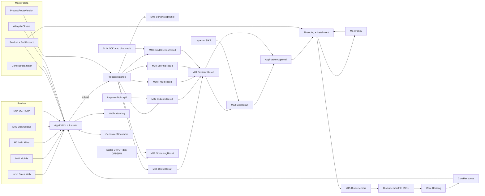

# Cikal: Data Lineage

**Version:** 0.1  
**Date:** 2026-10-21  
**Author:** Fahrudin  
**Status:** Draft  

Asal, perubahan, dan tujuan data utama Cikal. Nama entity merujuk `data-dictionary.md`.

## Alur data pengajuan

Tanpa modul tertentu, langkahnya dilewati (StepExecution SKIPPED) dan hasilnya terbaca SKIP di Decision Matrix.

## Tabel lineage

| Data | Sumber | Transformasi | Tujuan | Frekuensi |
|---|---|---|---|---|
| Loan ID | LoanIdCounter + Product.productCode | ddMMyyyy + kode produk + 7 digit berurutan | Application, DisbursementFile `appl_no`, notifikasi | Saat draft pertama |
| Data identitas pemohon | Input Sales / OCR / mitra / upload | Validasi format; OCR mengisi field, bisa diubah | Dedup, Dukcapil, Fraud, SIKP, DisbursementFile `hdr` | Real-time |
| Alamat | Input + master wilayah | Pilihan berjenjang provinsi s.d. kode pos | DisbursementFile `addr`, dokumen akad | Real-time |
| Versi rute | ProductRouteVersion aktif | Dikunci di ProcessInstance saat submit | StepExecution | Saat submit |
| Hasil Dedup | Application + data pengajuan lain | Exact + fuzzy per field, matriks | DecisionResult | Per proses |
| Hasil Dukcapil | Layanan Dukcapil | Skor nama x bobot + skor ibu x bobot, ambang | DecisionResult | Per proses |
| Hasil Fraud | Application + IP + Blacklist | Frekuensi nama per hari, kategori IP, matriks | DecisionResult, Blacklist | Per proses |
| Skor dan RAC | Application + ScoringModel | Kriteria terpenuhi x bobot + konstanta vs cut off | DecisionResult | Per proses |
| Kolektibilitas | SLIK OJK atau biro kredit (API) atau laporan iDeb (MANUAL) | Agregasi fasilitas aktif, lalu CreditBureauOutcomeMapping | DecisionResult | Per proses |
| Hasil screening | Daftar DTTOT dan DPPSPM hasil impor | Kemiripan nama terhadap ambang | ScreeningResult, Application (bila dikonfirmasi) | Per proses |
| Log integrasi | Semua panggilan adapter | PII disamarkan | IntegrationCallLog | Real-time |
| Keputusan | 6 hasil pemeriksaan | Lookup DecisionMatrix | Approval atau Recontest | Per proses |
| Status KUR | Layanan SIKP | Kode 07/12/15 + sisa hari menjadi GO/NOTGO | ApplicationApproval | Per proses, KUR dengan limit > batas SIKP |
| Rantai approver | ApprovalLevel + ApprovalHierarchy | Nominal menentukan level s.d. final approver | HumanTask, ApplicationApproval | Per proses |
| Struktur kredit | Application + Product + SubProduct + FormulaVersion | Angsuran per jenis bunga (TRM_INS); biaya, nilai cair bersih, DBR lewat rumus configurable (RM-07, RM-08) | Installment, akad, DisbursementFile, FormulaExecutionLog | Saat approval selesai, ulang setelah e-polis |
| IJK | Rumus `IJK_AMOUNT` + InsuranceRate, input petugas, atau respons asuransi (`IJK_SOURCE`) | Default: plafon x tarif(usia, tahun tenor) | Financing, Policy, FormulaExecutionLog | Saat e-polis |
| Hasil LKN | Input surveyor + FormulaVersion | Rumus configurable RM-09, RM-10 | SurveyMikro, SurveyKpr, kriteria scoring | Saat LKN disimpan |
| File pencairan | Application + Collateral + Financing + Installment | Pemetaan ke format FAST | Core Banking | Saat Validity Check Valid |
| Status akhir | CoreResponse | SUKSES menjadi DISBURSED; GAGAL menjadi RECONTEST | Application, notifikasi | Saat file core diterima |
| Jejak perubahan | Semua aksi user | Data lama + baru dalam JSON | AuditLog | Real-time |
| Perubahan master | Input maker | ChangeRequest, diterapkan setelah approve | Entity master | Saat checker menyetujui |
