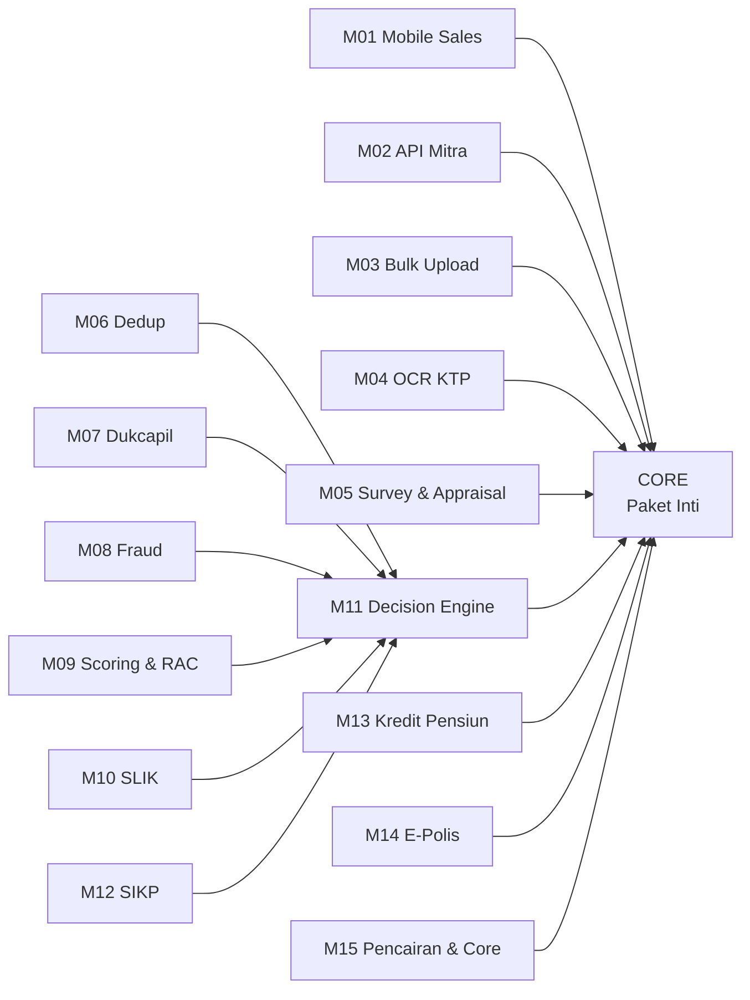
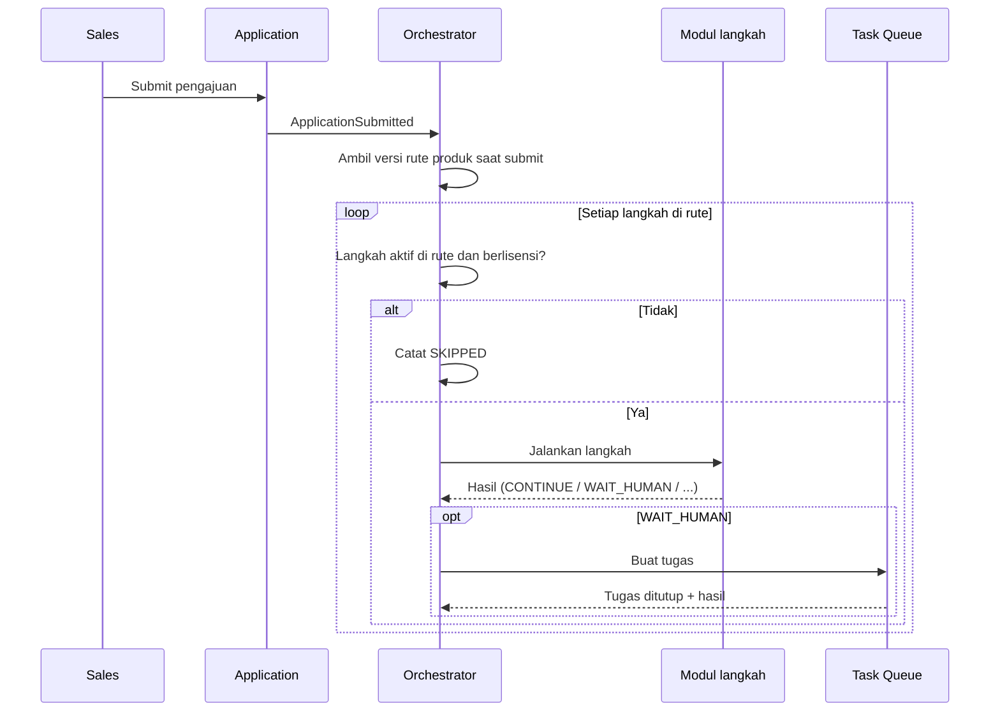

# Cikal: Referensi Teknis High-Code (Stack-Agnostic)

**Version:** 0.1  
**Date:** 2026-10-21  
**Author:** Fahrudin  
**Status:** Draft untuk tim engineer  

## 0. Cara memakai dokumen ini

Dokumen ini adalah **patokan** untuk tim engineer yang akan membangun Cikal. Isinya:

- aturan perilaku sistem yang wajib dipertahankan dari LOS OutSystems 11 (AS-IS),
- cara sistem dipecah menjadi modul yang bisa dijual terpisah, untuk SaaS maupun on-premise,
- kontrak antar modul, pengganti BPT, mekanisme lintas modul, dan integrasi eksternal.

Dokumen ini **tidak memilih tech stack**. Bahasa pemrograman, framework, database, message broker, dan infrastruktur diputuskan tim engineer. Tim engineer menulis dokumen teknis mereka sendiri (bagian 15) berdasarkan dokumen ini.

**Urutan acuan saat terjadi perbedaan:**

1. `Docs/ba/Doc_BA_Cikal_Versi 1.xlsx` (US/AC/MRTM) beserta jawaban kuesioner asumsi
2. Dokumen ini
3. Dokumen teknis LOS OS11 (`Docs/Reverse Engineering OS11/Tech_Docs/`)

Bagian yang ditandai **[Usulan]** adalah keputusan teknis BA yang boleh diubah tim engineer dengan alasan tertulis. Bagian lain adalah aturan bisnis yang hanya boleh diubah lewat Doc BA.

Dokumen terkait:

- `cikal-to-be-concept.md`, `cikal-project-overview.md` (AS-IS lengkap), `design-system.md`
- `ba/data-dictionary.md` (struktur entity dan field per modul), `ba/glossary.md`, `ba/data-lineage.md`

**Desain UI (Figma):** https://www.figma.com/design/765rmxZwfHj9KSV4qmzOj3/LOS-Product

| Halaman Figma | Isi | Tautan |
|---|---|---|
| Layout | Kerangka halaman web dan mobile | https://www.figma.com/design/765rmxZwfHj9KSV4qmzOj3/LOS-Product |
| Components | Komponen UI (turunan OutSystems UI + brand Perkasa) | https://www.figma.com/design/765rmxZwfHj9KSV4qmzOj3/LOS-Product |
| Guidelines | Warna, tipografi, ikon | https://www.figma.com/design/765rmxZwfHj9KSV4qmzOj3/LOS-Product |
| UI Flow - Web | Alur layar aplikasi web | https://www.figma.com/design/765rmxZwfHj9KSV4qmzOj3/LOS-Product?node-id=2003-1917 |
| UI Flow - Mobile | Alur layar aplikasi mobile (M01) | https://www.figma.com/design/765rmxZwfHj9KSV4qmzOj3/LOS-Product?node-id=2011-1748 |

Desain Figma adalah desain LOS AS-IS. Layar baru Cikal (editor rute produk, konsol lisensi, ChangeRequest generik) belum ada di Figma. Token desain sudah dirangkum di `design-system.md`.

---

## 1. Tujuan dan model bisnis

| Hal | Isi |
|---|---|
| Tujuan rebuild | Lepas dari lisensi OutSystems; sistem bisa dirawat developer junior-middle dengan bantuan AI |
| Aturan bisnis | Mengikuti LOS OS11 (AS-IS), dengan perbaikan yang sudah tercatat di Doc BA |
| Model bisnis | **SaaS** (satu instalasi, banyak client) dan **on-premise** (dipasang di server client) |
| Harga | Ditentukan dari modul yang dibeli client |
| Prinsip produk | Satu codebase, tidak ada versi khusus per client. Perbedaan antar client hanya dari **konfigurasi** dan **lisensi modul** |

Contoh: client A membeli Inti + modul 1, 2, 5, 6, 7, 11, 15. Client B membeli Inti + modul 6, 11, 15. Keduanya memakai versi Cikal yang sama.

---

## 2. Prinsip arsitektur

| ID | Prinsip | Akibat teknis |
|---|---|---|
| AP-01 | Satu codebase untuk SaaS dan on-premise | Tidak ada branch per client. Fitur client diatur lisensi dan konfigurasi |
| AP-02 | Modul yang dijual terpisah bisa dipasang dan dicabut tanpa mengubah modul lain | Setiap modul tambahan adalah unit deploy sendiri dengan kontrak yang jelas |
| AP-03 | Modul tidak membaca database modul lain | Data modul lain hanya diakses lewat API atau event |
| AP-04 | Alur proses diatur konfigurasi rute per produk, bukan kode | Pengganti BPT adalah orkestrator rute yang sederhana (bagian 6) |
| AP-05 | Sederhana lebih penting dari canggih | Tidak memakai workflow engine berat yang butuh spesialis |
| AP-06 | Setiap integrasi eksternal punya mode simulasi | Semua modul bisa diuji tanpa sistem pihak ketiga |
| AP-07 | Pemisahan tugas ditegakkan sistem | Maker tidak menyetujui perubahannya sendiri; penginput pengajuan tidak menyetujui pengajuannya |
| AP-08 | Kode berupa teks yang mudah dibaca manusia dan AI | Konvensi penamaan konsisten, kontrak API terdokumentasi (contoh: OpenAPI), aturan bisnis tidak tersembunyi di konfigurasi platform |

---

## 3. Katalog modul

### 3.1 Daftar modul

| Kode | Modul | Jenis | Isi | Asal di OS11 |
|---|---|---|---|---|
| CORE | Paket Inti | Wajib | Identitas dan akses, company dan organisasi, master data, produk dan rute, checker-maker, audit, notifikasi, pengajuan web, dokumen, simulasi angsuran, approval, inquiry, dashboard, process monitoring | LOSHome, LOSUIMaster, LOSCS, LOSFunction, LOSBankProcess (sebagian), LOSPlafondCalculationBL, LOSDocumentMatrixBL, LOSCompanyConfigBL, LOS_Notification_BL |
| M01 | Mobile Sales | Tambahan | Aplikasi mobile: beranda produk, order stepper, Loan List, LKN mobile, profil; Device Info | LOSMobileApp |
| M02 | API Mitra | Tambahan | Registrasi aplikasi mitra, token, insert pengajuan | LOSInsertCustomerServices (API) |
| M03 | Bulk Upload | Tambahan | Template Excel, upload massal, Monitor Upload | LOSInsertCustomerServices (Upload), Monitoring |
| M04 | OCR KTP | Tambahan | Baca KTP untuk isi data pribadi | LOSOCRServices |
| M05 | Survey & Appraisal | Tambahan | LKN Mikro, LKN KPR, biaya dan form appraisal | ApplicationLKN, ApplicationLKNKPR, ApplicationAppraisal |
| M06 | Dedup | Tambahan | Cek duplikasi, Prescreen Dedup, Dedup Matrix | LOSDedupBL |
| M07 | Dukcapil | Tambahan | Verifikasi kependudukan, Prescreen Dukcapil 2 tingkat, aturan skor | LOSDukcapilAPI, LOSDukcapilBL |
| M08 | Fraud | Tambahan | Fraud check, Prescreen Fraud, blacklist, Fraud Matrix | LOSFraud |
| M09 | Scoring & RAC | Tambahan | Penyusun model tanpa SQL, uji model, eksekusi RAC dan scoring | DynamicScoring, LOSRACBL, LOSScoringBL |
| M10 | SLIK | Tambahan | Cek kolektibilitas | LOSSLIKBL |
| M11 | Decision Engine | Tambahan | Decision Matrix, keputusan Go/NotGo, Recontest | LOSDecisionEngine |
| M12 | SIKP | Tambahan | Cek KUR di SIKP | LOSSIKPBL, LOSSIKPServices |
| M13 | Kredit Pensiun | Tambahan | Verifikasi Taspen/EDAPEM | Edapem |
| M14 | E-Polis | Tambahan | Request e-polis, nilai IJK, hitung ulang struktur kredit | GetEpolis |
| M15 | Pencairan & Core | Tambahan | Validity Check, Print/Reprint Akad, file pencairan, respons core | LOSDisbursementBL, LOSGenerateDocument (akad), LOSInteractionCoreService |
| SIM | Alat Simulasi | Non-produksi | Respons tiruan semua integrasi | Simulation Device, WaitingFromCore_Dummy |

### 3.2 Aturan ketergantungan antar modul

| ID | Aturan | Alasan |
|---|---|---|
| DEP-01 | CORE selalu terpasang dan tidak bisa dinonaktifkan | Semua modul bergantung pada identitas, tenant, produk, rute, dan pengajuan |
| DEP-02 | Jika salah satu dari M06, M07, M08, M09, M10 dibeli, M11 wajib dibeli | Hasil modul penilaian baru berarti setelah digabung menjadi Go/NotGo [Usulan] |
| DEP-03 | Tanpa M11, pengajuan yang lolos verifikasi dokumen langsung masuk Approval | Alur tetap berjalan untuk client tanpa engine penilaian |
| DEP-04 | M12 hanya bisa dipasang bersama M11 | Hasil SIKP masuk ke keputusan Go/NotGo |
| DEP-05 | M13 aktif hanya jika client punya produk berkategori Pension | Field Taspen tampil hanya untuk produk pensiun |
| DEP-06 | Tanpa M14, langkah Epolis dilewati | Struktur kredit tidak dihitung ulang dengan nilai asuransi |
| DEP-07 | Tanpa M15, proses berakhir di status "Approved" dan pencairan dilakukan di luar Cikal | Client yang hanya butuh origination sampai persetujuan [Usulan] |
| DEP-08 | M05 versi mobile (LKN mobile) butuh M01 | LKN mobile adalah bagian aplikasi mobile |
| DEP-09 | M04 bisa dipakai di web (CORE) dan mobile (M01) | OCR adalah layanan, bukan layar |
| DEP-10 | Paket lisensi divalidasi terhadap aturan ini saat aktivasi | Mencegah kombinasi yang tidak bisa berjalan |

Panah berarti "membutuhkan".

---

## 4. Batas layanan (service boundaries)

### 4.1 Layanan logis

Tabel ini adalah pembagian logis. Tim engineer boleh menggabungkan beberapa layanan logis di dalam CORE menjadi satu unit deploy (contoh: modular monolith untuk CORE) selama batas data dan kontraknya tetap. Modul tambahan (M01 sampai M15) **wajib** bisa dipasang dan dicabut terpisah dari CORE (AP-02).

| Layanan | Modul | Tanggung jawab | Data yang dimiliki |
|---|---|---|---|
| Identity & Access | CORE | Login lokal dan SSO, sesi, reset password, user, role, hak akses menu, akses khusus per user | User, Role, RoleAccess, UserAccess, Menu, LoginAttempt |
| Tenant & License | CORE | Company (tenant), lisensi modul, aktivasi, salin konfigurasi antar company | Company, License, ModuleEntitlement |
| Organization | CORE | Regional, Branch, Sub Branch, Currency, Currency Rate | Regional, Branch, SubBranch, Currency, CurrencyRate |
| Master Data | CORE | General Parameter, data wilayah, template dokumen, asuransi, parameter sistem | GeneralParameter, Province s.d. Zip, DocumentTemplate, Insurance, SystemParameter |
| Product & Route | CORE | Produk, rute modul per produk dan versinya, document checklist | Product, ProductRoute, ProductRouteVersion, DocumentChecklist |
| Change Request | CORE | Checker-maker untuk semua data master | ChangeRequest |
| Audit | CORE | Log audit semua perubahan dan aksi penting | AuditLog |
| Notification | CORE | Email ke nasabah dan pengguna | NotificationLog, EmailTemplate |
| Document | CORE | Penyimpanan file, konversi ke PDF, generate dokumen dari template | DocumentFile (metadata), GeneratedDocument |
| Application | CORE | Data pengajuan (Application, Personal, Spouse, Occupation, Business, Collateral, Document, Emergency Contact), Loan ID, draft, submit | Application dan seluruh bagian datanya |
| Orchestrator | CORE | Menjalankan rute, riwayat langkah, aging, retry, recontest | ProcessInstance, StepExecution |
| Task Queue | CORE | Antrean kerja manusia: ambil, lepas, tutup tugas | HumanTask |
| Approval | CORE | Level approval, hierarki approver, keputusan approver, auto approval, struktur kredit dan jadwal angsuran | ApprovalLevel, ApprovalHierarchy, ApprovalDecision, Financing, Installment |
| Calculation | CORE | Simulasi angsuran (Flat, Effective, Floating, Hybrid, Capped) | Tidak menyimpan data |
| Reporting | CORE | Dashboard, inquiry, export | Read model dari event layanan lain |
| Mobile BFF | M01 | API khusus aplikasi mobile, device info | Device |
| Partner Gateway | M02 | Registrasi mitra, token, insert pengajuan | PartnerClient, PartnerKey |
| Bulk Upload | M03 | Template, upload, validasi massal, hasil gagal | UploadFile, UploadRowResult |
| OCR | M04 | Adapter OCR KTP | OcrRequestLog |
| Survey | M05 | LKN Mikro, LKN KPR, appraisal, foto survey | Survey, Appraisal, SurveyPhoto |
| Dedup | M06 | Cek duplikasi dan matrix | DedupResult, DedupMatrix |
| Dukcapil | M07 | Adapter Dukcapil, skor, prescreen | DukcapilResult, DukcapilRule, DukcapilReview |
| Fraud | M08 | Fraud check, blacklist, matrix, prescreen | FraudResult, FraudMatrix, Blacklist, FraudReview |
| Scoring | M09 | Model, kriteria, bobot, uji, eksekusi | ScoringModel, Criterion, Weight, ScoringResult |
| SLIK | M10 | Adapter SLIK | SlikResult |
| Decision | M11 | Decision Matrix, keputusan, recontest | DecisionMatrix, DecisionResult |
| SIKP | M12 | Adapter SIKP | SikpResult |
| Pension | M13 | Adapter EDAPEM/Taspen | PensionVerification |
| E-Polis | M14 | Adapter asuransi, nilai IJK | Policy |
| Disbursement | M15 | Validity check, akad, file pencairan, respons core | Disbursement, AkadPrint, CoreResponse |

### 4.2 Identitas bersama

Semua layanan memakai identitas yang sama:

| Identitas | Keterangan |
|---|---|
| `tenantId` | Company. Selalu ada di setiap data dan setiap permintaan |
| `currencyCode` | Mata uang dalam company (AS-IS memakai pasangan CompanyCode + CurrencyCode) |
| `applicationId` | ID internal pengajuan |
| `loanId` | Nomor pengajuan bisnis (format di bagian 11.1). Dipakai di dokumen, file core, dan log |
| `processInstanceId` | Satu eksekusi rute. Recontest membuat instance baru dengan `loanId` yang sama |
| `correlationId` | Untuk menelusuri satu permintaan lintas layanan [Usulan] |

---

## 5. Komunikasi antar modul

### 5.1 Kontrak modul langkah proses

Setiap modul yang menjadi langkah di rute (Survey, Dedup, Dukcapil, Verification, Fraud, RAC, Scoring, SLIK, Decision, SIKP, Approval, Epolis, Validity Check, Print Akad, Disbursement) memenuhi kontrak berikut.

**Masukan** dari orchestrator:

| Field | Keterangan |
|---|---|
| `tenantId`, `applicationId`, `loanId`, `processInstanceId` | Identitas |
| `stepCode` | Kode langkah (contoh `DEDUP`) |
| `attempt` | Percobaan ke berapa (untuk retry) |
| `idempotencyKey` | Kombinasi `processInstanceId` + `stepCode` + `attempt` |

**Keluaran** ke orchestrator (satu dari enam):

| Hasil | Arti | Contoh AS-IS |
|---|---|---|
| `CONTINUE` | Lanjut ke langkah berikutnya | Fraud Clean, Dukcapil Passed |
| `WAIT_HUMAN` | Buat tugas di antrean manusia, tunggu sampai ditutup | Dedup Review, Survey, Approval manual |
| `BACK_TO_DRAFT` | Kembali ke Sales untuk diperbaiki | Verification Not Match, Validity Not Valid, Return approver |
| `RECONTEST` | Ditolak, bisa diproses ulang oleh Risk Manager | Decision NotGo, SIKP NotGo, respons core GAGAL |
| `FINISH` | Proses berakhir | Dukcapil Failed, Approval Reject, High Fraud Potential, respons core SUKSES |
| `ERROR` | Gagal teknis; bisa di-retry atau dihentikan | Layanan Dukcapil timeout |

Setiap keluaran membawa `outcomeCode` (contoh `MATCH`, `REVIEW`, `GO`, `NOTGO`) dan `summary` yang ditampilkan di timeline.

### 5.2 Event bisnis [Usulan]

Layanan menerbitkan event agar Reporting, Notification, dan Audit tidak perlu memanggil layanan lain secara langsung.

| Event | Penerbit | Pemakai |
|---|---|---|
| `ApplicationSubmitted` | Application | Orchestrator, Notification, Reporting |
| `StepStarted`, `StepCompleted`, `StepFailed`, `StepSkipped` | Orchestrator | Reporting, Audit, realtime UI |
| `HumanTaskCreated`, `HumanTaskAssigned`, `HumanTaskReleased`, `HumanTaskClosed` | Task Queue | Reporting, realtime UI |
| `ApplicationDecided` (GO/NOTGO) | Decision | Notification, Reporting |
| `ApplicationApproved`, `ApplicationRejected`, `ApplicationReturned` | Approval | Notification, Reporting, Disbursement |
| `DisbursementCompleted`, `DisbursementFailed` | Disbursement | Notification, Reporting |
| `MasterDataChanged` | Change Request | Layanan pemilik data, Audit |
| `LicenseChanged` | Tenant & License | Semua layanan (refresh hak pakai modul) |

### 5.3 Aturan komunikasi

| ID | Aturan |
|---|---|
| COM-01 | Panggilan UI ke backend lewat satu pintu (API gateway atau setara) yang memeriksa token, tenant, dan lisensi modul |
| COM-02 | Langkah otomatis dijalankan secara asinkron (antrean pesan atau setara) agar submit tidak menunggu integrasi eksternal |
| COM-03 | Setiap pemanggilan langkah idempotent: memanggil ulang dengan `idempotencyKey` yang sama tidak menghasilkan efek ganda |
| COM-04 | Timeout pemanggilan integrasi eksternal ditetapkan per adapter (default usulan 30 detik); melewati batas menghasilkan `ERROR` |
| COM-05 | Layanan modul yang tidak berlisensi tidak dipanggil; orchestrator mencatat langkah sebagai `SKIPPED - not licensed` |

---

## 6. Orchestrator rute (pengganti BPT)

### 6.1 Konsep

### 6.2 Aturan rute

| ID | Aturan | Sumber |
|---|---|---|
| RT-01 | Setiap produk punya rute sendiri | Keputusan brainstorming |
| RT-02 | Admin menyalakan atau mematikan modul; urutan langkah tetap (bagian 6.3) | Keputusan brainstorming |
| RT-03 | Langkah wajib tidak bisa dimatikan: Data Entry, Approval; ditambah Validity Check, Print Akad, Disbursement bila M15 berlisensi | Doc BA US-31 |
| RT-04 | Editor rute hanya menampilkan modul yang berlisensi untuk tenant | Lisensi modul |
| RT-05 | Perubahan rute lewat checker-maker dan menghasilkan versi baru | Doc BA US-31 |
| RT-06 | Pengajuan memakai versi rute saat submit sampai selesai | Doc BA US-31 |
| RT-07 | Produk tanpa rute yang disetujui tidak bisa dipakai untuk pengajuan baru | Doc BA US-20, US-39 |
| RT-08 | Kondisi internal modul tetap di modul (contoh: SIKP hanya jika limit di atas batas) | Keputusan brainstorming |

RT-03 menggantikan aturan R-06 di `cikal-to-be-concept.md`. R-06 menyebut Decision sebagai modul wajib; sejak modul dijual terpisah, Decision Engine adalah modul M11 yang opsional (bagian 3.2).

### 6.3 Urutan langkah baku

Urutan diturunkan dari BPT `BankLoanOrigination_Dynamics` dan diagram OM v2.2.

| Urutan | Kode langkah | Modul | Jenis | Keterangan |
|---|---|---|---|---|
| 1 | DATA_ENTRY | CORE | Manual | Mulai saat draft, selesai saat submit |
| 2 | SURVEY | M05 | Manual | Termasuk pembayaran appraisal untuk produk dengan appraisal |
| 3 | DEDUP | M06 | Otomatis + manual bila Review | Match lanjut ke 5 (melewati 4); UnMatch atau Skip lanjut ke 4 |
| 4 | DUKCAPIL | M07 | Otomatis + manual bila Review | Review: Verifikator, lalu Supervisor bila diteruskan |
| 5 | VERIFICATION | CORE | Manual | Not Match mengembalikan ke Draft |
| 6 | FRAUD | M08 | Otomatis + manual bila Suspicious | High Fraud Potential: Finish + blacklist |
| 7 | RAC | M09 | Otomatis | |
| 8 | SCORING | M09 | Otomatis | |
| 9 | SLIK | M10 | Otomatis | |
| 10 | DECISION | M11 | Otomatis | NotGo ke Recontest |
| 11 | SIKP | M12 | Otomatis, bersyarat | Hanya jika limit di atas batas SIKP |
| 12 | APPROVAL | CORE | Manual atau otomatis | Auto approval bila limit <= limit produk dan Go |
| 13 | EPOLIS | M14 | Manual | |
| 14 | VALIDITY_CHECK | M15 | Manual | |
| 15 | PRINT_AKAD | M15 | Manual | Reprint tidak punya langkah sendiri |
| 16 | DISBURSEMENT | M15 | Manual | Membuat file pencairan |
| 17 | WAIT_CORE | M15 | Menunggu sistem eksternal | SUKSES: Finish; GAGAL: Recontest |

Status AS-IS `DataWarehouse` tidak dibawa ke Cikal karena tidak punya fungsi di dokumen teknis [Usulan].

### 6.4 Status pengajuan

Dua lapis status dipakai terpisah agar tidak tercampur (AS-IS mencampurnya):

| Lapis | Nilai | Dipakai di |
|---|---|---|
| Status pengajuan | `DRAFT`, `ON_PROGRESS`, `RECONTEST`, `APPROVED`, `DISBURSED`, `FINISHED_REJECTED`, `FINISHED_CANCELLED` | Loan List, inquiry, dashboard |
| Langkah saat ini | Kode langkah di tabel 6.3 | Timeline, antrean kerja, monitoring |
| Status langkah | `PENDING`, `RUNNING`, `WAITING_HUMAN`, `COMPLETED`, `SKIPPED`, `ERROR` | Timeline, Process Monitoring |

Pemetaan ke label UI (contoh: kartu dashboard "Save as Draft", "Submitted", "GO", "NOT GO", tab mobile "Draft", "On Progress", "Disburse") ditetapkan di data dictionary.

### 6.5 Error, retry, recontest

| ID | Aturan | Sumber AS-IS |
|---|---|---|
| ER-01 | Langkah otomatis yang gagal berstatus `ERROR` dengan pesan error; proses berhenti di langkah itu | `WaitErrorClicked<Step>` |
| ER-02 | Admin Operasional bisa Retry atau Finish dari Process Monitoring | BPT Monitoring |
| ER-03 | Retry otomatis untuk error sementara (contoh: timeout) maksimal 3 kali dengan jeda bertambah sebelum menjadi `ERROR` [Usulan] | Tidak ada di AS-IS |
| ER-04 | Recontest membuat `processInstance` baru dengan `loanId` yang sama, mulai dari langkah pertama setelah DATA_ENTRY; riwayat instance lama tetap tersimpan | RecontestGo (IsRecontest=true) |
| ER-05 | Batas recontest per pengajuan: 3 kali (parameter) | Doc BA US-71 |
| ER-06 | Setiap langkah mencatat waktu mulai, waktu selesai, aging dalam hari kalender, pelaku, dan hasil | ApplicationHistory |

---

## 7. Antrean kerja manusia

| ID | Aturan | Sumber |
|---|---|---|
| TQ-01 | Langkah manual membuat satu tugas berisi `stepCode`, `applicationId`, cabang, dan role yang berhak | Human activity BPT |
| TQ-02 | Pengguna mengambil tugas (Assign to Me) sebelum mengerjakan; tugas yang sudah diambil tidak bisa dikerjakan orang lain | LOSActivityLoan.AssignedUser |
| TQ-03 | Pengguna bisa melepas tugasnya (Release Me); Supervisor bisa melepas tugas orang lain | Release Me |
| TQ-04 | Pengambilan bersamaan diselesaikan dengan "yang pertama menang"; yang kedua menerima pesan tugas sudah diambil | Doc BA AC-58.04 |
| TQ-05 | Menutup tugas mengirim hasil ke orchestrator | Activity Close |
| TQ-06 | Pengecualian AS-IS: antrean LKN KPR tidak memakai Assign to Me karena CS dan Appraiser mengisi bagian berbeda | LKN Web |
| TQ-07 | User yang dinonaktifkan melepaskan semua tugasnya kembali ke antrean | Doc BA AC-07.05 |

---

## 8. Multi-tenant, lisensi, dan aktivasi modul

### 8.1 Tenant

| ID | Aturan |
|---|---|
| TN-01 | Satu company = satu tenant. Setiap data dan setiap permintaan membawa `tenantId` |
| TN-02 | Pengguna hanya melihat data tenant-nya; di dalam tenant dibatasi lagi oleh regional/cabang sesuai user |
| TN-03 | SaaS: strategi isolasi data (database per tenant, schema per tenant, atau kolom tenant) diputuskan tim engineer; wajib ada uji otomatis yang membuktikan data antar tenant tidak bocor |
| TN-04 | On-premise: satu instalasi bisa berisi satu atau beberapa company milik client yang sama |

### 8.2 Lisensi modul

| ID | Aturan |
|---|---|
| LC-01 | Lisensi berisi: tenant, daftar modul, tanggal mulai, tanggal berakhir, batas jumlah user (bila dipakai untuk harga) [Usulan] |
| LC-02 | SaaS: lisensi disimpan per tenant dan diubah oleh tim internal PPU lewat konsol admin, bukan oleh Super User client |
| LC-03 | On-premise: lisensi berupa file atau kunci yang ditandatangani secara kriptografis; aplikasi menolak lisensi yang diubah [Usulan] |
| LC-04 | Lisensi diperiksa di empat tempat: menu UI, API gateway, editor rute, dan orchestrator |
| LC-05 | On-premise: layanan modul yang tidak berlisensi tidak dipasang sama sekali |
| LC-06 | Lisensi kedaluwarsa: aplikasi masuk mode baca saja (data tetap bisa dilihat dan diekspor, pengajuan baru ditolak) [Usulan] |
| LC-07 | Mencabut modul tidak menghapus data modul tersebut; pengajuan yang sedang berada di langkah modul itu diselesaikan dulu atau dihentikan admin [Usulan] |
| LC-08 | Kombinasi modul divalidasi terhadap aturan ketergantungan (bagian 3.2) saat lisensi diterbitkan |

---

## 9. Mekanisme lintas modul

### 9.1 Autentikasi dan otorisasi

| ID | Aturan | Sumber |
|---|---|---|
| AU-01 | Login lokal dan SSO (OIDC). User SSO baru dibuat tanpa role sampai admin menetapkan | Login SSO doc, Asumsi A-11 |
| AU-02 | Password: minimal 8, maksimal 128 karakter, huruf besar, huruf kecil, angka, karakter spesial | Doc BA US-04 |
| AU-03 | Terkunci 15 menit setelah 5 kali gagal; sesi berakhir setelah 30 menit tidak aktif; tautan reset berlaku 10 menit | Asumsi A-28 |
| AU-04 | Hak akses per menu: View, Create, Update, Delete, Approve; dicek di UI dan di setiap API | Asumsi A-13 |
| AU-05 | Pemisahan tugas: maker bukan checker; penginput pengajuan bukan approver | Asumsi A-14 |
| AU-06 | Password awal dari admin wajib diganti saat login pertama | Doc BA US-05 |
| AU-07 | API mitra memakai pasangan API key dan token Bearer berumur pendek per company | API JWT LOS |

### 9.2 Checker-maker

Satu mekanisme dipakai semua data master (menggantikan sekitar 15 tabel `*Temp` di AS-IS).

| ID | Aturan |
|---|---|
| CM-01 | Perubahan disimpan sebagai permintaan perubahan berisi: entitas, ID data (kosong untuk data baru), data lama, data baru, pembuat, status |
| CM-02 | Status: `WAITING_APPROVAL`, `REVISE`, `APPROVED`, `REJECTED` |
| CM-03 | Approve: data baru diterapkan ke tabel utama dalam satu transaksi, lalu permintaan ditutup |
| CM-04 | Reject: tabel utama tidak berubah |
| CM-05 | Revise wajib alasan (maksimal 500 karakter); Maker yang sama mengajukan ulang |
| CM-06 | Satu data hanya boleh punya satu permintaan terbuka |
| CM-07 | Data yang memakai checker-maker: user, role, hak akses, menu, organisasi, currency, kurs, produk, general parameter, template dokumen, document checklist, approval setup, rute produk, semua matrix, model scoring, parameter sistem, asuransi |
| CM-08 | Pengecualian AS-IS: import Approval Setup via Excel langsung berlaku tanpa checker-maker. Di Cikal diusulkan tetap lewat checker-maker [Usulan, perlu konfirmasi] |

### 9.3 Audit

| ID | Aturan |
|---|---|
| AD-01 | Dicatat: siapa, kapan, tenant, modul, aksi, ID data, data lama, data baru |
| AD-02 | Aksi yang dicatat: semua create/update/delete, keputusan checker, keputusan approver, ambil/lepas tugas, cetak dan cetak ulang akad, login dan gagal login |
| AD-03 | Log audit tidak bisa diubah atau dihapus lewat aplikasi |
| AD-04 | Masa simpan log audit ditetapkan di NFR (bagian 13) |

### 9.4 Konfigurasi dan rahasia

| ID | Aturan | Pengganti AS-IS |
|---|---|---|
| CF-01 | Parameter bisnis yang bisa diubah admin disimpan per tenant dan lewat checker-maker | Site Properties: `SIKPFilterLoanAmount`, `DaysRemaining`, `DedupMatrixSetup` |
| CF-02 | Rahasia (API key, password integrasi) disimpan di penyimpanan rahasia, tidak tampil di UI | Site Property `OksaraKey` |
| CF-03 | Konfigurasi teknis per lingkungan (URL integrasi, mode simulasi) diatur saat deploy, bukan lewat UI | Service Center |

### 9.5 Dokumen dan file

| ID | Aturan | Sumber |
|---|---|---|
| DC-01 | File disimpan di penyimpanan objek; database hanya menyimpan metadata | DocumentCustomer binary |
| DC-02 | Unggahan: maksimal 2 MB, png/jpg/jpeg/pdf/docx, dikonversi dan disimpan sebagai PDF | LKN Web, Asumsi A-17 |
| DC-03 | Generate dokumen dari template Word dengan placeholder, hasil PDF | MSWordUtils |
| DC-04 | Dokumen yang di-generate: Surat Pengajuan Kredit, SP3K (KPR, nomor dari counter bulanan), Surat Perjanjian Kredit (akad) | Approval doc, Print Akad doc |
| DC-05 | Daftar placeholder per template ditetapkan di data dictionary; template dengan placeholder tidak dikenal ditolak | Doc BA US-24 |

### 9.6 Lain-lain

| ID | Hal | Aturan |
|---|---|---|
| OT-01 | Excel | Template unduhan berisi dropdown dari General Parameter; hasil upload gagal diunduh dengan kolom alasan |
| OT-02 | Realtime | Inquiry dan antrean diperbarui otomatis saat langkah berubah (push atau polling) |
| OT-03 | Job terjadwal | Reset counter SP3K bulanan, sinkron data wilayah, lisensi kedaluwarsa |
| OT-04 | Bahasa | Label UI dan pesan sistem bahasa Inggris (Asumsi A-27) |
| OT-05 | Format | Uang dalam rupiah tanpa desimal di UI kecuali kurs; tanggal tampil `DD-MM-YYYY`; zona waktu disimpan UTC, ditampilkan WIB [Usulan] |

---

## 10. Integrasi eksternal

Setiap integrasi dibuat sebagai **adapter** dengan dua implementasi: asli dan simulasi. Pilihan implementasi diatur per lingkungan.

| Integrasi | Modul | Arah | Kontrak AS-IS (ringkas) | Catatan Cikal |
|---|---|---|---|---|
| SSO (OIDC, Keycloak) | CORE | Keluar | Authorization code flow; cocokkan user lewat email | Konfigurasi IdP per tenant |
| Email (SMTP) | CORE | Keluar | Email submitted, rejected, reset password | Template per tenant |
| Data wilayah (Oksara) | CORE | Keluar | GET provinsi, kota, kecamatan, kelurahan; Bearer token; disinkron ke database lokal | Job terjadwal + tombol sinkron manual |
| OCR KTP (Oksara) | M04 | Keluar | POST multipart file KTP; respons: provinsi, kota, NIK, nama, tempat/tanggal lahir, jenis kelamin, alamat, agama, status kawin, pekerjaan, masa berlaku, foto | Endpoint ngrok lama tidak dipakai |
| Insert pengajuan mitra | M02 | Masuk | Register company (CompanyCode, CompanyName, PlatformCode, Address) menghasilkan API key; Login (ApiKey) menghasilkan token Bearer + ExpiryAt; insert customer dengan token | Tambah reference number mitra untuk mencegah duplikasi (Doc BA AC-54.05) |
| Dukcapil | M07 | Keluar | Masukan: NIK, NoKK, FullName, MotherName, DOB, POB. Keluaran per field: Status, Score; isSuccess, Message | Skor dan ambang di sisi Cikal (bagian 11.3) |
| SLIK OJK | M10 | Keluar | Kolektibilitas 1 sampai 5 | AS-IS masih simulasi |
| SIKP | M12 | Keluar | Masukan NIK. Keluaran: Error, Code, Message, DaysRemaining, Data (identitas, plafon, subsidi, linkage) | AS-IS server tiruan |
| EDAPEM / Taspen | M13 | Keluar | Masukan Taspen Number; keluaran Account Number, Amount, Edapem Date | AS-IS import Excel |
| Scoring | M09 | Internal | AS-IS: REST `appid` + `StrategyGroupName`, respons score, Constant, CutOff, ScoreOutcomes | Di Cikal menjadi bagian M09, bukan aplikasi terpisah |
| Asuransi (e-polis) | M14 | Keluar | Request polis dengan nilai IJK, respons nomor polis | AS-IS data tiruan |
| Core banking FAST (kirim) | M15 | Keluar | Satu objek JSON per pengajuan (bagian 11.10) | Cara kirim diputuskan (Asumsi A-09) |
| Core banking FAST (respons) | M15 | Masuk | AS-IS: POST file biner ke `ResponseDisburse`; isi file menentukan SUKSES atau GAGAL per Loan ID | Respons duplikat dan respons untuk pengajuan yang tidak menunggu diabaikan dan dicatat (Doc BA US-80) |

Kontrak rinci (field, tipe, contoh, kode error) ditulis tim engineer per adapter berdasarkan dokumen teknis AS-IS dan spesifikasi pihak ketiga.

---

## 11. Aturan bisnis yang wajib dipertahankan

Rincian lengkap dan kasus uji ada di Doc BA (AC dan MRTM). Tabel ini adalah indeks untuk engineer.

### 11.1 Loan ID

Format `ddMMyyyy` + kode produk (1 sampai 5 karakter) + 7 digit counter. Counter per produk per company, tidak direset harian, aman terhadap penyimpanan bersamaan. Terbentuk saat Save as Draft pertama dan tidak berubah. Rujukan: MRTM TRM_LID.

### 11.2 Dedup

Atribut: NIK, Full Name ID, DOB, POB, Mother Maiden Name. NIK/DOB/POB exact; nama dan nama ibu exact atau fuzzy dengan ambang 50 sampai 100%. Kombinasi dipetakan Dedup Matrix ke Match, UnMatch, Review, Skip. Rujukan: MRTM TRM_DDP, Asumsi A-02.

### 11.3 Dukcapil

DOB dan POB wajib sama persis. Skor = nama x 0,60 + nama ibu x 0,40. Passed >= 0,90; Review 0,75 sampai < 0,90; Failed < 0,75; Skip bila data wajib kosong. Bobot dan ambang adalah parameter. Rujukan: MRTM TRM_DKC, Asumsi A-03.

### 11.4 Fraud

Blacklist atau lebih dari 3 pengajuan per nama per hari dengan kecepatan IP tinggi: High Fraud Potential (Finish + blacklist). VPN/proxy atau lokasi IP beda domisili: Suspicious (Prescreen Fraud). Selain itu Clean. Rujukan: MRTM TRM_FRD, Asumsi A-04.

### 11.5 Scoring dan RAC

Lulus jika `Constant + jumlah bobot kriteria terpenuhi >= CutOff`. Kriteria = field + operator + nilai (tanpa SQL). RAC memakai mekanisme yang sama dengan kriteria wajib; kemampuan bayar: rasio angsuran terhadap penghasilan <= DBR max produk. Rujukan: Doc BA US-37, US-38, US-67, Asumsi A-26.

### 11.6 SLIK

Kolektibilitas 1 = Good, 2 = Fair, 3 sampai 5 = Poor; tanpa riwayat = No credit history. Rujukan: MRTM TRM_SLK.

### 11.7 Decision

Decision Matrix memetakan hasil Dedup, Dukcapil, Fraud, RAC, Scoring, SLIK ke Go atau NotGo. Modul yang tidak dipakai rute atau tidak berlisensi bernilai Skip. Kombinasi tanpa baris matrix: NotGo dengan keterangan default. Rujukan: Doc BA US-36, US-69.

### 11.8 SIKP

Berjalan bila Requested Limit > batas SIKP (default 50.000.000) dan produk memakai modul SIKP. DaysRemaining > 0: NotGo (masih ada KUR aktif). Rujukan: Doc BA US-70, Asumsi A-19.

### 11.9 Approval dan struktur kredit

Level approval per cabang + produk + rentang nominal, tidak boleh tumpang tindih. Approver per level dan sub level. Level bawah memutuskan dulu. Komentar wajib. Semua level approve: bentuk struktur kredit (Financing) dan jadwal angsuran, generate SP3K untuk KPR. Auto approval bila Go dan limit <= Limit Auto Approval produk. Rujukan: MRTM TRM_APV, Doc BA US-26, US-27, US-72 s.d. US-74.

Perhitungan angsuran memakai PMT/IPMT/PPMT sesuai jenis bunga produk (Flat, Effective, Floating = rate + spread, Hybrid = fixed lalu floating, Capped = min(rate + spread, cap)). Rujukan: MRTM TRM_INS. Komponen struktur kredit (biaya admin, provisi, asuransi, nilai cair bersih) dirinci di data dictionary.

### 11.10 Pencairan dan file core

Validity Check: Disbursement Date minimal H+1 dan tidak sebelum tanggal e-polis; First Installment Date bisa diubah dan menggeser semua jatuh tempo. File core: satu objek JSON per pengajuan dengan bagian `upload_om_trn_appl_hdr`, `upload_om_trn_appl_object`, `upload_om_trn_appl_strucrdt`, `upload_om_trn_appl_addr`, `upload_ar_trn_installments`; nilai tetap `buss_unit` = "LB2", `create_by` = "LOS", `obj_code` = "HONVAR011"; core FAST menerima tenor maksimal 24 bulan. Rujukan: Doc BA US-76, US-79, Asumsi A-09, A-18.

### 11.11 Pengajuan

Syarat draft 7 field; field wajib submit per section; NPWP wajib bila limit > 50.000.000; Taspen wajib untuk produk pensiun; urutan step form mengikuti produk, status kawin, pekerjaan, dan kebutuhan agunan. Rujukan: MRTM TRM_APP, TRM_STP, Doc BA US-39 s.d. US-50, Asumsi A-15, A-16.

---

## 12. Konvensi API [Usulan]

| ID | Konvensi |
|---|---|
| API-01 | REST + JSON; versi di path (`/v1/...`) |
| API-02 | Setiap API didokumentasikan dengan spesifikasi mesin-baca (contoh: OpenAPI) dan disimpan bersama kode |
| API-03 | Token Bearer di header `Authorization`; tenant diambil dari token, bukan dari parameter yang bisa diubah klien |
| API-04 | Format error seragam: `code`, `message` (teks persis seperti di AC), `details` (daftar error per field) |
| API-05 | Daftar memakai paging (`page`, `pageSize`, default 20) dan sorting (`sort=field,asc`) |
| API-06 | Permintaan yang mengubah data menerima `Idempotency-Key` |
| API-07 | Nama field dan kode bahasa Inggris, `camelCase` untuk JSON |

---

## 13. Kebutuhan non-fungsional [Usulan, perlu konfirmasi]

Doc BA belum memuat NFR. Nilai di bawah adalah titik awal untuk didiskusikan.

| Kategori | Usulan |
|---|---|
| Keamanan data | NIK, nomor KK, NPWP, nomor rekening, dan nama ibu dienkripsi saat disimpan; NIK ditampilkan tersamar di daftar (contoh `3273********0001`) |
| Keamanan transport | Semua koneksi memakai TLS |
| Ketersediaan (SaaS) | 99,5% per bulan di luar jadwal pemeliharaan |
| Kinerja | Halaman daftar dan detail tampil < 2 detik untuk 95% permintaan; submit pengajuan < 3 detik (langkah otomatis berjalan di belakang) |
| Skala awal | 50 pengguna bersamaan per tenant; 10.000 pengajuan per bulan per tenant |
| Audit | Log audit disimpan minimal 5 tahun |
| Backup | Backup harian, simpan 30 hari; uji pemulihan tiap kuartal |
| Observability | Log terstruktur dengan `tenantId`, `loanId`, `correlationId`; metrik error per langkah; alert bila langkah `ERROR` melebihi ambang |
| Browser | Chrome dan Edge dua versi terakhir |
| Mobile | Android versi yang ditetapkan tim mobile |
| On-premise | Kebutuhan server minimum per kombinasi modul didokumentasikan; instalasi dan upgrade memakai paket yang sama dengan SaaS |

---

## 14. Deployment

### 14.1 SaaS

- Satu instalasi untuk semua tenant, dikelola tim PPU.
- Semua modul terpasang; akses dibatasi lisensi per tenant.
- Lingkungan minimal: development, UAT, production. Modul SIM hanya di development dan UAT.

### 14.2 On-premise

- Paket instalasi sama dengan SaaS; hanya layanan CORE dan modul berlisensi yang dipasang (LC-05).
- Integrasi memakai implementasi asli milik client, atau simulasi selama masa uji.
- Upgrade mengikuti versi rilis yang sama dengan SaaS; perubahan skema database disertai skrip migrasi otomatis.

### 14.3 Versi

- Rilis memakai nomor versi bersama untuk semua modul (contoh 1.4.0) agar kompatibilitas mudah dijamin [Usulan].
- Kontrak antar modul dan event diberi versi; perubahan yang memutus kompatibilitas hanya di versi mayor.

---

## 15. Dokumen yang harus dibuat tim engineer

| No | Dokumen | Isi minimal |
|---|---|---|
| 1 | Keputusan tech stack (ADR) | Bahasa, framework, database, broker pesan, gateway, mobile, alasan memilih |
| 2 | Arsitektur sistem | Diagram komponen, unit deploy (bagaimana layanan logis bagian 4 digabung atau dipisah), komunikasi |
| 3 | Desain multi-tenant | Strategi isolasi data (TN-03), uji kebocoran data antar tenant |
| 4 | Desain lisensi | Format lisensi, penandatanganan, pemeriksaan di empat titik (LC-04), mode kedaluwarsa |
| 5 | Kontrak API per layanan | Spesifikasi mesin-baca sesuai bagian 12 |
| 6 | Kontrak event | Daftar event, skema, versi |
| 7 | Skema data per layanan | Tabel, relasi, indeks; turunan dari data dictionary BA |
| 8 | Desain orchestrator | Implementasi bagian 6, termasuk idempotency dan retry |
| 9 | Spesifikasi adapter integrasi | Per integrasi di bagian 10: field, error, timeout, mode simulasi |
| 10 | Keamanan | Autentikasi, otorisasi, enkripsi data, pengelolaan rahasia |
| 11 | Infrastruktur dan deployment | SaaS dan on-premise, CI/CD, paket instalasi, migrasi skema |
| 12 | Observability | Logging, metrik, alert |
| 13 | Strategi pengujian | Uji unit, kontrak, integrasi, end-to-end terhadap AC dan MRTM Doc BA |

---

## 16. Hal yang belum diputuskan

| ID | Hal | Pemilik |
|---|---|---|
| TO-01 | Tech stack | Tim engineer |
| TO-02 | Penggabungan layanan logis CORE menjadi unit deploy | Tim engineer |
| TO-03 | Strategi isolasi data SaaS | Tim engineer |
| TO-04 | Apakah lisensi dihitung juga berdasarkan jumlah user atau volume pengajuan | Product Owner |
| TO-05 | Migrasi data dari LOS OS11 (O-03 di kuesioner) | Product Owner + IT |
| TO-06 | Nilai NFR final (bagian 13) | Product Owner + IT |
| TO-07 | Jawaban kuesioner asumsi A-01 s.d. A-31 | Stakeholder |
| TO-08 | Data dictionary dan field spec BA (status baku, field per form, komponen struktur kredit, placeholder template) | BA |
| TO-09 | Doc BA belum punya US untuk konsol lisensi internal PPU (terbitkan, ubah, cabut lisensi; validasi ketergantungan modul) dan untuk pembatasan editor rute berdasarkan lisensi | BA |
| TO-10 | Apakah Cikal dijual tanpa modul Pencairan & Core, sehingga proses berakhir di status Approved (DEP-07) | Product Owner |
