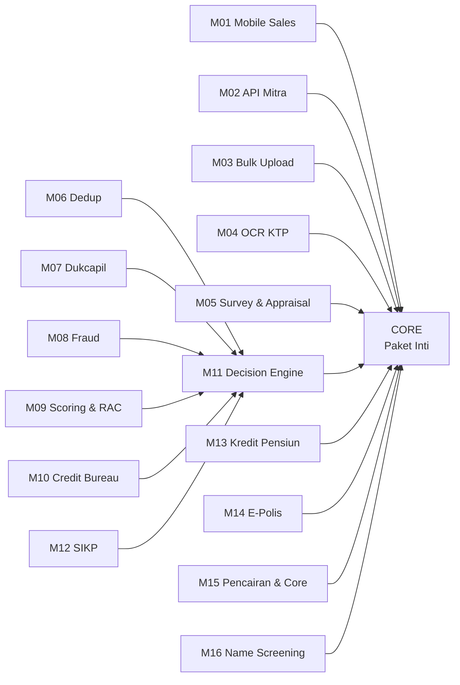
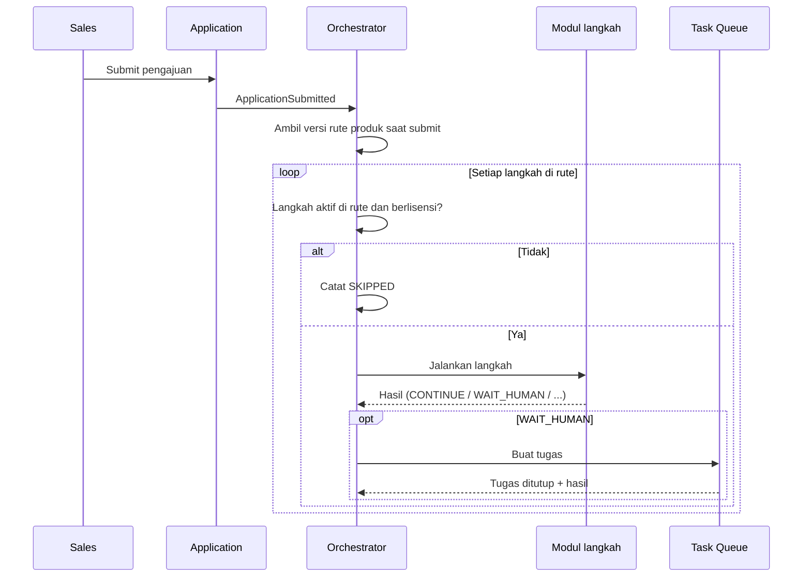
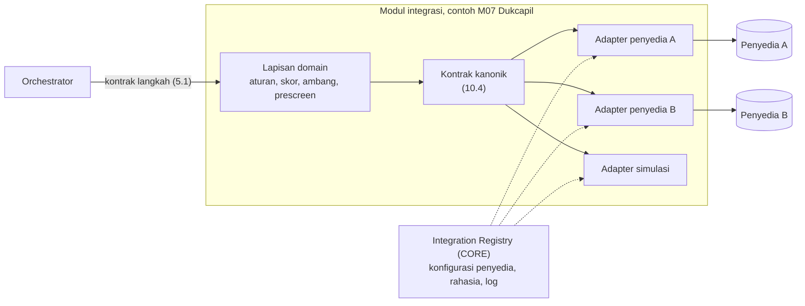

# Cikal: Referensi Teknis High-Code (Stack-Agnostic)

**Version:** 0.1  
**Date:** 2026-10-21  
**Author:** Fahrudin  
**Status:** Draft untuk tim engineer  

## 0. Cara memakai dokumen ini

Dokumen ini adalah **patokan** untuk tim engineer yang akan membangun Cikal. Isinya:

- aturan perilaku sistem yang wajib dipertahankan dari LOS OutSystems 11 (AS-IS),
- cara sistem dipecah menjadi modul yang bisa dijual terpisah, untuk SaaS maupun on-premise,
- kontrak antar modul, pengganti BPT, mekanisme lintas modul, dan integrasi eksternal.

Dokumen ini **tidak memilih tech stack**. Bahasa pemrograman, framework, database, message broker, dan infrastruktur diputuskan tim engineer. Tim engineer menulis dokumen teknis mereka sendiri (bagian 15) berdasarkan dokumen ini.

**Urutan acuan saat terjadi perbedaan:**

1. `Docs/ba/Doc_BA_Cikal_Versi 1.xlsx` (US/AC/MRTM) beserta jawaban kuesioner asumsi
2. Dokumen ini
3. Dokumen teknis LOS OS11 (`Docs/Reverse Engineering OS11/Tech_Docs/`)

Bagian yang ditandai **[Usulan]** adalah keputusan teknis BA yang boleh diubah tim engineer dengan alasan tertulis. Bagian lain adalah aturan bisnis yang hanya boleh diubah lewat Doc BA.

Dokumen terkait:

- `cikal-to-be-concept.md`, `cikal-project-overview.md` (AS-IS lengkap), `design-system.md`
- `ba/data-dictionary.md` (struktur entity dan field per modul), `ba/glossary.md`, `ba/data-lineage.md`

**Desain UI (Figma):** https://www.figma.com/design/765rmxZwfHj9KSV4qmzOj3/LOS-Product

| Halaman Figma | Isi | Tautan |
|---|---|---|
| Layout | Kerangka halaman web dan mobile | https://www.figma.com/design/765rmxZwfHj9KSV4qmzOj3/LOS-Product |
| Components | Komponen UI (turunan OutSystems UI + brand Perkasa) | https://www.figma.com/design/765rmxZwfHj9KSV4qmzOj3/LOS-Product |
| Guidelines | Warna, tipografi, ikon | https://www.figma.com/design/765rmxZwfHj9KSV4qmzOj3/LOS-Product |
| UI Flow - Web | Alur layar aplikasi web | https://www.figma.com/design/765rmxZwfHj9KSV4qmzOj3/LOS-Product?node-id=2003-1917 |
| UI Flow - Mobile | Alur layar aplikasi mobile (M01) | https://www.figma.com/design/765rmxZwfHj9KSV4qmzOj3/LOS-Product?node-id=2011-1748 |

Desain Figma adalah desain LOS AS-IS. Layar baru Cikal (editor rute produk, konsol lisensi, ChangeRequest generik, parameter sistem, editor rumus, konfigurasi integrasi, review Name Screening) belum ada di Figma; lihat TO-17. Token desain sudah dirangkum di `design-system.md`.

---

## 1. Tujuan dan model bisnis

| Hal | Isi |
|---|---|
| Tujuan rebuild | Lepas dari lisensi OutSystems; sistem bisa dirawat developer junior-middle dengan bantuan AI |
| Aturan bisnis | Mengikuti LOS OS11 (AS-IS), dengan perbaikan yang sudah tercatat di Doc BA |
| Model bisnis | **SaaS** (satu instalasi, banyak client) dan **on-premise** (dipasang di server client) |
| Harga | Ditentukan dari modul yang dibeli client |
| Prinsip produk | Satu codebase, tidak ada versi khusus per client. Perbedaan antar client hanya dari **konfigurasi** dan **lisensi modul** |

Contoh: client A membeli Inti + modul 1, 2, 5, 6, 7, 11, 15. Client B membeli Inti + modul 6, 11, 15. Keduanya memakai versi Cikal yang sama.

---

## 2. Prinsip arsitektur

| ID | Prinsip | Akibat teknis |
|---|---|---|
| AP-01 | Satu codebase untuk SaaS dan on-premise | Tidak ada branch per client. Fitur client diatur lisensi dan konfigurasi |
| AP-02 | Modul yang dijual terpisah bisa dipasang dan dicabut tanpa mengubah modul lain | Setiap modul tambahan adalah unit deploy sendiri dengan kontrak yang jelas |
| AP-03 | Modul tidak membaca database modul lain | Data modul lain hanya diakses lewat API atau event |
| AP-04 | Alur proses diatur konfigurasi rute per produk, bukan kode | Pengganti BPT adalah orkestrator rute yang sederhana (bagian 6) |
| AP-05 | Sederhana lebih penting dari canggih | Tidak memakai workflow engine berat yang butuh spesialis |
| AP-06 | Setiap integrasi eksternal punya mode simulasi | Semua modul bisa diuji tanpa sistem pihak ketiga |
| AP-07 | Pemisahan tugas ditegakkan sistem | Maker tidak menyetujui perubahannya sendiri; penginput pengajuan tidak menyetujui pengajuannya |
| AP-08 | Kode berupa teks yang mudah dibaca manusia dan AI | Konvensi penamaan konsisten, kontrak API terdokumentasi (contoh: OpenAPI), aturan bisnis tidak tersembunyi di konfigurasi platform |

---

## 3. Katalog modul

### 3.1 Daftar modul

| Kode | Modul | Jenis | Isi | Asal di OS11 |
|---|---|---|---|---|
| CORE | Paket Inti | Wajib | Identitas dan akses, company dan organisasi, master data, produk dan rute, checker-maker, audit, notifikasi, pengajuan web, dokumen, simulasi angsuran, approval, inquiry, dashboard, process monitoring | LOSHome, LOSUIMaster, LOSCS, LOSFunction, LOSBankProcess (sebagian), LOSPlafondCalculationBL, LOSDocumentMatrixBL, LOSCompanyConfigBL, LOS_Notification_BL |
| M01 | Mobile Sales | Tambahan | Aplikasi mobile: beranda produk, order stepper, Loan List, LKN mobile, profil; Device Info | LOSMobileApp |
| M02 | API Mitra | Tambahan | Registrasi aplikasi mitra, token, insert pengajuan | LOSInsertCustomerServices (API) |
| M03 | Bulk Upload | Tambahan | Template Excel, upload massal, Monitor Upload | LOSInsertCustomerServices (Upload), Monitoring |
| M04 | OCR KTP | Tambahan | Baca KTP untuk isi data pribadi | LOSOCRServices |
| M05 | Survey & Appraisal | Tambahan | LKN Mikro, LKN KPR, biaya dan form appraisal | ApplicationLKN, ApplicationLKNKPR, ApplicationAppraisal |
| M06 | Dedup | Tambahan | Cek duplikasi, Prescreen Dedup, Dedup Matrix | LOSDedupBL |
| M07 | Dukcapil | Tambahan | Verifikasi kependudukan, Prescreen Dukcapil 2 tingkat, aturan skor | LOSDukcapilAPI, LOSDukcapilBL |
| M08 | Fraud | Tambahan | Fraud check, Prescreen Fraud, blacklist, Fraud Matrix | LOSFraud |
| M09 | Scoring & RAC | Tambahan | Penyusun model tanpa SQL, uji model, eksekusi RAC dan scoring | DynamicScoring, LOSRACBL, LOSScoringBL |
| M10 | Credit Bureau | Tambahan | Cek riwayat kredit lewat SLIK OJK atau biro kredit swasta; mode API atau unggah laporan | LOSSLIKBL |
| M11 | Decision Engine | Tambahan | Decision Matrix, keputusan Go/NotGo, Recontest | LOSDecisionEngine |
| M12 | SIKP | Tambahan | Cek KUR di SIKP | LOSSIKPBL, LOSSIKPServices |
| M13 | Kredit Pensiun | Tambahan | Verifikasi Taspen/EDAPEM | Edapem |
| M14 | E-Polis | Tambahan | Request e-polis, nilai IJK, hitung ulang struktur kredit | GetEpolis |
| M15 | Pencairan & Core | Tambahan | Validity Check, Print/Reprint Akad, file pencairan, respons core | LOSDisbursementBL, LOSGenerateDocument (akad), LOSInteractionCoreService |
| M16 | Name Screening [Usulan] | Tambahan | Screening nama terhadap daftar DTTOT dan DPPSPM, review kepatuhan | Tidak ada (baru) |
| SIM | Adapter simulasi | Non-produksi | Implementasi simulasi setiap adapter, aktif per lingkungan (IN-03); bukan modul yang dijual | Simulation Device, WaitingFromCore_Dummy |

Kategori setiap modul (internal, hibrida, integrasi) dan batas antara yang dibangun Cikal dan yang berasal dari pihak ketiga ada di bagian 10.1.

### 3.2 Aturan ketergantungan antar modul

| ID | Aturan | Alasan |
|---|---|---|
| DEP-01 | CORE selalu terpasang dan tidak bisa dinonaktifkan | Semua modul bergantung pada identitas, tenant, produk, rute, dan pengajuan |
| DEP-02 | Jika salah satu dari M06, M07, M08, M09, M10 dibeli, M11 wajib dibeli | Hasil modul penilaian baru berarti setelah digabung menjadi Go/NotGo [Usulan] |
| DEP-03 | Tanpa M11, pengajuan yang lolos verifikasi dokumen langsung masuk Approval | Alur tetap berjalan untuk client tanpa engine penilaian |
| DEP-04 | M12 hanya bisa dipasang bersama M11 | Hasil SIKP masuk ke keputusan Go/NotGo |
| DEP-05 | M13 aktif hanya jika client punya produk berkategori Pension | Field Taspen tampil hanya untuk produk pensiun |
| DEP-06 | Tanpa M14, langkah Epolis dilewati | Struktur kredit tidak dihitung ulang dengan nilai asuransi |
| DEP-07 | Tanpa M15, proses berakhir di status "Approved" dan pencairan dilakukan di luar Cikal | Client yang hanya butuh origination sampai persetujuan [Usulan] |
| DEP-08 | M05 versi mobile (LKN mobile) butuh M01 | LKN mobile adalah bagian aplikasi mobile |
| DEP-09 | M04 bisa dipakai di web (CORE) dan mobile (M01) | OCR adalah layanan, bukan layar |
| DEP-10 | Paket lisensi divalidasi terhadap aturan ini saat aktivasi | Mencegah kombinasi yang tidak bisa berjalan |
| DEP-11 | M16 tidak bergantung pada M11. Hit yang dikonfirmasi langsung mengakhiri proses (FINISH) | Screening adalah kewajiban kepatuhan, bukan masukan skor |

Panah berarti "membutuhkan".

---

## 4. Batas layanan (service boundaries)

### 4.1 Layanan logis

Tabel ini adalah pembagian logis. Tim engineer boleh menggabungkan beberapa layanan logis di dalam CORE menjadi satu unit deploy (contoh: modular monolith untuk CORE) selama batas data dan kontraknya tetap. Modul tambahan (M01 sampai M15) **wajib** bisa dipasang dan dicabut terpisah dari CORE (AP-02).

| Layanan | Modul | Tanggung jawab | Data yang dimiliki |
|---|---|---|---|
| Identity & Access | CORE | Login lokal dan SSO, sesi, reset password, user, role, hak akses menu, akses khusus per user | User, Role, RoleAccess, UserAccess, Menu, LoginAttempt |
| Tenant & License | CORE | Company (tenant), lisensi modul, aktivasi, salin konfigurasi antar company | Company, License, ModuleEntitlement |
| Organization | CORE | Regional, Branch, Sub Branch, Currency, Currency Rate | Regional, Branch, SubBranch, Currency, CurrencyRate |
| Master Data | CORE | General Parameter, data wilayah, template dokumen, asuransi, parameter sistem | GeneralParameter, Province s.d. Zip, DocumentTemplate, Insurance, SystemParameterDefinition, SystemParameterValue |
| Product & Route | CORE | Produk, rute modul per produk dan versinya, document checklist | Product, ProductRoute, ProductRouteVersion, DocumentChecklist |
| Change Request | CORE | Checker-maker untuk semua data master | ChangeRequest |
| Audit | CORE | Log audit semua perubahan dan aksi penting | AuditLog |
| Notification | CORE | Email ke nasabah dan pengguna | NotificationLog, EmailTemplate |
| Document | CORE | Penyimpanan file, konversi ke PDF, generate dokumen dari template | DocumentFile (metadata), GeneratedDocument |
| Application | CORE | Data pengajuan (Application, Personal, Spouse, Occupation, Business, Collateral, Document, Emergency Contact), Loan ID, draft, submit | Application dan seluruh bagian datanya |
| Orchestrator | CORE | Menjalankan rute, riwayat langkah, aging, retry, recontest | ProcessInstance, StepExecution |
| Task Queue | CORE | Antrean kerja manusia: ambil, lepas, tutup tugas | HumanTask |
| Verification | CORE | Verifikasi dokumen pengajuan | DocumentVerification (hasil per dokumen di ApplicationDocument) |
| Approval | CORE | Level approval, hierarki approver, keputusan approver, auto approval, struktur kredit dan jadwal angsuran | ApprovalLevel, ApprovalHierarchy, ApplicationApproval, Financing, Installment |
| Integration Registry | CORE | Konfigurasi penyedia per tenant, rujukan rahasia, uji koneksi, log panggilan, endpoint data masuk (bagian 10) | IntegrationProvider, IntegrationConfig, IntegrationCallLog |
| Calculation | CORE | Simulasi angsuran (Flat, Effective, Floating, Hybrid, Capped), mesin rumus configurable (bagian 9.7), kalender hari libur | FormulaDefinition, FormulaVersion, FormulaVariable, FormulaTestCase, FormulaExecutionLog, HolidayCalendar |
| Reporting | CORE | Dashboard, inquiry, export | Read model dari event layanan lain |
| Mobile BFF | M01 | API khusus aplikasi mobile, device info | Device |
| Partner Gateway | M02 | Registrasi mitra, token, insert pengajuan | PartnerClient, PartnerToken |
| Bulk Upload | M03 | Template, upload, validasi massal, hasil gagal | UploadFile, UploadRowResult |
| OCR | M04 | Adapter OCR KTP | OcrRequestLog |
| Survey | M05 | LKN Mikro, LKN KPR, appraisal, foto survey | SurveyMikro, SurveyKpr, Appraisal, SurveyPhoto |
| Dedup | M06 | Cek duplikasi, matrix, setting fuzzy, prescreen | DedupMatrix, DedupFieldSetting, DedupResult, DedupCandidate, DedupReview |
| Dukcapil | M07 | Adapter penyedia, skor, prescreen | DukcapilRule, DukcapilResult, DukcapilReview |
| Fraud | M08 | Fraud check, adapter reputasi IP, blacklist, matrix, aturan kecepatan, prescreen | FraudMatrix, FraudVelocityRule, FraudResult, Blacklist, FraudReview |
| Scoring | M09 | Model, kriteria, bobot, uji, eksekusi | ScoringModel, ScoringCriterion, ScoringModelProduct, ScoringResult, ScoringResultDetail |
| Credit Bureau | M10 | Adapter SLIK dan biro kredit, unggah laporan, agregasi, pemetaan hasil | CreditBureauOutcomeMapping, CreditBureauResult, CreditFacility |
| Decision | M11 | Decision Matrix, keputusan, recontest | DecisionMatrix, DecisionResult, Recontest |
| SIKP | M12 | Adapter SIKP | SikpResult |
| Pension | M13 | Adapter EDAPEM/Taspen | PensionVerification |
| E-Polis | M14 | Adapter asuransi, nilai IJK | Policy |
| Disbursement | M15 | Validity check, akad, adapter core banking, respons core | Disbursement, AkadPrint, DisbursementFile, CoreResponse |
| Name Screening | M16 | Daftar screening, pencocokan, review kepatuhan | ScreeningSetting, ScreeningList, ScreeningListEntry, ScreeningResult, ScreeningHit, ScreeningReview |

### 4.2 Identitas bersama

Semua layanan memakai identitas yang sama:

| Identitas | Keterangan |
|---|---|
| `tenantId` | Company. Selalu ada di setiap data dan setiap permintaan |
| `currencyCode` | Mata uang dalam company (AS-IS memakai pasangan CompanyCode + CurrencyCode) |
| `applicationId` | ID internal pengajuan |
| `loanId` | Nomor pengajuan bisnis (format di bagian 11.1). Dipakai di dokumen, file core, dan log |
| `processInstanceId` | Satu eksekusi rute. Recontest membuat instance baru dengan `loanId` yang sama |
| `correlationId` | Untuk menelusuri satu permintaan lintas layanan [Usulan] |

---

## 5. Komunikasi antar modul

### 5.1 Kontrak modul langkah proses

Setiap modul yang menjadi langkah di rute (Survey, Dedup, Dukcapil, Name Screening, Verification, Fraud, RAC, Scoring, Credit Bureau, Decision, SIKP, Approval, Epolis, Validity Check, Print Akad, Disbursement, Wait Core) memenuhi kontrak berikut.

**Masukan** dari orchestrator:

| Field | Keterangan |
|---|---|
| `tenantId`, `applicationId`, `loanId`, `processInstanceId` | Identitas |
| `stepCode` | Kode langkah (contoh `DEDUP`) |
| `attempt` | Percobaan ke berapa (untuk retry) |
| `idempotencyKey` | Kombinasi `processInstanceId` + `stepCode` + `attempt` |

**Keluaran** ke orchestrator (satu dari tujuh):

| Hasil | Arti | Contoh AS-IS |
|---|---|---|
| `CONTINUE` | Lanjut ke langkah berikutnya | Fraud Clean, Dukcapil Passed |
| `WAIT_HUMAN` | Buat tugas di antrean manusia, tunggu sampai ditutup | Dedup Review, Survey, Approval manual |
| `WAIT_EXTERNAL` | Tunggu jawaban asinkron pihak ketiga yang dicocokkan dengan `externalReference`; lewat batas tunggu menjadi `ERROR` (IN-08) | Menunggu respons core banking |
| `BACK_TO_DRAFT` | Kembali ke Sales untuk diperbaiki | Verification Not Match, Validity Not Valid, Return approver |
| `RECONTEST` | Ditolak, bisa diproses ulang oleh Risk Manager | Decision NotGo, SIKP NotGo, respons core GAGAL |
| `FINISH` | Proses berakhir | Dukcapil Failed, Approval Reject, High Fraud Potential, respons core SUKSES |
| `ERROR` | Gagal teknis; bisa di-retry atau dihentikan | Layanan Dukcapil timeout |

Setiap keluaran membawa `outcomeCode` (contoh `MATCH`, `REVIEW`, `GO`, `NOTGO`) dan `summary` yang ditampilkan di timeline.

### 5.2 Event bisnis [Usulan]

Layanan menerbitkan event agar Reporting, Notification, dan Audit tidak perlu memanggil layanan lain secara langsung.

| Event | Penerbit | Pemakai |
|---|---|---|
| `ApplicationSubmitted` | Application | Orchestrator, Notification, Reporting |
| `StepStarted`, `StepCompleted`, `StepFailed`, `StepSkipped` | Orchestrator | Reporting, Audit, realtime UI |
| `HumanTaskCreated`, `HumanTaskAssigned`, `HumanTaskReleased`, `HumanTaskClosed` | Task Queue | Reporting, realtime UI |
| `ApplicationDecided` (GO/NOTGO) | Decision | Notification, Reporting |
| `ApplicationApproved`, `ApplicationRejected`, `ApplicationReturned` | Approval | Notification, Reporting, Disbursement |
| `DisbursementCompleted`, `DisbursementFailed` | Disbursement | Notification, Reporting |
| `MasterDataChanged` | Change Request | Layanan pemilik data, Audit |
| `LicenseChanged` | Tenant & License | Semua layanan (refresh hak pakai modul) |

### 5.3 Aturan komunikasi

| ID | Aturan |
|---|---|
| COM-01 | Panggilan UI ke backend lewat satu pintu (API gateway atau setara) yang memeriksa token, tenant, dan lisensi modul |
| COM-02 | Langkah otomatis dijalankan secara asinkron (antrean pesan atau setara) agar submit tidak menunggu integrasi eksternal |
| COM-03 | Setiap pemanggilan langkah idempotent: memanggil ulang dengan `idempotencyKey` yang sama tidak menghasilkan efek ganda |
| COM-04 | Timeout pemanggilan integrasi eksternal diatur di konfigurasi penyedia per tenant (default 30 detik); melewati batas menghasilkan `ERROR` setelah retry (IN-07) |
| COM-05 | Layanan modul yang tidak berlisensi tidak dipanggil; orchestrator mencatat langkah sebagai `SKIPPED - not licensed` |

---

## 6. Orchestrator rute (pengganti BPT)

### 6.1 Konsep

### 6.2 Aturan rute

| ID | Aturan | Sumber |
|---|---|---|
| RT-01 | Setiap produk punya rute sendiri | Keputusan brainstorming |
| RT-02 | Admin menyalakan atau mematikan modul; urutan langkah tetap (bagian 6.3) | Keputusan brainstorming |
| RT-03 | Langkah wajib tidak bisa dimatikan: Data Entry, Approval; ditambah Validity Check, Print Akad, Disbursement bila M15 berlisensi | Doc BA US-31 |
| RT-04 | Editor rute hanya menampilkan modul yang berlisensi untuk tenant | Lisensi modul |
| RT-05 | Perubahan rute lewat checker-maker dan menghasilkan versi baru | Doc BA US-31 |
| RT-06 | Pengajuan memakai versi rute saat submit sampai selesai | Doc BA US-31 |
| RT-07 | Produk tanpa rute yang disetujui tidak bisa dipakai untuk pengajuan baru | Doc BA US-20, US-39 |
| RT-08 | Kondisi internal modul tetap di modul (contoh: SIKP hanya jika limit di atas batas) | Keputusan brainstorming |

RT-03 menggantikan aturan R-06 di `cikal-to-be-concept.md`. R-06 menyebut Decision sebagai modul wajib; sejak modul dijual terpisah, Decision Engine adalah modul M11 yang opsional (bagian 3.2).

### 6.3 Urutan langkah baku

Urutan diturunkan dari BPT `BankLoanOrigination_Dynamics` dan diagram OM v2.2.

| Urutan | Kode langkah | Modul | Jenis | Keterangan |
|---|---|---|---|---|
| 1 | DATA_ENTRY | CORE | Manual | Mulai saat draft, selesai saat submit |
| 2 | SURVEY | M05 | Manual | Termasuk pembayaran appraisal untuk produk dengan appraisal |
| 3 | DEDUP | M06 | Otomatis + manual bila Review | Match: lanjut ke NAME_SCREENING (melewati DUKCAPIL); UnMatch atau Skip: lanjut ke DUKCAPIL |
| 4 | DUKCAPIL | M07 | Otomatis + manual bila Review | Review: Verifikator, lalu Supervisor bila diteruskan |
| 5 | NAME_SCREENING | M16 | Otomatis + manual bila ada hit | Hit dikonfirmasi: Finish. Tidak dilewati oleh hasil Dedup Match |
| 6 | VERIFICATION | CORE | Manual | Not Match mengembalikan ke Draft |
| 7 | FRAUD | M08 | Otomatis + manual bila Suspicious | High Fraud Potential: Finish + blacklist |
| 8 | RAC | M09 | Otomatis | |
| 9 | SCORING | M09 | Otomatis | |
| 10 | CREDIT_BUREAU | M10 | Otomatis, atau manual bila mode MANUAL | AS-IS bernama SLIK |
| 11 | DECISION | M11 | Otomatis | NotGo ke Recontest |
| 12 | SIKP | M12 | Otomatis, bersyarat | Hanya jika limit lebih dari batas SIKP |
| 13 | APPROVAL | CORE | Manual atau otomatis | Auto approval bila limit <= limit produk dan Go |
| 14 | EPOLIS | M14 | Manual | |
| 15 | VALIDITY_CHECK | M15 | Manual | |
| 16 | PRINT_AKAD | M15 | Manual | Reprint tidak punya langkah sendiri |
| 17 | DISBURSEMENT | M15 | Manual | Membuat data pencairan dan mengirimnya lewat adapter core |
| 18 | WAIT_CORE | M15 | Menunggu sistem eksternal (`WAIT_EXTERNAL`) | SUKSES: Finish; GAGAL: Recontest |

Urutan ini berlaku tetap. Kode langkah, bukan nomor urut, yang dipakai di data dan API, sehingga menyisipkan langkah baru di versi mendatang tidak mengubah data lama.

Status AS-IS `DataWarehouse` tidak dibawa ke Cikal karena tidak punya fungsi di dokumen teknis [Usulan].

### 6.4 Status pengajuan

Dua lapis status dipakai terpisah agar tidak tercampur (AS-IS mencampurnya):

| Lapis | Nilai | Dipakai di |
|---|---|---|
| Status pengajuan | `DRAFT`, `ON_PROGRESS`, `RECONTEST`, `APPROVED`, `DISBURSED`, `FINISHED_REJECTED`, `FINISHED_CANCELLED` | Loan List, inquiry, dashboard |
| Langkah saat ini | Kode langkah di tabel 6.3 | Timeline, antrean kerja, monitoring |
| Status langkah | `PENDING`, `RUNNING`, `WAITING_HUMAN`, `WAITING_EXTERNAL`, `COMPLETED`, `SKIPPED`, `ERROR` | Timeline, Process Monitoring |

Pemetaan ke label UI (contoh: kartu dashboard "Save as Draft", "Submitted", "GO", "NOT GO", tab mobile "Draft", "On Progress", "Disburse") ditetapkan di data dictionary (Application, tabel pemetaan status ke label UI).

### 6.5 Error, retry, recontest

| ID | Aturan | Sumber AS-IS |
|---|---|---|
| ER-01 | Langkah otomatis yang gagal berstatus `ERROR` dengan pesan error; proses berhenti di langkah itu | `WaitErrorClicked<Step>` |
| ER-02 | Admin Operasional bisa Retry atau Finish dari Process Monitoring | BPT Monitoring |
| ER-03 | Retry otomatis untuk error sementara (contoh: timeout) maksimal 3 kali dengan jeda bertambah sebelum menjadi `ERROR` [Usulan] | Tidak ada di AS-IS |
| ER-04 | Recontest membuat `processInstance` baru dengan `loanId` yang sama, mulai dari langkah pertama setelah DATA_ENTRY; riwayat instance lama tetap tersimpan | RecontestGo (IsRecontest=true) |
| ER-05 | Batas recontest per pengajuan: 3 kali (parameter) | Doc BA US-71 |
| ER-06 | Setiap langkah mencatat waktu mulai, waktu selesai, aging dalam satuan `AGING_UNIT` (RM-04), pelaku, dan hasil | ApplicationHistory |

---

## 7. Antrean kerja manusia

| ID | Aturan | Sumber |
|---|---|---|
| TQ-01 | Langkah manual membuat satu tugas berisi `stepCode`, `applicationId`, cabang, dan role yang berhak | Human activity BPT |
| TQ-02 | Pengguna mengambil tugas (Assign to Me) sebelum mengerjakan; tugas yang sudah diambil tidak bisa dikerjakan orang lain | LOSActivityLoan.AssignedUser |
| TQ-03 | Pengguna bisa melepas tugasnya (Release Me); Supervisor bisa melepas tugas orang lain | Release Me |
| TQ-04 | Pengambilan bersamaan diselesaikan dengan "yang pertama menang"; yang kedua menerima pesan tugas sudah diambil | Doc BA AC-58.04 |
| TQ-05 | Menutup tugas mengirim hasil ke orchestrator | Activity Close |
| TQ-06 | Pengecualian AS-IS: antrean LKN KPR tidak memakai Assign to Me karena CS dan Appraiser mengisi bagian berbeda | LKN Web |
| TQ-07 | User yang dinonaktifkan melepaskan semua tugasnya kembali ke antrean | Doc BA AC-07.05 |

---

## 8. Multi-tenant, lisensi, dan aktivasi modul

### 8.1 Tenant

| ID | Aturan |
|---|---|
| TN-01 | Satu company = satu tenant. Setiap data dan setiap permintaan membawa `tenantId` |
| TN-02 | Pengguna hanya melihat data tenant-nya; di dalam tenant dibatasi lagi oleh regional/cabang sesuai user |
| TN-03 | SaaS: strategi isolasi data (database per tenant, schema per tenant, atau kolom tenant) diputuskan tim engineer; wajib ada uji otomatis yang membuktikan data antar tenant tidak bocor |
| TN-04 | On-premise: satu instalasi bisa berisi satu atau beberapa company milik client yang sama |

### 8.2 Lisensi modul

| ID | Aturan |
|---|---|
| LC-01 | Lisensi berisi: tenant, daftar modul, tanggal mulai, tanggal berakhir, batas jumlah user (bila dipakai untuk harga) [Usulan] |
| LC-02 | SaaS: lisensi disimpan per tenant dan diubah oleh tim internal PPU lewat konsol admin, bukan oleh Super User client |
| LC-03 | On-premise: lisensi berupa file atau kunci yang ditandatangani secara kriptografis; aplikasi menolak lisensi yang diubah [Usulan] |
| LC-04 | Lisensi diperiksa di empat tempat: menu UI, API gateway, editor rute, dan orchestrator |
| LC-05 | On-premise: layanan modul yang tidak berlisensi tidak dipasang sama sekali |
| LC-06 | Lisensi kedaluwarsa: aplikasi masuk mode baca saja (data tetap bisa dilihat dan diekspor, pengajuan baru ditolak) [Usulan] |
| LC-07 | Mencabut modul tidak menghapus data modul tersebut; pengajuan yang sedang berada di langkah modul itu diselesaikan dulu atau dihentikan admin [Usulan] |
| LC-08 | Kombinasi modul divalidasi terhadap aturan ketergantungan (bagian 3.2) saat lisensi diterbitkan |

---

## 9. Mekanisme lintas modul

### 9.1 Autentikasi dan otorisasi

| ID | Aturan | Sumber |
|---|---|---|
| AU-01 | Login lokal dan SSO (OIDC). User SSO baru dibuat tanpa role sampai admin menetapkan | Login SSO doc, Asumsi A-11 |
| AU-02 | Password: minimal 8, maksimal 128 karakter, huruf besar, huruf kecil, angka, karakter spesial | Doc BA US-04 |
| AU-03 | Terkunci 15 menit setelah 5 kali gagal; sesi berakhir setelah 30 menit tidak aktif; tautan reset berlaku 10 menit | Asumsi A-28 |
| AU-04 | Hak akses per menu: View, Create, Update, Delete, Approve; dicek di UI dan di setiap API | Asumsi A-13 |
| AU-05 | Pemisahan tugas: maker bukan checker; penginput pengajuan bukan approver | Asumsi A-14 |
| AU-06 | Password awal dari admin wajib diganti saat login pertama | Doc BA US-05 |
| AU-07 | API mitra memakai pasangan API key dan token Bearer berumur pendek per company | API JWT LOS |

### 9.2 Checker-maker

Satu mekanisme dipakai semua data master (menggantikan sekitar 15 tabel `*Temp` di AS-IS).

| ID | Aturan |
|---|---|
| CM-01 | Perubahan disimpan sebagai permintaan perubahan berisi: entitas, ID data (kosong untuk data baru), data lama, data baru, pembuat, status |
| CM-02 | Status: `WAITING_APPROVAL`, `REVISE`, `APPROVED`, `REJECTED` |
| CM-03 | Approve: data baru diterapkan ke tabel utama dalam satu transaksi, lalu permintaan ditutup |
| CM-04 | Reject: tabel utama tidak berubah |
| CM-05 | Revise wajib alasan (maksimal 500 karakter); Maker yang sama mengajukan ulang |
| CM-06 | Satu data hanya boleh punya satu permintaan terbuka |
| CM-07 | Data yang memakai checker-maker: user, role, hak akses, menu, organisasi, currency, kurs, produk, general parameter, template dokumen, document checklist, approval setup, rute produk, semua matrix, model scoring, parameter sistem, asuransi, rumus dan aturan perhitungan (bagian 9.7), kalender hari libur |
| CM-08 | Pengecualian AS-IS: import Approval Setup via Excel langsung berlaku tanpa checker-maker. Di Cikal diusulkan tetap lewat checker-maker [Usulan, perlu konfirmasi] |

### 9.3 Audit

| ID | Aturan |
|---|---|
| AD-01 | Dicatat: siapa, kapan, tenant, modul, aksi, ID data, data lama, data baru |
| AD-02 | Aksi yang dicatat: semua create/update/delete, keputusan checker, keputusan approver, ambil/lepas tugas, cetak dan cetak ulang akad, login dan gagal login |
| AD-03 | Log audit tidak bisa diubah atau dihapus lewat aplikasi |
| AD-04 | Masa simpan log audit ditetapkan di NFR (bagian 13) |

### 9.4 Konfigurasi dan rahasia

| ID | Aturan | Pengganti AS-IS |
|---|---|---|
| CF-01 | Parameter bisnis yang bisa diubah admin disimpan per tenant dan lewat checker-maker; aturan lengkap di bagian 9.8 | Site Properties: `SIKPFilterLoanAmount`, `DaysRemaining`, `DedupMatrixSetup` |
| CF-02 | Rahasia (API key, password integrasi) disimpan di penyimpanan rahasia, tidak tampil di UI | Site Property `OksaraKey` |
| CF-03 | Konfigurasi teknis per lingkungan (nilai awal URL integrasi, izin mode simulasi) diatur saat deploy. Konfigurasi penyedia per tenant diatur lewat Integration Registry (IN-05) | Service Center |

### 9.5 Dokumen dan file

| ID | Aturan | Sumber |
|---|---|---|
| DC-01 | File disimpan di penyimpanan objek; database hanya menyimpan metadata | DocumentCustomer binary |
| DC-02 | Unggahan: maksimal 2 MB, png/jpg/jpeg/pdf/docx, dikonversi dan disimpan sebagai PDF | LKN Web, Asumsi A-17 |
| DC-03 | Generate dokumen dari template Word dengan placeholder, hasil PDF | MSWordUtils |
| DC-04 | Dokumen yang di-generate: Surat Pengajuan Kredit, SP3K (KPR, nomor dari counter bulanan), Surat Perjanjian Kredit (akad) | Approval doc, Print Akad doc |
| DC-05 | Daftar placeholder per template ditetapkan di data dictionary; template dengan placeholder tidak dikenal ditolak | Doc BA US-24 |

### 9.6 Lain-lain

| ID | Hal | Aturan |
|---|---|---|
| OT-01 | Excel | Template unduhan berisi dropdown dari General Parameter; hasil upload gagal diunduh dengan kolom alasan |
| OT-02 | Realtime | Inquiry dan antrean diperbarui otomatis saat langkah berubah (push atau polling) |
| OT-03 | Job terjadwal | Reset counter SP3K bulanan, sinkron data wilayah, lisensi kedaluwarsa |
| OT-04 | Bahasa | Label UI dan pesan sistem bahasa Inggris (Asumsi A-27) |
| OT-05 | Format | Uang dalam rupiah tanpa desimal di UI kecuali kurs; tanggal tampil `DD-MM-YYYY`; zona waktu disimpan UTC, ditampilkan WIB [Usulan] |

### 9.7 Rumus dan aturan perhitungan yang bisa dikonfigurasi

Perhitungan yang rumusnya tidak tertulis di tech docs LOS OS11 (katalog di bagian 11.12) **tidak boleh di-hard code**. Kode program hanya berisi mesin rumus, katalog variabel, dan rumus default. Rumus, ambang, pemetaan hasil, dan pembulatan diatur admin per tenant lewat UI, sehingga setiap bank bisa memakai kebijakan kreditnya sendiri tanpa rilis aplikasi baru.

Ada tiga bentuk konfigurasi:

| Bentuk | Dipakai untuk | Contoh |
|---|---|---|
| **Rumus** | Nilai yang dihitung dari variabel | Plafon maksimal, biaya provisi, nilai cair bersih, IJK, laba usaha LKN, rasio DBR |
| **Tabel aturan** | Pemetaan kondisi ke hasil | Kode respons SIKP ke GO/NOTGO, kolektibilitas Credit Bureau ke hasil, aturan kecepatan Fraud |
| **Parameter pilihan** | Pilihan perilaku dari daftar yang disediakan kode | Algoritma kemiripan Dedup, satuan aging, aturan tanggal jatuh tempo akhir bulan, batas rentang approval |

| ID | Aturan |
|---|---|
| FM-01 | Setiap perhitungan configurable punya kode rumus tetap (contoh `MAX_LOAN_AMOUNT`). Kode dipanggil modul; isi rumus diambil dari konfigurasi aktif |
| FM-02 | Bahasa rumus berupa ekspresi terbatas: aritmetika, perbandingan, logika (AND, OR, NOT), `IF`, `MIN`, `MAX`, `ABS`, `ROUND`, `ROUNDUP`, `ROUNDDOWN`, fungsi keuangan (`PMT`, `IPMT`, `PPMT`, `PV`), fungsi tanggal (`DATEDIFF`, `ADDMONTHS`, `EOMONTH`, `WORKDAYS`), dan `LOOKUP` ke tabel tarif yang terdaftar. Tidak boleh ada SQL, skrip bebas, perulangan, atau panggilan ke sistem luar (sejalan dengan penghapusan SQL di scoring, US-37). Pilihan library atau mesin ekspresi diserahkan ke tim engineer |
| FM-03 | Rumus hanya boleh memakai variabel dari katalog variabel (field pengajuan, field produk, hasil rumus lain, parameter sistem). Setiap variabel punya kode, tipe, dan sumber. Saat disimpan, sistem menolak rumus dengan variabel tidak dikenal, tipe tidak cocok, atau referensi melingkar |
| FM-04 | Cakupan: rumus default tenant, dan rumus khusus produk yang menimpa default tenant. Bila tidak ada keduanya, sistem memakai rumus default bawaan aplikasi |
| FM-05 | Rumus dan tabel aturan berversi, lewat checker-maker (bagian 9.2), dengan tanggal mulai berlaku. Versi yang dipakai satu pengajuan dikunci saat submit, sama seperti versi rute (RT-06). Recontest memakai versi aktif saat recontest diajukan |
| FM-06 | Sebelum diajukan ke checker, maker wajib menjalankan minimal satu uji: mengisi contoh nilai variabel dan melihat hasilnya. Kasus uji disimpan dan ditampilkan ke checker |
| FM-07 | Pembulatan diatur per rumus: mode (`HALF_UP`, `UP`, `DOWN`), jumlah desimal, dan tahap (per baris atau di hasil akhir). Default: rupiah penuh, `HALF_UP` [Usulan] |
| FM-08 | Setiap eksekusi rumus mencatat kode rumus, versi, nilai input, dan hasil, sehingga perhitungan satu pengajuan bisa ditelusuri ulang saat audit atau sengketa |
| FM-09 | Error rumus (pembagian dengan nol, variabel kosong) tidak boleh diganti nilai default diam-diam. Langkah berstatus `ERROR` dan ditangani sesuai aturan error orchestrator (bagian 6) |
| FM-10 | Hasil rumus bisa dipakai sebagai variabel di kriteria scoring dan RAC (contoh rasio DBR sebagai kriteria RAC), di Decision, dan di template dokumen |
| FM-11 | Untuk parameter pilihan, kode program menyediakan semua pilihan yang tercantum. Admin memilih; menambah pilihan baru (contoh algoritma kemiripan baru) tetap memerlukan rilis aplikasi |
| FM-12 | Aplikasi dirilis dengan rumus default seperti tercantum di bagian 11.12. Rumus default ditandai "default" di UI, dan tenant diminta meninjaunya saat aktivasi sebelum go-live |

### 9.8 Aturan parameter sistem

Parameter sistem adalah nilai tunggal yang mengatur perilaku aplikasi tanpa rilis ulang (pengganti Site Properties OS11). Daftar lengkap, tipe, default, dan cakupan tiap parameter ada di data dictionary, entity SystemParameterDefinition.

| ID | Aturan | Rujukan |
|---|---|---|
| PR-01 | Daftar parameter (kunci, tipe, rentang, pilihan, default, cakupan, modul pemilik) ditentukan aplikasi. Tenant hanya mengubah nilai. Menambah parameter baru memerlukan rilis | |
| PR-02 | Tipe nilai: `NUMBER`, `MONEY`, `PERCENT`, `TEXT`, `BOOLEAN`, `CHOICE` (satu dari daftar), `MULTI_CHOICE` (beberapa dari daftar), `SECRET`. Nilai di luar tipe, rentang, atau daftar pilihan ditolak saat disimpan | Doc BA AC-30.02, AC-30.03 |
| PR-03 | Cakupan tiap parameter tetap, ditentukan aplikasi: `INSTALLATION` (diatur saat deploy, tidak tampil di UI tenant, CF-03), `TENANT` (satu nilai per company), atau `PRODUCT` (nilai per produk menimpa nilai tenant). Urutan pencarian nilai: produk, lalu tenant, lalu default aplikasi | FM-04 |
| PR-04 | Perubahan nilai lewat checker-maker. Nilai lama tetap berlaku sampai disetujui. Maker boleh menetapkan tanggal mulai berlaku di masa depan | Doc BA AC-30.01, bagian 9.2 |
| PR-05 | Setiap nilai yang disetujui menjadi versi baru. Versi lama disimpan dengan status `SUPERSEDED` dan tidak dihapus | AD-03 |
| PR-06 | Parameter bertanda **kunci saat submit** memakai nilai yang aktif saat pengajuan disubmit, sama seperti rute (RT-06) dan rumus (FM-05). Nilainya disimpan sebagai snapshot di proses pengajuan. Recontest memakai nilai aktif saat recontest diajukan. Parameter tanpa tanda kunci (keamanan, batas upload, tampilan) langsung berlaku untuk semua aksi berikutnya | |
| PR-07 | Satu nilai hanya disimpan di satu tempat. Bila modul punya layar konfigurasi sendiri (Dukcapil Rule, Dedup Matrix, Fraud Matrix, model scoring), semua nilai modul itu disimpan di sana, bukan di parameter sistem, supaya ikut terpasang dan tercabut bersama modulnya (AP-02). Contoh: bobot dan ambang Dukcapil hanya ada di Dukcapil Rule (M07, US-34). Parameter tunggal milik modul yang tidak punya layar sendiri boleh berada di parameter sistem dengan `moduleCode` modul tersebut (PR-08) | |
| PR-08 | Parameter milik modul yang tidak berlisensi tidak tampil di UI dan tidak dipakai | LC-04 |
| PR-09 | Parameter `SECRET` disimpan di penyimpanan rahasia, tampil sebagai "********", dan hanya bisa diganti, tidak bisa dilihat. Checker melihat keterangan "value replaced", bukan nilainya. Audit tidak menyimpan nilai rahasia | CF-02, Doc BA AC-30.04 |
| PR-10 | Parameter keamanan punya batas pengaman yang tidak bisa dilonggarkan tenant (contoh: percobaan login gagal maksimal 10, masa tautan reset maksimal 60 menit, sesi idle maksimal 60 menit) [Usulan] | AU-03 |
| PR-11 | Tenant baru diaktifkan dengan nilai default aplikasi. Fitur salin konfigurasi antar company (Doc BA US-16) diperluas sehingga mencakup parameter sistem, rumus, dan tabel aturan [Usulan, perlu AC baru] | Doc BA US-16 |
| PR-12 | Setiap perubahan nilai dicatat di audit beserta nilai lama dan baru, kecuali `SECRET` | AD-01 |

---

## 10. Integrasi pihak ketiga dan pola adapter

Cikal **tidak membangun** layanan milik pihak ketiga (Dukcapil, SLIK, SIKP, asuransi, core banking, dan sejenisnya). Cikal menyediakan **tempatnya**: setiap modul yang membutuhkan pihak ketiga punya slot adapter. Menambah atau mengganti penyedia cukup dengan adapter baru yang memenuhi kontrak kanonik modul itu. Logika domain, layar, orchestrator, dan modul lain tidak berubah.

### 10.1 Klasifikasi modul

| Kode | Modul | Kategori | Dibangun Cikal | Berasal dari pihak ketiga |
|---|---|---|---|---|
| CORE | Paket Inti | Internal, dengan integrasi pendukung | Semua aturan inti | Login SSO (IdP bank), pengiriman email (SMTP), data wilayah |
| M01 | Mobile Sales | Internal | Aplikasi mobile dan API khususnya | Tidak ada |
| M02 | API Mitra | Internal (pintu masuk) | Registrasi mitra, token, validasi pengajuan | Sistem mitra adalah klien yang memanggil Cikal, bukan penyedia |
| M03 | Bulk Upload | Internal | Template, validasi massal | Tidak ada |
| M04 | OCR KTP | Integrasi | Adapter, pengisian field, log | Pembacaan KTP (Oksara di AS-IS, atau vendor OCR lain) |
| M05 | Survey & Appraisal | Internal | Form LKN, appraisal, foto | Laporan penilai eksternal (KJPP) cukup diunggah sebagai dokumen |
| M06 | Dedup | Internal | Pencocokan terhadap data pengajuan tenant sendiri | Tidak ada |
| M07 | Dukcapil | Hibrida | Skor berbobot, ambang, Prescreen 2 tingkat, penyimpanan hasil | Data kependudukan: Ditjen Dukcapil langsung (perjanjian kerja sama per bank) atau aggregator e-KYC |
| M08 | Fraud | Hibrida | Fraud Matrix, aturan kecepatan, blacklist, Prescreen | Reputasi dan lokasi alamat IP (opsional) |
| M09 | Scoring & RAC | Internal | Penyusun model, eksekusi | Skor biro kredit dapat dipakai sebagai variabel masukan lewat M10 |
| M10 | Credit Bureau (AS-IS: SLIK) | Hibrida | Agregasi fasilitas, pemetaan kolektibilitas ke hasil, unggah laporan | SLIK OJK (laporan iDeb), biro kredit swasta (contoh Pefindo Biro Kredit, CLIK) |
| M11 | Decision Engine | Internal | Decision Matrix | Tidak ada |
| M12 | SIKP | Hibrida | Pemetaan kode respons ke GO/NOTGO | SIKP Kemenkeu (host-to-host penyalur KUR) |
| M13 | Kredit Pensiun | Hibrida | Pencocokan dan tampilan data pensiun | Data pensiunan: Taspen, Asabri, atau file EDAPEM |
| M14 | E-Polis | Hibrida | IJK (rumus atau dari asuransi), hitung ulang struktur kredit | Penerbitan polis oleh asuransi jiwa kredit atau penjamin kredit |
| M15 | Pencairan & Core | Hibrida | Validity Check, akad, data pencairan kanonik, pemrosesan respons | Core banking milik bank. Format FAST di AS-IS hanya salah satu adapter |
| M16 | Name Screening [Usulan] | Hibrida | Pencocokan nama, antrean review kepatuhan | Daftar DTTOT dan DPPSPM (file resmi), atau layanan screening yang sudah dipakai bank |

**Hibrida** berarti data mentah datang dari pihak ketiga, sedangkan tafsiran dan keputusan adalah milik Cikal dan diatur lewat konfigurasi (bagian 9.7, 9.8).

M16 tidak ada di LOS OS11. Modul ini diusulkan karena bank wajib melakukan screening APU-PPT terhadap daftar terduga teroris dan pendanaan senjata pemusnah massal saat menerima nasabah. Bila bank sudah melakukannya di sistem lain, M16 tidak perlu dibeli (TO-14).

### 10.2 Tiga lapisan modul integrasi

| Lapisan | Isi | Berubah bila penyedia diganti? |
|---|---|---|
| Adapter | Format request dan response penyedia, autentikasi, transport (REST, SOAP, file, VPN), pemetaan kode error | Ya, adapter baru |
| Kontrak kanonik | Bentuk data yang dipertukarkan domain dan adapter | Tidak |
| Domain | Aturan configurable: bobot, ambang, tabel aturan, rumus | Tidak |
| Layar dan data | Prescreen, hasil, timeline, audit | Tidak |
| Orchestrator dan modul lain | Kontrak langkah (5.1) | Tidak |

Kode adapter berada di dalam modul pemiliknya, sehingga ikut terpasang dan tercabut bersama modul (AP-02). Konfigurasi penyedia, rahasia, dan log panggilan disimpan oleh layanan Integration Registry di CORE agar semua integrasi dikelola dari satu layar.

### 10.3 Aturan integrasi

| ID | Aturan |
|---|---|
| IN-01 | Lapisan domain hanya mengenal kontrak kanonik. Field, kode, atau format khusus penyedia tidak boleh muncul di luar adapter |
| IN-02 | Satu modul boleh punya banyak adapter. Tenant memilih satu penyedia aktif per modul. Pengecualian: E-Polis memilih penyedia per perusahaan asuransi (atribut `providerCode` di master Insurance) |
| IN-03 | Setiap adapter punya pasangan simulasi (AP-06). Mode simulasi hanya boleh dipakai di lingkungan non-produksi atau tenant bertanda trial; di produksi ditolak. Adapter simulasi menggantikan modul SIM AS-IS |
| IN-04 | Kredensial integrasi milik tenant karena akses ke Dukcapil, SLIK, SIKP, dan asuransi diberikan per bank. Kredensial disimpan di penyimpanan rahasia (CF-02). Satu kredensial tidak boleh dipakai untuk lebih dari satu tenant. On-premise: kredensial diisi bank |
| IN-05 | Konfigurasi penyedia per tenant (penyedia, mode, endpoint, timeout, jumlah retry, rujukan rahasia, pengaturan khusus penyedia) diatur di layar Integration lewat checker-maker. Pengaturan khusus divalidasi terhadap skema yang dideklarasikan adapter. Tombol "Test Connection" wajib berhasil sebelum perubahan diajukan ke checker. Nilai awal endpoint per lingkungan diisi saat deploy (CF-03) |
| IN-06 | Setiap panggilan ke pihak ketiga dicatat: tenant, modul, penyedia, `loanId`, `correlationId`, percobaan ke, durasi, status, kode error, request dan response dengan PII disamarkan. Respons mentah lengkap disimpan terenkripsi di entity hasil modul (atribut `rawResponse`) untuk audit |
| IN-07 | Kategori error dan penanganannya: `TIMEOUT`, `CONNECTION`, `PROVIDER_ERROR` di-retry sesuai ER-03 lalu menjadi `ERROR`; `AUTH` dan `CONFIG` langsung `ERROR` tanpa retry dan mengirim alert ke admin tenant; `INVALID_RESPONSE` langsung `ERROR`. Penolakan bisnis dari penyedia (contoh NIK tidak ditemukan) **bukan** error teknis; adapter memetakannya ke field kontrak kanonik dan domain menentukan hasilnya |
| IN-08 | Tiga mode interaksi: `SYNC` (jawaban dalam batas timeout), `ASYNC` (adapter mengembalikan `externalReference`, langkah berstatus `WAITING_EXTERNAL` sampai callback atau polling; lewat batas tunggu menjadi `ERROR`), dan `MANUAL` (langkah membuat tugas manusia untuk mengunggah atau mengisi hasil, contoh laporan iDeb SLIK) |
| IN-09 | Modul integrasi tanpa penyedia aktif tidak boleh dilewati diam-diam. Versi rute tidak bisa diajukan ke checker bila salah satu modul integrasinya belum punya penyedia aktif. Bila konfigurasi dicabut saat pengajuan berjalan, langkah menjadi `ERROR` dengan pesan "Integration provider not configured" |
| IN-10 | Pemakaian ulang hasil: atribut `resultReuseDays` di konfigurasi penyedia, default 0 (selalu memanggil ulang, termasuk saat recontest). Bila lebih dari 0, hasil untuk NIK yang sama di tenant yang sama dalam rentang hari itu dipakai ulang dan ditandai "Reused" di timeline. Gunanya menekan biaya per panggilan |
| IN-11 | Adapter hanya mengirim field yang ada di kontrak kanonik (minimasi data) |
| IN-12 | Persetujuan pemrosesan data: pengajuan menyimpan waktu dan kanal persetujuan nasabah. Bila parameter `REQUIRE_CONSENT_FOR_EXTERNAL_CHECK` = Ya, modul M07, M10, dan M16 berhenti dengan `ERROR` "Customer consent not recorded" bila persetujuan belum ada. Default Tidak sampai dikonfirmasi bagian legal (TO-15) |
| IN-13 | Menambah penyedia baru berarti menulis adapter baru (kode dan rilis), lengkap dengan uji kontrak terhadap kontrak kanonik dan adapter simulasinya. Pemetaan format penyedia lewat UI tidak disediakan, karena sulit diuji dan berisiko keamanan [Usulan] |
| IN-14 | Perubahan versi API penyedia ditangani di adapter tanpa mengubah kontrak kanonik. Perubahan kontrak kanonik hanya di versi mayor (bagian 14.3) |
| IN-15 | Data masuk dari pihak ketiga (callback core banking, polis asinkron) diterima lewat endpoint per tenant yang terautentikasi sesuai penyedia (API key, token, atau mTLS), bersifat idempotent, dan dicocokkan dengan `externalReference`. Data yang tidak cocok dengan langkah yang sedang menunggu dicatat lalu diabaikan (sejalan dengan Doc BA US-80) |

### 10.4 Kontrak kanonik per modul

Tabel ini adalah batas antara domain dan adapter. Tipe data mengikuti data dictionary. Spesifikasi teknis per penyedia (format asli, autentikasi, kode error) ditulis tim engineer di dokumen adapter (bagian 15, nomor 9).

| Modul | Permintaan (domain ke adapter) | Respons (adapter ke domain) | Mode | Tafsiran di domain |
|---|---|---|---|---|
| M04 OCR | File gambar KTP (jpg, png, pdf; maksimal `UPLOAD_MAX_MB`) | `status` (SUCCESS, UNREADABLE); per field nilai + `confidence` 0 s.d. 1: nik, fullName, placeOfBirth, dateOfBirth, gender, bloodType, address, rt, rw, subDistrict, district, city, province, religion, maritalStatus, occupation, nationality, validUntil | SYNC | Field terisi otomatis dan bisa diubah user (Doc BA US-41) |
| M07 Dukcapil | nik, kkNumber (opsional), fullName, motherMaidenName, dateOfBirth, placeOfBirth | `recordFound` (Ya/Tidak), `dobMatch`, `pobMatch` (Ya/Tidak), `fullNameScore`, `motherNameScore` (0 s.d. 1), `providerReference`. Penyedia yang hanya memberi cocok/tidak cocok dipetakan adapter ke 1,0 / 0,0 | SYNC | MRTM TRM_DKC dengan bobot dan ambang di DukcapilRule; `recordFound` = Tidak memakai `notFoundOutcome` di DukcapilRule (default REVIEW) |
| M08 Fraud (reputasi IP) | ipAddress | `isVpnOrProxy` (Ya/Tidak), `country`, `province`, `city`, `riskScore` 0 s.d. 100 | SYNC | VPN/proxy: Suspicious; provinsi IP beda dengan provinsi KTP: Suspicious (TRM_FRD_004, TRM_FRD_005). Tanpa penyedia atau tanpa IP: pengecekan IP "Not applicable" (Doc BA AC-65.02) |
| M10 Credit Bureau | nik, fullName, dateOfBirth, placeOfBirth, motherMaidenName, npwpNumber (opsional), purposeCode | `reportReference`, `reportDate`, `hasHistory`, `facilities[]` (lenderName, facilityType, plafond, outstanding, collectibility 1 s.d. 5, daysPastDue, condition ACTIVE/CLOSED), `reportFileId` (opsional) | SYNC, ASYNC, atau MANUAL | Agregasi kolektibilitas fasilitas aktif sesuai `CREDIT_BUREAU_AGGREGATION`, lalu `CreditBureauOutcomeMapping` |
| M12 SIKP | nik | `responseCode`, `message`, `daysRemaining`, data (registryNumber, plafond, isSubsidized, subsidizedAmount, isLinkage, linkage) | SYNC | `SikpOutcomeRule` |
| M13 Kredit Pensiun | pensionNumber, nik, institution (TASPEN, ASABRI) | `found`, pensionerName, accountNumber, pensionAmount, dataDate | SYNC, atau pencarian di data impor file | Ditemukan: data tampil dan dipakai sebagai variabel; tidak ditemukan: Doc BA AC-42.02 |
| M14 E-Polis | loanId, data tertanggung (fullName, nik, dateOfBirth, gender), loanAmount, tenor, coverageStartDate, insuranceId, ijkAmount (bila `IJK_SOURCE` bukan INSURER) | `status` (ISSUED, PENDING, REJECTED), policyNumber, premiumAmount (wajib bila `IJK_SOURCE` = INSURER), policyFileId, rejectReason | SYNC atau ASYNC | ISSUED: struktur kredit dihitung ulang; REJECTED: langkah kembali ke petugas dengan alasan (Doc BA AC-75.04) |
| M15 Core (kirim) | Data pencairan kanonik: header (loanId, produk, cabang, identitas nasabah), alamat, agunan, struktur kredit (loanAmount, biaya, netDisbursement, bunga, tenor), jadwal angsuran, rekening dan tanggal pencairan | `accepted` (Ya/Tidak), `externalReference` | ASYNC | Langkah WAIT_CORE menunggu respons |
| M15 Core (respons) | Diterima lewat callback, file, atau polling sesuai adapter | loanId, `outcome` (SUCCESS, FAILED), cif, coreLoanAccount, disburseDate, referensi (mainLimit, childLimit, collateralLink, collateralDetail), failureReasons[] | Masuk (IN-15) | SUCCESS: DISBURSED; FAILED: RECONTEST (Doc BA US-80) |
| M16 Name Screening | fullName, dateOfBirth, nik, nationality | `hits[]` (listCode DTTOT, DPPSPM, atau INTERNAL; entryReference; matchedName; score 0 s.d. 1) | SYNC | Skor >= `SCREENING_THRESHOLD` (default 0,85): tugas review Compliance Officer; dikonfirmasi: FINISH (FINISHED_REJECTED); salah deteksi: lanjut. Tanpa hit: lanjut. Pelaporan ke PPATK di luar Cikal |
| CORE SSO | Authorization code flow OIDC | Klaim `sub`, `email`, `name` | SYNC | User dicocokkan lewat email (AU-01) |
| CORE Email | Penerima, subjek, isi HTML dari EmailTemplate | `accepted` atau error | SYNC, dengan antrean kirim | Gagal kirim dicatat FAILED di NotificationLog dan tidak menghentikan proses |
| CORE Data wilayah | Level (provinsi s.d. kelurahan) dan kode induk | Daftar kode, nama, kode pos | Job terjadwal | Disimpan ke master wilayah lokal (US-23) |

### 10.5 Adapter yang dibangun di rilis pertama

Rilis pertama membangun adapter berdasarkan kontrak AS-IS ditambah adapter simulasi. Adapter untuk penyedia nyata lain dibangun setelah client menetapkan penyedianya dan menyerahkan spesifikasi teknisnya (TO-16).

| Modul | Adapter rilis pertama |
|---|---|
| CORE | OIDC generik (diuji dengan Keycloak), SMTP generik, data wilayah Oksara |
| M04 | Oksara OCR, simulasi |
| M07 | Format AS-IS (NIK, NoKK, FullName, MotherName, DOB, POB), simulasi |
| M08 | Simulasi reputasi IP. Tanpa penyedia nyata, pengecekan IP berstatus "Not applicable" |
| M10 | Mode MANUAL (unggah laporan iDeb dan isi kolektibilitas per fasilitas), simulasi |
| M12 | Format AS-IS, simulasi |
| M13 | Impor file EDAPEM (AS-IS), simulasi |
| M14 | Simulasi (AS-IS juga masih data tiruan) |
| M15 | FAST JSON kirim dan respons file (AS-IS), simulasi |
| M16 | Daftar internal hasil impor file DTTOT/DPPSPM, simulasi |

### 10.6 Ringkasan kontrak AS-IS (rujukan)

| Integrasi | Modul | Arah | Kontrak AS-IS (ringkas) | Catatan Cikal |
|---|---|---|---|---|
| SSO (OIDC, Keycloak) | CORE | Keluar | Authorization code flow; cocokkan user lewat email | Konfigurasi IdP per tenant |
| Email (SMTP) | CORE | Keluar | Email submitted, rejected, reset password | Template per tenant |
| Data wilayah (Oksara) | CORE | Keluar | GET provinsi, kota, kecamatan, kelurahan; Bearer token; disinkron ke database lokal | Job terjadwal + tombol sinkron manual |
| OCR KTP (Oksara) | M04 | Keluar | POST multipart file KTP; respons: provinsi, kota, NIK, nama, tempat/tanggal lahir, jenis kelamin, alamat, agama, status kawin, pekerjaan, masa berlaku, foto | Endpoint ngrok lama tidak dipakai |
| Insert pengajuan mitra | M02 | Masuk | Register company (CompanyCode, CompanyName, PlatformCode, Address) menghasilkan API key; Login (ApiKey) menghasilkan token Bearer + ExpiryAt; insert customer dengan token | Tambah reference number mitra untuk mencegah duplikasi (Doc BA AC-54.05) |
| Dukcapil | M07 | Keluar | Masukan: NIK, NoKK, FullName, MotherName, DOB, POB. Keluaran per field: Status, Score; isSuccess, Message | Skor dan ambang di sisi Cikal (bagian 11.3) |
| SLIK OJK | M10 | Keluar | Kolektibilitas 1 sampai 5 | AS-IS masih simulasi |
| SIKP | M12 | Keluar | Masukan NIK. Keluaran: Error, Code, Message, DaysRemaining, Data (identitas, plafon, subsidi, linkage) | AS-IS server tiruan |
| EDAPEM / Taspen | M13 | Keluar | Masukan Taspen Number; keluaran Account Number, Amount, Edapem Date | AS-IS import Excel |
| Scoring | M09 | Internal | AS-IS: REST `appid` + `StrategyGroupName`, respons score, Constant, CutOff, ScoreOutcomes | Di Cikal menjadi bagian M09, bukan aplikasi terpisah |
| Asuransi (e-polis) | M14 | Keluar | Request polis dengan nilai IJK, respons nomor polis | AS-IS data tiruan |
| Core banking FAST (kirim) | M15 | Keluar | Satu objek JSON per pengajuan (bagian 11.10) | Cara kirim diputuskan (Asumsi A-09) |
| Core banking FAST (respons) | M15 | Masuk | AS-IS: POST file biner ke `ResponseDisburse`; isi file menentukan SUKSES atau GAGAL per Loan ID | Respons duplikat dan respons untuk pengajuan yang tidak menunggu diabaikan dan dicatat (Doc BA US-80) |

---

## 11. Aturan bisnis yang wajib dipertahankan

Rincian lengkap dan kasus uji ada di Doc BA (AC dan MRTM). Tabel ini adalah indeks untuk engineer.

### 11.1 Loan ID

Format `ddMMyyyy` + kode produk (1 sampai 5 karakter) + 7 digit counter. Counter per produk per company, tidak direset harian, aman terhadap penyimpanan bersamaan. Terbentuk saat Save as Draft pertama dan tidak berubah. Rujukan: MRTM TRM_LID.

### 11.2 Dedup

Atribut: NIK, Full Name ID, DOB, POB, Mother Maiden Name. NIK/DOB/POB exact; nama dan nama ibu exact atau fuzzy dengan ambang 50 sampai 100%. Kombinasi dipetakan Dedup Matrix ke Match, UnMatch, Review, Skip. Rujukan: MRTM TRM_DDP, Asumsi A-02.

### 11.3 Dukcapil

DOB dan POB wajib sama persis. Skor = nama x 0,60 + nama ibu x 0,40. Passed >= 0,90; Review 0,75 sampai < 0,90; Failed < 0,75; Skip bila data wajib kosong. Bobot dan ambang diatur di Dukcapil Rule (PR-07). NIK tidak ditemukan di sumber data memakai `notFoundOutcome` di Dukcapil Rule, default Review [Usulan]. Rujukan: MRTM TRM_DKC, Asumsi A-03.

### 11.4 Fraud

Blacklist atau lebih dari 3 pengajuan per nama per hari dengan kecepatan IP tinggi: High Fraud Potential (Finish + blacklist). VPN/proxy atau lokasi IP beda domisili: Suspicious (Prescreen Fraud). Selain itu Clean. Rujukan: MRTM TRM_FRD, Asumsi A-04.

### 11.5 Scoring dan RAC

Lulus jika `Constant + jumlah bobot kriteria terpenuhi >= CutOff`. Kriteria = field + operator + nilai (tanpa SQL). RAC memakai mekanisme yang sama dengan kriteria wajib; kemampuan bayar: rasio angsuran terhadap penghasilan <= DBR max produk. Rujukan: Doc BA US-37, US-38, US-67, Asumsi A-26.

### 11.6 Credit Bureau (AS-IS: SLIK)

Kolektibilitas 1 = Good, 2 = Fair, 3 sampai 5 = Poor; tanpa riwayat = No credit history. Debitur dengan beberapa fasilitas memakai kolektibilitas fasilitas aktif terburuk (`CREDIT_BUREAU_AGGREGATION`). Rujukan: MRTM TRM_SLK.

### 11.7 Decision

Decision Matrix memetakan hasil Dedup, Dukcapil, Fraud, RAC, Scoring, Credit Bureau ke Go atau NotGo. Name Screening (M16) tidak masuk matrix (DEP-11). Modul yang tidak dipakai rute atau tidak berlisensi bernilai Skip. Kombinasi tanpa baris matrix: NotGo dengan keterangan default. Rujukan: Doc BA US-36, US-69.

### 11.8 SIKP

Berjalan bila Requested Limit > batas SIKP (default 50.000.000) dan produk memakai modul SIKP. DaysRemaining > 0: NotGo (masih ada KUR aktif). Rujukan: Doc BA US-70, Asumsi A-19.

### 11.9 Approval dan struktur kredit

Level approval per cabang + produk + rentang nominal, tidak boleh tumpang tindih. Approver per level dan sub level. Level bawah memutuskan dulu. Komentar wajib. Semua level approve: bentuk struktur kredit (Financing) dan jadwal angsuran, generate SP3K untuk KPR. Auto approval bila Go dan limit <= Limit Auto Approval produk. Rujukan: MRTM TRM_APV, Doc BA US-26, US-27, US-72 s.d. US-74.

Perhitungan angsuran memakai PMT/IPMT/PPMT sesuai jenis bunga produk (Flat, Effective, Floating = rate + spread, Hybrid = fixed lalu floating, Capped = min(rate + spread, cap)). Rujukan: MRTM TRM_INS. Komponen struktur kredit (biaya admin, provisi, asuransi, nilai cair bersih) dirinci di data dictionary.

### 11.10 Pencairan dan file core

Validity Check: Disbursement Date minimal H+1 dan tidak sebelum tanggal e-polis; First Installment Date bisa diubah dan menggeser semua jatuh tempo. File core: satu objek JSON per pengajuan dengan bagian `upload_om_trn_appl_hdr`, `upload_om_trn_appl_object`, `upload_om_trn_appl_strucrdt`, `upload_om_trn_appl_addr`, `upload_ar_trn_installments`; nilai tetap `buss_unit` = "LB2", `create_by` = "LOS", `obj_code` = "HONVAR011"; core FAST menerima tenor maksimal 24 bulan. Rujukan: Doc BA US-76, US-79, Asumsi A-09, A-18.

### 11.11 Pengajuan

Syarat draft 7 field; field wajib submit per section; NPWP wajib bila limit > 50.000.000; Taspen wajib untuk produk pensiun; urutan step form mengikuti produk, status kawin, pekerjaan, dan kebutuhan agunan. Rujukan: MRTM TRM_APP, TRM_STP, Doc BA US-39 s.d. US-50, Asumsi A-15, A-16.

### 11.12 Katalog rumus dan perhitungan

Rumus yang dipakai LOS OS11 di luar perhitungan angsuran per interest type (Flat, Effective, Floating, Hybrid, Capped; lihat MRTM TRM_INS dan dokumen `Installment Simulation_Functional.pdf`). Sumber diambil dari teks tech docs OS11.

Kolom **Penanganan**:

- **Tetap**: rumus tertulis jelas di tech docs OS11. Angka di dalamnya (bobot, ambang, batas) tetap diatur lewat parameter atau matrix, tidak di-hard code.
- **Configurable**: rumus tidak tertulis di tech docs OS11. Perhitungan diatur lewat mekanisme bagian 9.7 dengan kode rumus atau tabel aturan yang disebut. Kolom Rumus berisi **default** yang dirilis bersama aplikasi; tenant boleh mengubahnya.

| ID | Modul | Perhitungan | Rumus atau default | Sumber AS-IS | Penanganan |
|---|---|---|---|---|---|
| RM-01 | CORE Application | Plafon maksimal (`FindMaxLoanAmount`) | Default: `PV(interestRate / 12, tenorProposed, monthlyIncomeAllowance x dbrMax)`, dibatasi `maxPlafond` produk. Dokumen AS-IS hanya menyebut input rate, nper, pmt | LOS Mobile Development Guide, Order Application Web | Configurable: `MAX_LOAN_AMOUNT` |
| RM-02 | CORE Application | Usia pemohon dan usia saat lunas | Default usia: `DATEDIFF(dateOfBirth, submitDate, "YEAR")` tahun penuh. Default usia saat lunas: usia dalam bulan + tenor, dibandingkan `maxAgeAtMaturityMonth` | Master Product LOS, entity Product | Configurable: `APPLICANT_AGE`, `AGE_AT_MATURITY_MONTH` |
| RM-03 | CORE Application | Kurs | Nilai rupiah = nominal x `rupiahEquivalent`; kurs dan `rateTimestamp` dikunci saat submit | Currency Rate doc, AC-32.16 lama | Tetap; pembulatan configurable (FM-07) |
| RM-04 | CORE Orchestrator | Aging per langkah | Aging = `endDate` minus `startDate`. Parameter pilihan satuan: hari kalender (default), hari kerja (memakai kalender hari libur), atau jam | BPT_Docs, LOS Mobile Development Guide | Configurable: parameter `AGING_UNIT` |
| RM-05 | CORE Approval | Auto approval | Auto approve bila `requestedLimit` <= `limitAutoApproval` dan `limitAutoApproval` > 0 | Doc BA lama US-38, Master Product | Tetap |
| RM-06 | CORE Approval | Pemilihan level approver | Level dipilih bila plafon masuk rentang `amountBegin` s.d. `amountEnd`; rantai naik lewat `upLevel` / `upSubLevel` sampai `isFinalApprover`. Parameter pilihan batas rentang: awal dan akhir inklusif (default), atau awal inklusif dan akhir eksklusif | Master Approval Setup | Configurable: parameter `APPROVAL_RANGE_BOUNDARY` |
| RM-07 | CORE Approval | Struktur kredit (`SetStrukturCredit`) | Default: `ADMIN_FEE_AMOUNT` = `adminFee`; `PROVISION_FEE_AMOUNT` = `loanAmount x provisionFee / 100`; `SALES_FEE_AMOUNT` = `salesFee`; `NET_DISBURSEMENT` = `loanAmount` minus admin minus provisi minus `insuranceValue`. Angsuran tetap memakai rumus interest type | Approval doc, entity Product, File send to Core | Configurable: empat kode rumus di kiri |
| RM-08 | CORE Approval | DBR dan DSR | Default: `DBR_RATIO` = `monthlyInstallment / monthlyIncomeAllowance x 100`; `DSR_RATIO` = (angsuran baru + angsuran berjalan) / penghasilan x 100. Titik pengecekan diatur dengan menjadikannya kriteria RAC (FM-10) | Entity Product | Configurable: `DBR_RATIO`, `DSR_RATIO` |
| RM-09 | M05 Survey | Laporan keuangan LKN Mikro | Default: `LKN_BUSINESS_EXPENSE` = jumlah biaya usaha; `LKN_BUSINESS_PROFIT` = omzet minus HPP minus biaya usaha; `LKN_TOTAL_INCOME` = laba usaha + pendapatan lain; `LKN_TOTAL_EXPENSE` = jumlah pengeluaran rumah tangga + pajak; `LKN_REMAINING_INCOME` = total pendapatan minus total pengeluaran; `LKN_GROSS_PROFIT_MARGIN` = (omzet minus HPP) / omzet x 100; `LKN_DOH_INVENTORY` = persediaan / HPP x basis hari; `LKN_DOH_RECEIVABLE` = piutang / omzet x basis hari; `LKN_DOH_PAYABLE` = utang / HPP x basis hari; `LKN_WORKING_CAPITAL_NEED` = (DOH persediaan + DOH piutang minus DOH utang) x HPP / basis hari; `LKN_TOTAL_EXPOSURE` = plafon diajukan + eksposur berjalan. Basis hari default 30 | Entity ApplicationLKN | Configurable: kode rumus di kiri, parameter `LKN_DAY_BASIS` |
| RM-10 | M05 Survey | Laporan keuangan LKN KPR | Default: `LKN_KPR_TOTAL_INCOME` = `income + otherIncome`; `LKN_KPR_TOTAL_EXPENSE` = jumlah komponen biaya | Entity ApplicationLKNKPR | Configurable: kode rumus di kiri |
| RM-11 | M06 Dedup | Kecocokan fuzzy | NIK, DOB, POB: exact. Full Name ID dan Mothers Maiden Name: skor kemiripan dibandingkan ambang. Parameter pilihan algoritma per field: Levenshtein ratio (default), Jaro-Winkler, token set ratio. Ambang per field, default 80 (rentang AS-IS 50 s.d. 80) | Prescreener Dedup, Dedup Matrix | Configurable: tabel `DedupFieldSetting` |
| RM-12 | M07 Dukcapil | Skor akhir | Skor akhir = (skor nama x bobot nama) + (skor nama ibu x bobot ibu); default bobot 0,60 dan 0,40. DOB dan POB harus cocok, bila tidak hasilnya Failed | Dukcapil Matrix | Tetap; bobot di `DukcapilRule` |
| RM-13 | M07 Dukcapil | Keputusan | Skor >= ambang Passed (default 0,90): Passed; ambang Review (default 0,75) <= skor < ambang Passed: Review; di bawahnya Failed | Dukcapil Matrix | Tetap; ambang di `DukcapilRule` |
| RM-14 | M08 Fraud | Aturan kecepatan pengajuan | Tabel aturan: dimensi (nama, NIK, IP, perangkat), jendela waktu, jumlah maksimal, hasil. Default dua baris: nama sama lebih dari 3 per hari = High Fraud Potential + blacklist (aktif; MRTM TRM_FRD_002, TRM_FRD_003); IP sama lebih dari 20 per jam = Suspicious (nonaktif; hanya ada di dokumen Fraud Service, belum di Doc BA) | Fraud Service, Fraud Matrix | Configurable: tabel `FraudVelocityRule` |
| RM-15 | M09 Scoring & RAC | Skor dan hasil | Skor = konstanta + jumlah bobot kriteria yang terpenuhi; Pass bila skor >= cut off. Hasil Review: skor di antara batas bawah Review dan cut off; batas bawah kosong berarti tanpa Review (default) | DynamicScoring_Docs, Scoring_Functional, RAC_Docs | Tetap untuk Pass/Fail; batas Review configurable di `ScoringModel` |
| RM-16 | M10 Credit Bureau | Kualitas dari kolektibilitas | Tabel aturan kolektibilitas 1 s.d. 5 dan "tanpa riwayat" ke kualitas dan hasil (default sesuai MRTM TRM_SLK). Parameter pilihan agregasi untuk debitur dengan beberapa fasilitas: terburuk (default) atau terbaru | SLIK Service doc | Configurable: tabel `CreditBureauOutcomeMapping`, parameter `CREDIT_BUREAU_AGGREGATION` |
| RM-17 | M12 SIKP | Syarat cek dan hasil | Cek bila `requestedLimit` > `SIKP_MIN_LIMIT` (default 50.000.000), sesuai Asumsi A-19 dan AC-70.03. AS-IS memakai >=; Cikal sengaja mengikuti Doc BA. Tabel aturan kode respons + kondisi `daysRemaining` ke GO/NOTGO. Default: 07 GO; 12 GO; 15 dengan `daysRemaining` > 0 NOTGO; 15 dengan `daysRemaining` <= 0 GO | Simulation SIKP | Configurable: tabel `SikpOutcomeRule` |
| RM-18 | M14 E-Polis | Nilai IJK | Parameter pilihan sumber IJK: rumus (default), input petugas (Asumsi A-23), atau dari respons asuransi. Default rumus: `IJK_AMOUNT` = `loanAmount x LOOKUP(InsuranceRate, applicantAge, ROUNDUP(tenor / 12)) / 100`. Setelah IJK ada, struktur kredit dihitung ulang | Epolis doc, template tarif asuransi | Configurable: `IJK_AMOUNT`, parameter `IJK_SOURCE` |
| RM-19 | M15 Pencairan | Jadwal angsuran file core | Per baris: pokok = PPMT, bunga = IPMT, sisa pokok baris terakhir 0. Default `INSTALLMENT_DUE_DATE` = `ADDMONTHS(firstInstallmentDate, n - 1)`; parameter pilihan bila tanggal tidak ada di bulan itu: mundur ke akhir bulan (default) atau maju ke tanggal 1 bulan berikutnya | Installment Simulation, File send to Core | Configurable: `INSTALLMENT_DUE_DATE`, parameter `DUE_DATE_END_OF_MONTH` |
| RM-20 | M15 Pencairan | Tanggal pencairan | Disbursement Date >= H+1 dan >= tanggal request e-polis | Validity Check | Tetap |
| RM-21 | CORE Dashboard | Agregasi dashboard | Total pengajuan (semua atau per produk), total per status, total pencairan per regional. Periode dipilih user; daftar status yang dihitung sebagai "release" diatur admin (default `DISBURSED`) | Dashboard_Web | Configurable: parameter `DASHBOARD_RELEASE_STATUSES` |

Selain itu, beberapa nilai dibentuk dengan aturan penomoran, bukan rumus: Loan ID (bagian 11.1) dan nomor SP3K yang direset tiap bulan.

Pembulatan uang untuk semua rumus di atas diatur per rumus (FM-07).

Rumus default di atas adalah usulan BA berdasarkan praktik umum kredit dan nama field AS-IS. Rumus ini tetap perlu ditinjau oleh bisnis kredit tiap tenant saat aktivasi (FM-12).

---

## 12. Konvensi API [Usulan]

| ID | Konvensi |
|---|---|
| API-01 | REST + JSON; versi di path (`/v1/...`) |
| API-02 | Setiap API didokumentasikan dengan spesifikasi mesin-baca (contoh: OpenAPI) dan disimpan bersama kode |
| API-03 | Token Bearer di header `Authorization`; tenant diambil dari token, bukan dari parameter yang bisa diubah klien |
| API-04 | Format error seragam: `code`, `message` (teks persis seperti di AC), `details` (daftar error per field) |
| API-05 | Daftar memakai paging (`page`, `pageSize`, default 20) dan sorting (`sort=field,asc`) |
| API-06 | Permintaan yang mengubah data menerima `Idempotency-Key` |
| API-07 | Nama field dan kode bahasa Inggris, `camelCase` untuk JSON |

---

## 13. Kebutuhan non-fungsional [Usulan, perlu konfirmasi]

Doc BA belum memuat NFR. Nilai di bawah adalah titik awal untuk didiskusikan.

| Kategori | Usulan |
|---|---|
| Keamanan data | NIK, nomor KK, NPWP, nomor rekening, dan nama ibu dienkripsi saat disimpan; NIK ditampilkan tersamar di daftar (contoh `3273********0001`) |
| Keamanan transport | Semua koneksi memakai TLS |
| Ketersediaan (SaaS) | 99,5% per bulan di luar jadwal pemeliharaan |
| Kinerja | Halaman daftar dan detail tampil < 2 detik untuk 95% permintaan; submit pengajuan < 3 detik (langkah otomatis berjalan di belakang) |
| Skala awal | 50 pengguna bersamaan per tenant; 10.000 pengajuan per bulan per tenant |
| Audit | Log audit disimpan minimal 5 tahun |
| Log integrasi | Log panggilan pihak ketiga (IN-06) disimpan 1 tahun dengan PII disamarkan; respons mentah di hasil modul mengikuti retensi data pengajuan |
| Backup | Backup harian, simpan 30 hari; uji pemulihan tiap kuartal |
| Observability | Log terstruktur dengan `tenantId`, `loanId`, `correlationId`; metrik error per langkah; alert bila langkah `ERROR` melebihi ambang |
| Browser | Chrome dan Edge dua versi terakhir |
| Mobile | Android versi yang ditetapkan tim mobile |
| On-premise | Kebutuhan server minimum per kombinasi modul didokumentasikan; instalasi dan upgrade memakai paket yang sama dengan SaaS |

---

## 14. Deployment

### 14.1 SaaS

- Satu instalasi untuk semua tenant, dikelola tim PPU.
- Semua modul terpasang; akses dibatasi lisensi per tenant.
- Lingkungan minimal: development, UAT, production. Adapter simulasi hanya boleh aktif di development dan UAT, kecuali tenant trial (IN-03).

### 14.2 On-premise

- Paket instalasi sama dengan SaaS; hanya layanan CORE dan modul berlisensi yang dipasang (LC-05).
- Integrasi memakai adapter penyedia yang dikontrak client, dengan kredensial milik client (IN-04), atau simulasi selama masa uji.
- Upgrade mengikuti versi rilis yang sama dengan SaaS; perubahan skema database disertai skrip migrasi otomatis.

### 14.3 Versi

- Rilis memakai nomor versi bersama untuk semua modul (contoh 1.4.0) agar kompatibilitas mudah dijamin [Usulan].
- Kontrak antar modul dan event diberi versi; perubahan yang memutus kompatibilitas hanya di versi mayor.

---

## 15. Dokumen yang harus dibuat tim engineer

| No | Dokumen | Isi minimal |
|---|---|---|
| 1 | Keputusan tech stack (ADR) | Bahasa, framework, database, broker pesan, gateway, mobile, alasan memilih |
| 2 | Arsitektur sistem | Diagram komponen, unit deploy (bagaimana layanan logis bagian 4 digabung atau dipisah), komunikasi |
| 3 | Desain multi-tenant | Strategi isolasi data (TN-03), uji kebocoran data antar tenant |
| 4 | Desain lisensi | Format lisensi, penandatanganan, pemeriksaan di empat titik (LC-04), mode kedaluwarsa |
| 5 | Kontrak API per layanan | Spesifikasi mesin-baca sesuai bagian 12 |
| 6 | Kontrak event | Daftar event, skema, versi |
| 7 | Skema data per layanan | Tabel, relasi, indeks; turunan dari data dictionary BA |
| 8 | Desain orchestrator | Implementasi bagian 6, termasuk idempotency dan retry |
| 9 | Spesifikasi adapter integrasi | Per penyedia: pemetaan format asli ke kontrak kanonik bagian 10.4, autentikasi, kode error dan kategorinya (IN-07), mode (IN-08), skema pengaturan khusus (IN-05), perilaku adapter simulasi |
| 10 | Keamanan | Autentikasi, otorisasi, enkripsi data, pengelolaan rahasia |
| 11 | Infrastruktur dan deployment | SaaS dan on-premise, CI/CD, paket instalasi, migrasi skema |
| 12 | Observability | Logging, metrik, alert |
| 13 | Strategi pengujian | Uji unit, kontrak, integrasi, end-to-end terhadap AC dan MRTM Doc BA |

---

## 16. Hal yang belum diputuskan

Setiap butir punya **default sementara**. Tim engineer membangun dengan default itu dan tidak menunggu jawaban. Bila jawaban akhir berbeda, perubahan masuk lewat Doc BA atau revisi dokumen ini.

| ID | Hal | Pemilik | Default sementara |
|---|---|---|---|
| TO-01 | Tech stack | Tim engineer | Diputuskan di ADR (bagian 15, nomor 1) dengan mempertimbangkan AP-05 dan AP-08 |
| TO-02 | Penggabungan layanan logis CORE menjadi unit deploy | Tim engineer | CORE sebagai modular monolith; modul tambahan unit deploy terpisah (AP-02) [Usulan] |
| TO-03 | Strategi isolasi data SaaS | Tim engineer | Diputuskan di ADR; apa pun pilihannya wajib lulus uji kebocoran data TN-03 |
| TO-04 | Apakah lisensi dihitung juga berdasarkan jumlah user atau volume pengajuan | Product Owner | Lisensi hanya berisi modul dan masa berlaku; `maxUsers` disimpan tapi tidak ditegakkan |
| TO-05 | Migrasi data dari LOS OS11 (O-03 di kuesioner) | Product Owner + IT | Rilis pertama tanpa migrasi. Data dictionary sudah mencatat padanan nama AS-IS untuk migrasi nanti |
| TO-06 | Nilai NFR final (bagian 13) | Product Owner + IT | Nilai usulan di bagian 13 |
| TO-07 | Jawaban kuesioner asumsi A-01 s.d. A-31 | Stakeholder | Isi asumsi di Doc BA berlaku |
| TO-08 | Field spec per form (urutan, label, tata letak) dan katalog placeholder template dokumen | BA | Field dan aturan dari data dictionary; urutan dan label mengikuti Figma AS-IS dan AC Doc BA; placeholder mengikuti katalog placeholder di data dictionary (entity DocumentTemplate) |
| TO-09 | Doc BA belum punya US untuk konsol lisensi internal PPU (terbitkan, ubah, cabut lisensi; validasi ketergantungan modul) dan untuk pembatasan editor rute berdasarkan lisensi | BA | Bangun konsol lisensi minimal untuk tim PPU sesuai LC-01 s.d. LC-08 dan DEP-10, tanpa akses client |
| TO-10 | Apakah Cikal dijual tanpa modul Pencairan & Core, sehingga proses berakhir di status Approved (DEP-07) | Product Owner | Ya, DEP-07 berlaku |
| TO-11 | Doc BA belum punya US untuk konfigurasi rumus dan tabel aturan (bagian 9.7): editor rumus, katalog variabel, uji rumus, checker-maker, riwayat eksekusi | BA | Bangun sesuai FM-01 s.d. FM-12 dan entity Calculation di data dictionary |
| TO-12 | Tinjauan rumus default bagian 11.12 oleh bisnis kredit, termasuk perbandingan dengan action OS11 `SetStrukturCredit`, `FindMaxLoanAmount`, `CreateOrUpdateApplicationLKNDetail` | Bisnis kredit + tim LOS lama | Rumus default bagian 11.12 |
| TO-13 | Doc BA perlu disesuaikan dengan PR-07 dan PR-11: US-30 menyebut "ambang Dukcapil" dan AC-30.03 memakai "Dukcapil Review Threshold" di halaman System Parameter, padahal nilai itu milik Dukcapil Rule (US-34). US-16 perlu AC untuk menyalin parameter sistem, rumus, dan tabel aturan | BA | Ikuti PR-07. AC-30.03 diuji dengan parameter lain yang punya rentang (contoh `RECONTEST_MAX`, 0 s.d. 10). Salin konfigurasi mencakup parameter, rumus, dan tabel aturan |
| TO-14 | Apakah M16 Name Screening (APU-PPT) masuk katalog, atau screening sudah ditangani sistem lain di bank | Product Owner + Kepatuhan | M16 masuk katalog dan dibangun setelah modul AS-IS. Slot langkah NAME_SCREENING dan kontrak kanoniknya disiapkan sejak awal |
| TO-15 | Kewajiban persetujuan nasabah sebelum pemeriksaan pihak ketiga (UU 27/2022 tentang Pelindungan Data Pribadi) | Legal | Field persetujuan disediakan; penegakan IN-12 nonaktif (`REQUIRE_CONSENT_FOR_EXTERNAL_CHECK` = Tidak) |
| TO-16 | Penyedia nyata per modul untuk client pertama (Dukcapil langsung atau aggregator, biro kredit, asuransi, core banking) | Product Owner + client | Adapter rilis pertama bagian 10.5 |
| TO-17 | Desain UI untuk layar yang belum ada di Figma: editor rute, konsol lisensi, ChangeRequest generik, parameter sistem, editor rumus, konfigurasi integrasi, review Name Screening | UI designer | Ikuti pola di `design-system.md`: halaman daftar dengan filter, form detail, dan halaman Pending untuk checker [Usulan] |
| TO-18 | Doc BA belum punya US untuk konfigurasi integrasi (bagian 10.3), mode MANUAL Credit Bureau, dan M16 | BA | Bangun sesuai IN-01 s.d. IN-15, kontrak kanonik 10.4, dan entity di data dictionary |
