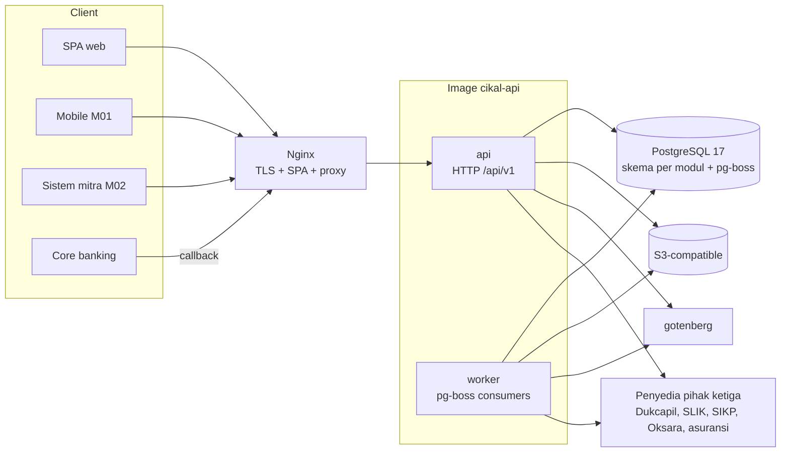
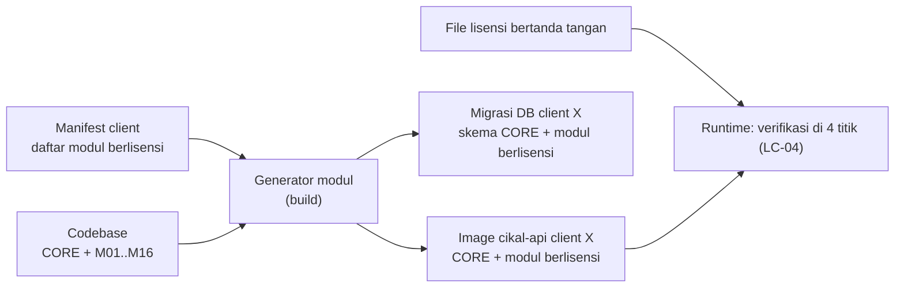
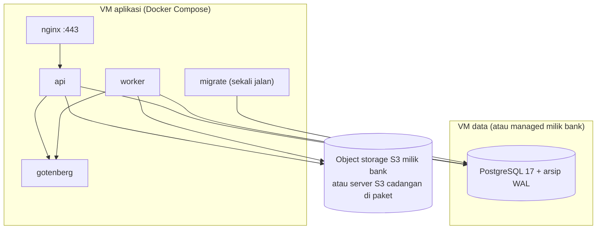

# 2. System Architecture

Cikal berjalan sebagai **satu modular monolith**: satu codebase dan satu image API yang memuat CORE dan modul tambahan berlisensi, satu proses worker dari image yang sama untuk langkah asinkron, PostgreSQL sebagai satu-satunya datastore transaksional, dan object storage S3-compatible untuk file. Batas modul dijaga di kode dan di skema database, bukan di jaringan.

## 2.1 Gambaran

| Lapisan | Komponen | Keterangan |
|---|---|---|
| Klien | SPA web (React), aplikasi mobile M01 (kelak), sistem mitra (M02), core banking (callback) | Semua masuk lewat reverse proxy |
| Edge | Nginx | TLS, file statis SPA, proxy `/api` ke API |
| Aplikasi | `api` (NestJS + Fastify) | HTTP API `/api/v1`, guard autentikasi, tenant, lisensi, hak akses |
| Aplikasi | `worker` (image sama dengan `api`) | Konsumen pg-boss: langkah otomatis, outbox event, job terjadwal |
| Pendukung | `gotenberg` | Konversi .docx ke PDF |
| Data | PostgreSQL 17 | Data per skema modul, antrean pg-boss, sesi |
| Data | Object storage S3-compatible | Dokumen, foto survey, PDF keluaran, template |

## 2.2 Kenapa bentuk ini

| Pertimbangan | Keputusan | Alasan |
|---|---|---|
| Ukuran tim dan beban | Modular monolith, bukan layanan per modul | Tim 1 fullstack + TL; beban 50 user bersamaan dan 10.000 pengajuan per bulan per tenant. Belasan layanan menambah jaringan, kontrak berversi, dan konsistensi terdistribusi tanpa manfaat pada beban ini |
| Default BA TO-02 (modul tambahan sebagai unit deploy terpisah, [Usulan]) | Menyimpang, dicatat sebagai ADR-001 | Tujuan TO-02 (modul tidak dibeli tidak terpasang, LC-05) dicapai dengan perakitan paket saat build (2.4). Tech ref bagian 0 mengizinkan perubahan bagian [Usulan] dengan alasan tertulis |
| Kriteria sukses "satu modul bisa dipahami sendiri" | Batas modul dicek lint dan skema DB | Satu folder per modul, satu antarmuka publik, larangan impor internal modul lain |
| Prinsip AP-05 "sederhana lebih penting dari canggih" | Tanpa workflow engine, broker pesan, Redis, atau search engine | Orchestrator ringan di atas pg-boss; komponen infrastruktur hanya PostgreSQL, S3, Gotenberg |
| Pemisahan kelak | Antarmuka modul sudah berupa kontrak | Modul bisa dikeluarkan menjadi layanan tanpa mengubah pemanggil, cukup mengganti adapter in-process dengan adapter HTTP |

## 2.3 Diagram komponen



## 2.4 Perakitan paket per lisensi



| Aturan | Isi |
|---|---|
| PK-01 | Manifest client berisi kode modul (CORE wajib). Build membangkitkan `licensed-modules.generated.ts` yang meng-import modul NestJS dari manifest saja |
| PK-02 | Kode, skema database, migrasi, menu, dan seed modul yang tidak ada di manifest tidak ikut ke image (LC-05) |
| PK-03 | Manifest divalidasi terhadap aturan ketergantungan DEP-01 s.d. DEP-11 saat build; build gagal bila tidak valid (DEP-10, LC-08) |
| PK-04 | Saat runtime, file lisensi bertanda tangan diperiksa di menu UI, guard API, editor rute, dan orchestrator (LC-04). Modul yang ada di image tetapi tidak di lisensi aktif diperlakukan tidak berlisensi (`SKIPPED - not licensed`) |
| PK-05 | Satu nomor versi rilis untuk semua modul (tech ref 14.3); paket client dibedakan oleh tag manifest, bukan cabang kode |

Rincian lisensi ada di `07-security.md` bagian 7.6.

## 2.5 Siklus request

```mermaid
sequenceDiagram
    participant U as Pengguna (SPA)
    participant N as Nginx
    participant A as api
    participant G as Guard (sesi, tenant, lisensi, hak akses)
    participant M as Modul
    participant DB as PostgreSQL
    participant Q as pg-boss
    participant W as worker
    U->>N: HTTPS /api/v1/applications/{id}/submit
    N->>A: proxy
    A->>G: cek sesi cookie, CSRF, tenant, lisensi modul, hak menu
    G-->>A: konteks request (userId, tenantId, roles, unit kerja)
    A->>DB: BEGIN; SET LOCAL app.tenant_id
    A->>M: application.submit(cmd)
    M->>DB: kunci data, simpan snapshot versi
    M->>DB: tulis outbox ApplicationSubmitted
    M->>Q: enqueue orchestrator.advance (transaksi sama)
    A->>DB: COMMIT
    A-->>U: 200 {loanId, status: ON_PROGRESS}
    Q->>W: orchestrator.advance
    W->>M: StepHandler.execute (DEDUP, DUKCAPIL, ...)
    W->>DB: simpan StepExecution, enqueue langkah berikutnya
```

## 2.6 Deployment



| Container | Jumlah | Catatan |
|---|---|---|
| `nginx` | 1 | TLS dari sertifikat bank; satu-satunya port yang dibuka |
| `api` | 1 (bisa 2 di belakang nginx) | Stateless; sesi di PostgreSQL |
| `worker` | 1 | Konkurensi per antrean diatur env |
| `migrate` | Sekali jalan per instalasi/upgrade | Menjalankan migrasi lalu berhenti; `api` dan `worker` menunggu `migrate` selesai |
| `gotenberg` | 1 | Hanya bisa dijangkau jaringan internal compose |
| `postgres` | Di VM data atau milik bank | Arsip WAL untuk RPO 1 jam |
| `s3` cadangan | Opsional | Hanya bila bank belum punya object storage; lisensi dicek legal |

## 2.7 Peta batas modul

Setiap modul punya satu folder di `apps/api/src/modules/<modul>`, satu skema PostgreSQL, dan satu antarmuka publik (`index.ts`).

| Modul | Folder | Skema DB | Bergantung pada |
|---|---|---|---|
| Identity & Access | `core/identity` | `iam` | Tenant & License, Organization, Audit |
| Tenant & License | `core/tenancy` | `tenancy` | (dasar) |
| Organization | `core/organization` | `org` | Tenant & License |
| Master Data | `core/masterdata` | `masterdata` | Change Request, Integration Registry |
| Product & Route | `core/product` | `product` | Change Request, Master Data |
| Change Request | `core/change-request` | `cr` | Audit |
| Audit | `core/audit` | `audit` | (dasar) |
| Notification | `core/notification` | `notification` | Document |
| Document | `core/document` | `document` | Calculation (placeholder rumus) |
| Application | `core/application` | `application` | Product & Route, Master Data, Organization, Document |
| Orchestrator | `core/orchestrator` | `orchestrator` | Product & Route, Task Queue, Integration Registry |
| Task Queue | `core/task-queue` | `taskqueue` | Identity & Access |
| Verification | `core/verification` | `verification` | Application, Task Queue |
| Approval | `core/approval` | `approval` | Application, Calculation, Document |
| Integration Registry | `core/integration` | `integration` | Change Request |
| Calculation | `core/calculation` | `calculation` | Master Data, Product & Route |
| Reporting | `core/reporting` | `reporting` (view saja) | Baca view dari skema lain |
| M01 s.d. M16 | `addons/m06-dedup`, dan seterusnya | `m06_dedup`, dan seterusnya | CORE saja (kecuali DEP-02, DEP-04, DEP-08) |

## 2.8 Aturan lintas modul

| ID | Aturan | Penegakan |
|---|---|---|
| XM-01 | Modul hanya memanggil modul lain lewat antarmuka publik (`modules/<x>/index.ts`) | Lint `noRestrictedImports` Biome dan pengecek dependensi di CI |
| XM-02 | Modul tidak membaca atau menulis tabel skema modul lain | Role database per skema tidak dipakai di runtime; dicek review dan uji arsitektur (query ke skema lain gagal di test) |
| XM-03 | Langkah proses dipanggil orchestrator lewat antarmuka `StepHandler` (`12-orchestrator-step-contract.md`) | Registrasi wajib per modul langkah |
| XM-04 | Efek samping lintas modul (notifikasi, reporting) lewat event outbox, bukan panggilan langsung. Pengecualian: jejak audit ditulis lewat `audit.record` di transaksi aksi (05 §5.7), karena harus commit bersama aksinya | Event ditulis di transaksi yang sama, dikirim worker |
| XM-05 | Foreign key: dari modul mana pun ke tabel CORE boleh; dari CORE ke modul tambahan dilarang; antar modul tambahan dilarang | Dicek di review migrasi |
| XM-06 | Modul tambahan tidak bergantung pada modul tambahan lain kecuali DEP-02 (M06 s.d. M10 ke M11 lewat hasil langkah), DEP-04, DEP-08 | Dicek generator paket (PK-03) |
| XM-07 | Reporting membaca lewat view di skema `reporting`; view didefinisikan di migrasi Reporting dan hanya `SELECT` | View tidak pernah dipakai modul lain |
