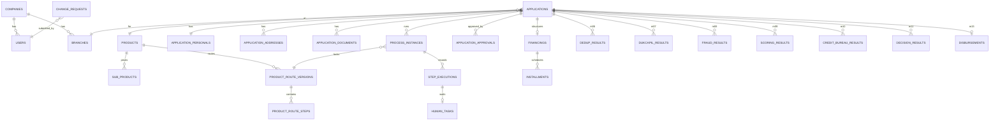
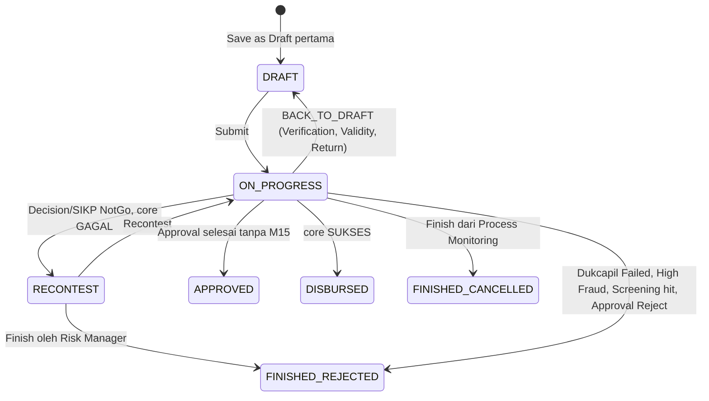
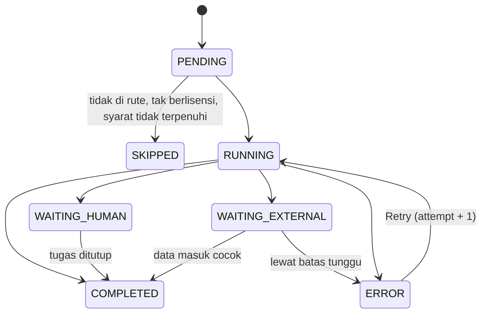

# 6. Data Model

Model fisik PostgreSQL 17, diturunkan dari `Docs/ba/data-dictionary.md`. Nama entity dan atribut data dictionary (`camelCase`) menjadi tabel dan kolom `snake_case`. Tabel ditulis penuh untuk CORE dan modul POC (M06, M07, M08, M09, M10, M11, M15); modul lain berupa daftar tabel di 6.11 dan dirinci saat dijadwalkan.

## 6.1 Konvensi

| ID | Konvensi |
|---|---|
| DM-01 | Satu skema PostgreSQL per modul (`02-system-architecture.md` 2.7). Nama tabel jamak, `snake_case` |
| DM-02 | Primary key `id uuid` berisi UUID v7, dibangkitkan aplikasi |
| DM-03 | Kolom standar setiap tabel bisnis: `tenant_id uuid not null` (FK `tenancy.companies.id`), `created_at timestamptz not null default now()`, `created_by uuid null`, `updated_at timestamptz not null default now()`, `updated_by uuid null`. Tidak diulang di tabel di bawah |
| DM-04 | Tabel bertanda **[instalasi]** tidak punya `tenant_id` dan tidak memakai RLS (data bawaan aplikasi atau berlaku untuk semua company) |
| DM-05 | Data master punya `is_active boolean not null default true`; tidak dihapus permanen |
| DM-06 | Uang `numeric(18,2)` dalam rupiah; persen `numeric(9,4)`; skor `numeric(5,4)` (0 s.d. 1); waktu `timestamptz` dalam UTC; tanggal bisnis `date` |
| DM-07 | Pilihan tetap disimpan `text` dengan `CHECK` terhadap daftar nilai; pilihan dari General Parameter disimpan `text` berisi `param_id` |
| DM-08 | Field sensitif disimpan terenkripsi di kolom `*_enc bytea` (AES-256-GCM). NIK juga punya `*_bidx bytea` (HMAC-SHA256) untuk pencarian exact |
| DM-09 | Row-Level Security aktif di setiap tabel ber-`tenant_id`: `USING (tenant_id = current_setting('app.tenant_id')::uuid)` untuk `SELECT`, `INSERT`, `UPDATE`, `DELETE`. Role aplikasi tidak punya `BYPASSRLS` |
| DM-10 | Foreign key mengikuti XM-05: modul ke CORE boleh; CORE ke modul tambahan dan antar modul tambahan tidak boleh |
| DM-11 | Kolom `version_number int` + `status` untuk data berversi (rute, rumus, parameter, integrasi, model scoring); hanya satu baris `ACTIVE` per kunci, dijaga indeks unik parsial `WHERE status = 'ACTIVE'` |

## 6.2 ERD (ringkas, antar modul)



## 6.3 Platform (`platform`)

### OUTBOX_EVENTS
| column | type | nullable | default | key | notes |
|---|---|---|---|---|---|
| id | uuid | no | | PK | |
| event_type | text | no | | | `ApplicationSubmitted` |
| aggregate_id | uuid | no | | | id pengajuan atau data master |
| payload | jsonb | no | | | tanpa field sensitif |
| published_at | timestamptz | yes | | | null = belum dikirim |
| attempts | int | no | 0 | | |

### TENANT_KEYS
| column | type | nullable | default | key | notes |
|---|---|---|---|---|---|
| id | uuid | no | | PK | |
| key_purpose | text | no | | | `ENCRYPTION`, `BLIND_INDEX` |
| wrapped_key | bytea | no | | | data key dibungkus kunci utama dari file secret |
| key_version | int | no | 1 | UQ(tenant_id, key_purpose, key_version) | rotasi |
| status | text | no | 'ACTIVE' | | `ACTIVE`, `RETIRED` |

### SECRETS
| column | type | nullable | default | key | notes |
|---|---|---|---|---|---|
| id | uuid | no | | PK | dirujuk `secret_ref` di tabel lain |
| purpose | text | no | | | `INTEGRATION_CREDENTIAL`, `SYSTEM_PARAMETER` |
| ciphertext | bytea | no | | | AES-256-GCM |
| key_version | int | no | | | |

## 6.4 Identity & Access (`iam`)

### USERS (UI label: "User Application")
| column | type | nullable | default | key | notes |
|---|---|---|---|---|---|
| id | uuid | no | | PK | |
| username | text | no | | UQ (instalasi) | 3 s.d. 50; `sales.jkt01` |
| full_name | text | no | | | maks 100 |
| email | text | no | | UQ(tenant_id, email) | `sari@contoh.co.id` |
| phone_number | text | yes | | | `08` + 8 s.d. 11 digit |
| auth_type | text | no | 'LOCAL' | | `LOCAL`, `SSO` |
| password_hash | text | yes | | | Argon2id; wajib bila LOCAL |
| must_change_password | boolean | no | true | | AC-05.03 |
| role_id | uuid | yes | | FK roles | kosong untuk SSO baru |
| regional_id, branch_id, sub_branch_id | uuid | yes | | FK org | branch wajib kecuali Super User |
| status | text | no | 'ACTIVE' | | `NO_ROLE`, `ACTIVE`, `INACTIVE`, `LOCKED` |
| failed_login_count | int | no | 0 | | reset saat login berhasil (AC-01.06) |
| locked_until | timestamptz | yes | | | AC-01.05 |
| sso_subject | text | yes | | UQ(tenant_id, sso_subject) | klaim `sub` OIDC |
| last_login_at | timestamptz | yes | | | |

### ROLES
| column | type | nullable | default | key | notes |
|---|---|---|---|---|---|
| id | uuid | no | | PK | |
| role_name | text | no | | UQ(tenant_id, lower(role_name)) | `Credit Analyst`; 3 s.d. 50 |
| is_active | boolean | no | true | | tidak bisa false bila dipakai user aktif (AC-08.04) |

### MENUS [instalasi]
| column | type | nullable | default | key | notes |
|---|---|---|---|---|---|
| id | uuid | no | | PK | |
| menu_code | text | no | | UQ | `MON-03` |
| menu_name | text | no | | | maks 50 |
| menu_index | int | no | | | >= 1 |
| parent_menu_id | uuid | yes | | FK menus | |
| link | text | yes | | | rute SPA |
| icon_name | text | yes | | | nama ikon Lucide |
| module_code | text | no | | | `CORE`, `M06`; menu modul tak berlisensi disembunyikan |
| is_active | boolean | no | true | | |

### ROLE_ACCESS, USER_ACCESS
| column | type | nullable | default | key | notes |
|---|---|---|---|---|---|
| id | uuid | no | | PK | |
| role_id / user_id | uuid | no | | FK | UQ(role_id, menu_id) / UQ(user_id, menu_id, valid_from) |
| menu_id | uuid | no | | FK menus | |
| can_view, can_create, can_update, can_delete, can_approve | boolean | no | false | | `CHECK (can_view OR NOT (can_create OR can_update OR can_delete OR can_approve))` (AC-09.03) |
| valid_from, valid_to | date | no (USER_ACCESS) | | | `valid_to >= valid_from`, inklusif (AC-10.02 s.d. AC-10.04) |

### SESSIONS
| column | type | nullable | default | key | notes |
|---|---|---|---|---|---|
| id | uuid | no | | PK | |
| user_id | uuid | no | | FK users | |
| token_hash | bytea | no | | UQ | SHA-256 dari nilai cookie |
| channel | text | no | | | `WEB`, `MOBILE` |
| csrf_token_hash | bytea | yes | | | WEB |
| last_activity_at | timestamptz | no | now() | | idle > `SESSION_IDLE_MINUTES` = kedaluwarsa |
| expires_at | timestamptz | no | | | batas absolut 12 jam |
| ip_address | inet | yes | | | |

### LOGIN_ATTEMPTS, PASSWORD_RESET_TOKENS
| table.column | type | nullable | notes |
|---|---|---|---|
| login_attempts.username | text | no | |
| login_attempts.success | boolean | no | |
| login_attempts.ip_address | inet | no | |
| login_attempts.attempted_at | timestamptz | no | |
| password_reset_tokens.user_id | uuid | no | FK users |
| password_reset_tokens.token_hash | bytea | no | UQ |
| password_reset_tokens.expires_at | timestamptz | no | dibuat + `RESET_LINK_MINUTES` |
| password_reset_tokens.used_at | timestamptz | yes | sekali pakai (AC-04.01) |

## 6.5 Tenant & License (`tenancy`), Organization (`org`)

### COMPANIES (UI label: "Company")
Tabel tenant itu sendiri: `id` adalah `tenant_id` bagi tabel lain; RLS memakai `id`.

| column | type | nullable | default | key | notes |
|---|---|---|---|---|---|
| id | uuid | no | | PK | |
| company_code | text | no | | UQ | `001`; 3 digit (AC-15.04) |
| company_name | text | no | | | maks 100 |
| platform_code | text | no | '01' | | `01` Conventional, `02` Syariah |
| address | text | no | | | maks 500 |
| sso_config | jsonb | yes | | | issuer, clientId, `secret_ref` |
| api_signing_key_ref | uuid | yes | | FK platform.secrets | M02 |

### LICENSES, MODULE_ENTITLEMENTS
| table.column | type | nullable | notes |
|---|---|---|---|
| licenses.license_number | text | no | UQ |
| licenses.deployment_type | text | no | `SAAS`, `ON_PREMISE` |
| licenses.valid_from, valid_to | date | no | |
| licenses.max_users | int | yes | disimpan, tidak ditegakkan (TO-04) |
| licenses.signature | bytea | no | Ed25519 atas isi kanonik lisensi |
| licenses.raw_document | jsonb | no | isi file lisensi asli |
| licenses.status | text | no | `ACTIVE`, `EXPIRED`, `REVOKED` |
| module_entitlements.license_id | uuid | no | FK licenses |
| module_entitlements.module_code | text | no | `CORE`, `M01` s.d. `M16`; UQ(license_id, module_code) |

### REGIONALS, BRANCHES, SUB_BRANCHES
| table.column | type | nullable | notes |
|---|---|---|---|
| regionals.regional_code | text | no | 2 s.d. 3 digit; UQ(tenant_id, regional_code) |
| regionals.regional_name | text | no | |
| branches.regional_id | uuid | no | FK regionals |
| branches.branch_code | text | no | `011`; UQ(regional_id, branch_code) (AC-17.04) |
| branches.branch_name | text | no | `Bandung` |
| sub_branches.branch_id | uuid | no | FK branches |
| sub_branches.sub_branch_code | text | no | UQ(branch_id, sub_branch_code) |
| sub_branches.sub_branch_name | text | no | |
| (ketiganya).is_active | boolean | no | |

### CURRENCIES, CURRENCY_RATES
| table.column | type | nullable | notes |
|---|---|---|---|
| currencies.currency_code | text | no | ISO 4217 numerik `360`; UQ(tenant_id, currency_code) |
| currencies.currency_name | text | no | `IDR` |
| currencies.description | text | no | dari tabel ISO |
| currency_rates.currency_id | uuid | no | FK currencies |
| currency_rates.rupiah_equivalent | numeric(18,6) | no | > 0 |
| currency_rates.rate_timestamp | timestamptz | no | |

## 6.6 Master Data (`masterdata`)

### GENERAL_PARAMETERS (UI label: "General Parameter")
| column | type | nullable | default | key | notes |
|---|---|---|---|---|---|
| id | uuid | no | | PK | |
| param_type | text | no | | | `Occupation` |
| param_id | text | no | | UQ(tenant_id, param_type, param_id) | `099` |
| param_value | text | no | | UQ(tenant_id, param_type, lower(param_value)) | `Pengemudi Daring`; maks 100 |
| bi_code | text | yes | | | kode pelaporan regulator |
| is_active | boolean | no | true | | |

### PROVINCES, CITIES, DISTRICTS, SUB_DISTRICTS, ZIP_CODES [instalasi]
Data wilayah Oksara berlaku untuk semua company (`REGION_API_KEY` bercakupan INSTALLATION). Kolom: `<level>_code text UQ`, `<level>_name text`, FK ke induk, `last_sync_at timestamptz`. Indeks `pg_trgm` pada nama untuk AC-23.03.

### INSURANCES, INSURANCE_RATES
| table.column | type | nullable | notes |
|---|---|---|---|
| insurances.insurance_code | text | no | `ASR01`; UQ(tenant_id, insurance_code) |
| insurances.insurance_name | text | no | |
| insurances.provider_code | text | yes | adapter E-Polis; kosong = polis di luar Cikal |
| insurance_rates.insurance_id | uuid | no | FK insurances |
| insurance_rates.product_id | uuid | yes | FK product.products |
| insurance_rates.age | int | no | |
| insurance_rates.tenor_year | int | no | 1 s.d. 15; UQ(insurance_id, product_id, age, tenor_year) |
| insurance_rates.premium_rate | numeric(9,4) | no | 0 s.d. 100; `0.8500` |

### SYSTEM_PARAMETER_DEFINITIONS [instalasi], SYSTEM_PARAMETER_VALUES
| table.column | type | nullable | notes |
|---|---|---|---|
| definitions.param_key | text | no | UQ; `SIKP_MIN_LIMIT` |
| definitions.label, description | text | no | |
| definitions.module_code | text | no | |
| definitions.category | text | no | `BUSINESS`, `SECURITY`, `INTEGRATION`, `DISPLAY` |
| definitions.value_type | text | no | `NUMBER`, `MONEY`, `PERCENT`, `TEXT`, `BOOLEAN`, `CHOICE`, `MULTI_CHOICE`, `SECRET` |
| definitions.allowed_values | jsonb | yes | |
| definitions.min_value, max_value | numeric | yes | |
| definitions.default_value | text | yes | |
| definitions.scope | text | no | `INSTALLATION`, `TENANT`, `PRODUCT` |
| definitions.lock_on_submit | boolean | no | PR-06 |
| values.definition_id | uuid | no | FK definitions |
| values.product_id | uuid | yes | FK product.products |
| values.value | text | yes | null bila SECRET |
| values.secret_ref | uuid | yes | FK platform.secrets |
| values.version_number | int | no | |
| values.status | text | no | `WAITING_APPROVAL`, `ACTIVE`, `SUPERSEDED`; UQ parsial ACTIVE per (tenant_id, definition_id, product_id) |
| values.effective_from | timestamptz | no | |
| values.change_request_id | uuid | no | FK cr.change_requests |

## 6.7 Product & Route (`product`)

### PRODUCTS (UI label: "Master Product")
| column | type | nullable | default | key | notes |
|---|---|---|---|---|---|
| id | uuid | no | | PK | |
| product_code | text | no | | UQ(tenant_id, upper(product_code)) | `KTA`; 1 s.d. 5 huruf/angka |
| product_name | text | no | | | `Kredit Tanpa Agunan` |
| product_category | text | no | | | `COLLATERAL`, `NON_COLLATERAL`, `PENSION`, `SYARIAH` |
| interest_type | text | no | | | `FLAT`, `EFFECTIVE`, `FLOATING`, `HYBRID`, `CAPPED` |
| contract_type | text | yes | | | Syariah saja |
| min_plafond, max_plafond | numeric(18,2) | no | | | `CHECK (max_plafond > min_plafond)` (AC-20.02) |
| min_tenor, max_tenor | int | no | | | bulan |
| min_age, max_age | int | no | | | tahun |
| max_age_at_maturity_month | int | yes | | | RM-02 |
| dbr_max, dsr | numeric(9,4) | no / yes | | | |
| multiple_salary_dbr | numeric(9,4) | yes | | | |
| admin_fee | numeric(18,2) | no | 0 | | |
| provision_fee | numeric(9,4) | no | 0 | | persen |
| sales_fee | numeric(18,2) | yes | | | |
| limit_auto_approval | numeric(18,2) | no | 0 | | `CHECK (limit_auto_approval <= max_plafond)`; 0 = nonaktif |
| scoring_approval, is_paylater | boolean | yes | | | disimpan tanpa perilaku (DD-03) |
| valid_from, valid_to | date | no / yes | | | |
| is_active | boolean | no | true | | |

### SUB_PRODUCTS
| column | type | nullable | notes |
|---|---|---|---|
| product_id | uuid | no | FK products |
| interest_rate | numeric(9,4) | no | > 0; `12.0000` |
| floating_rate, cap_rate | numeric(9,4) | yes | Floating, Hybrid, Capped |
| tenor_fixed | int | yes | Hybrid |
| approver_rate_min, approver_rate_max | numeric(9,4) | yes | rentang yang boleh diubah Approver (grooming v2 R-19) |
| valid_from, valid_to | date | no / yes | tidak tumpang tindih per produk (constraint exclusion `daterange`) |

### PRODUCT_ROUTES, PRODUCT_ROUTE_VERSIONS, PRODUCT_ROUTE_STEPS
| table.column | type | nullable | notes |
|---|---|---|---|
| product_routes.product_id | uuid | no | UQ |
| product_route_versions.route_id | uuid | no | FK product_routes |
| product_route_versions.version_number | int | no | UQ(route_id, version_number) |
| product_route_versions.status | text | no | `DRAFT`, `WAITING_APPROVAL`, `ACTIVE`, `SUPERSEDED` |
| product_route_versions.effective_from | timestamptz | yes | wajib bila ACTIVE |
| product_route_steps.version_id | uuid | no | FK versions |
| product_route_steps.step_code | text | no | kode tech ref 6.3; UQ(version_id, step_code) |
| product_route_steps.is_enabled | boolean | no | langkah wajib selalu true |

### DOCUMENT_CHECKLISTS, DOCUMENT_CHECKLIST_ITEMS
| table.column | type | nullable | notes |
|---|---|---|---|
| document_checklists.product_id | uuid | no | FK products |
| document_checklists.occupation, marital | text | no | `param_id`; UQ(tenant_id, product_id, occupation, marital) (AC-25.03) |
| document_checklist_items.checklist_id | uuid | no | FK checklists |
| document_checklist_items.document_type | text | no | `param_id` ParamType Document |
| document_checklist_items.is_mandatory | boolean | no | default true |

## 6.8 Change Request (`cr`), Audit (`audit`), Notification (`notification`), Document (`document`)

### CHANGE_REQUESTS
| column | type | nullable | default | key | notes |
|---|---|---|---|---|---|
| id | uuid | no | | PK | |
| entity_type | text | no | | | `PRODUCT`, `ROUTE`, `FORMULA`, ... (CM-07) |
| entity_id | uuid | yes | | | kosong untuk data baru |
| action | text | no | | | `CREATE`, `UPDATE` |
| old_data, new_data | jsonb | yes / no | | | |
| package_size | int | no | 1 | | jumlah baris untuk paket impor |
| status | text | no | 'WAITING_APPROVAL' | | `WAITING_APPROVAL`, `REVISE`, `APPROVED`, `REJECTED` |
| revise_reason | text | yes | | | maks 500 |
| submitted_by | uuid | no | | FK iam.users | |
| reviewed_by | uuid | yes | | FK iam.users | `CHECK (reviewed_by <> submitted_by)` |
| reviewed_at | timestamptz | yes | | | |

Indeks unik parsial `(tenant_id, entity_type, entity_id) WHERE status IN ('WAITING_APPROVAL','REVISE')` (AC-12.06).

### AUDIT_LOGS
| column | type | nullable | notes |
|---|---|---|---|
| user_id | uuid | yes | null untuk aksi sistem |
| role | text | yes | |
| module | text | no | |
| action | text | no | `CREATE` s.d. `LOGIN_FAILED`, `VIEW_APPLICATION` (grooming v2 R-18) |
| record_id | text | yes | |
| description | text | yes | |
| old_data, new_data | jsonb | yes | tanpa nilai SECRET |
| ip_address | inet | yes | |
| occurred_at | timestamptz | no | indeks (tenant_id, module, occurred_at) |

Role aplikasi hanya punya `INSERT` dan `SELECT` pada tabel ini (AD-03). Retensi 5 tahun.

### EMAIL_TEMPLATES, NOTIFICATION_LOGS
| table.column | type | nullable | notes |
|---|---|---|---|
| email_templates.template_code | text | no | `APP_RECEIVED`, `APP_REJECTED`, `APP_DISBURSED`, `RESET_PASSWORD`, `ADMIN_INVITE` |
| email_templates.subject, body | text | no | berbahasa Indonesia untuk nasabah |
| notification_logs.application_id | uuid | yes | FK application.applications |
| notification_logs.template_code, recipient | text | no | |
| notification_logs.status | text | no | `SENT`, `FAILED`, `SKIPPED` |
| notification_logs.sent_at, error_message | timestamptz, text | yes | |

### DOCUMENT_FILES, DOCUMENT_TEMPLATES, GENERATED_DOCUMENTS
| table.column | type | nullable | notes |
|---|---|---|---|
| document_files.file_name, original_extension | text | no | |
| document_files.stored_format | text | no | `PDF` |
| document_files.size_bytes | bigint | no | |
| document_files.storage_key | text | no | kunci objek S3 |
| document_templates.document_code | text | no | `AKAD-KPR`; UQ(tenant_id, document_code, product_id) |
| document_templates.product_id | uuid | yes | kosong = semua produk |
| document_templates.file_id | uuid | no | FK document_files; maks 5 MB |
| document_templates.placeholders | jsonb | no | hasil deteksi |
| generated_documents.application_id | uuid | no | FK application.applications |
| generated_documents.document_code, document_number | text | no / yes | `0013/SP3K/011/X/2026` |
| generated_documents.file_id | uuid | no | FK document_files |
| generated_documents.is_reprint | boolean | no | |

### DOCUMENT_NUMBER_FORMATS, DOCUMENT_NUMBER_COUNTERS (grooming v3, US-102)
| table.column | type | nullable | notes |
|---|---|---|---|
| formats.document_type | text | no | `SP3K`, `CONTRACT` |
| formats.pattern | text | no | `{SEQ:4}/SP3K/{BRANCH_CODE}/{MM_ROMAN}/{YYYY}` |
| formats.reset_period | text | no | `NONE`, `YEARLY`, `MONTHLY`, `DAILY` |
| formats.counter_scope | text | no | `COMPANY`, `BRANCH`, `PRODUCT`, `BRANCH_PRODUCT` |
| formats.version_number, status, effective_from | | no | berversi, UQ parsial ACTIVE per (tenant_id, document_type) |
| counters.format_id | uuid | no | FK formats |
| counters.scope_key | text | no | `011` |
| counters.period_key | text | no | `202610`; UQ(format_id, scope_key, period_key) |
| counters.last_number | bigint | no | dinaikkan dengan `UPDATE ... SET last_number = last_number + 1 RETURNING` |

## 6.9 Application (`application`)

### APPLICATIONS
| column | type | nullable | default | key | notes |
|---|---|---|---|---|---|
| id | uuid | no | | PK | |
| loan_id | text | no | | UQ(tenant_id, loan_id) | `20102026KTA0000013` |
| channel | text | no | | | `WEB`, `MOBILE`, `API`, `UPLOAD` |
| application_type, customer_type, segment, purpose_of_loan | text | yes | | | `param_id` |
| product_category | text | no | | | dari produk |
| product_id | uuid | no | | FK product.products | |
| branch_id | uuid | no | | FK org.branches | |
| tenor_proposed, tenor_approved | int | yes | | | |
| requested_limit, max_loan_amount, loan_amount | numeric(18,2) | yes | | | |
| insurance_id | uuid | yes | | FK masterdata.insurances | |
| source_code, sales_code, referral_code, marketing_code | text | yes | | | |
| cif_number | text | yes | | | |
| partner_reference | text | yes | | UQ(tenant_id, partner_reference) | M02 |
| consent_at | timestamptz | yes | | | IN-12 |
| consent_channel | text | yes | | | `WEB`, `MOBILE`, `API` |
| status | text | no | 'DRAFT' | | lihat 6.13 |
| current_step | text | yes | | | |
| return_note | text | yes | | | |
| submitted_by | uuid | yes | | FK iam.users | |
| submitted_at | timestamptz | yes | | | |

Indeks `pg_trgm` pada `loan_id` dan nama (lewat `application_personals.full_name`) untuk inquiry.

### APPLICATION_PERSONALS
| column | type | nullable | notes |
|---|---|---|---|
| application_id | uuid | no | PK/FK applications |
| full_name, full_name_id | text | no | maks 100 |
| place_of_birth | text | yes (draft) | |
| date_of_birth | date | yes (draft) | |
| gender, religion, nationality, education, marital | text | yes (draft) | `param_id` |
| mother_maiden_name_enc | bytea | yes | terenkripsi |
| id_type | text | no | `KTP` |
| id_card_number_enc | bytea | no | terenkripsi |
| id_card_number_bidx | bytea | no | blind index; indeks untuk Dedup dan pencarian |
| id_issued_date | date | yes | |
| id_expired_date | text | yes | `SEUMUR HIDUP` atau tanggal |
| npwp_number_enc, kk_number_enc | bytea | yes | |
| mobile_number, phone_number, email | text | yes | |
| bpjs_number, jkn_number | text | yes | |
| residence_status, residence_duration, correspondence_duration | text | yes | |
| home_number, beneficiary_owner_full_name, taspen_number | text | yes | |
| ocr_fields | jsonb | yes | |

### APPLICATION_ADDRESSES, APPLICATION_OCCUPATIONS, APPLICATION_EMERGENCY_CONTACTS, APPLICATION_DOCUMENTS
| table.column | type | nullable | notes |
|---|---|---|---|
| addresses.address_type | text | no | `ID`, `RESIDENCE`, `CORRESPONDENCE`; UQ(application_id, address_type) |
| addresses.address, rt, rw | text | no / yes | |
| addresses.province_code, city_code, district_code, sub_district_code, zip_code | text | yes | kode wilayah |
| addresses.same_as_id | boolean | no | |
| occupations.source_of_income, occupation, industry_of_profession, position, pension_instance | text | yes | |
| occupations.tenure_at_current_job | numeric(5,1) | yes | |
| occupations.monthly_income_allowance | numeric(18,2) | yes | > 0 kecuali Pension |
| occupations.organization, previous_employer | text | yes | |
| occupations.company_* | text | yes | nama, alamat, wilayah, telepon perusahaan |
| emergency_contacts.contact_name, relation_to_applicant | text | yes (draft) | |
| emergency_contacts.mobile_number | text | yes (draft) | `08`, 10 s.d. 13 digit, beda dari pemohon |
| emergency_contacts.home_phone_number, alt_phone_number, address, wilayah | text | yes | |
| documents.document_type | text | no | dari checklist |
| documents.file_id | uuid | yes | FK document.document_files |
| documents.verification_status | text | no | `PENDING`, `MATCH`, `NOT_MATCH` |
| documents.verification_remarks | text | yes | |

Tabel `application_spouses`, `application_businesses`, `application_collaterals` mengikuti data dictionary dengan konvensi yang sama; field sensitif (`id_number` pasangan, nomor sertifikat) terenkripsi.

### LOAN_ID_COUNTERS
| column | type | nullable | notes |
|---|---|---|---|
| product_code | text | no | UQ(tenant_id, product_code) |
| last_number | bigint | no | maks 9.999.999 (TRM_LID_005) |

## 6.10 Orchestrator (`orchestrator`), Task Queue (`taskqueue`), Verification, Approval, Integration, Calculation

### PROCESS_INSTANCES
| column | type | nullable | notes |
|---|---|---|---|
| application_id | uuid | no | FK application.applications |
| recontest_number | int | no | 0 untuk proses awal |
| route_version_id | uuid | no | FK product.product_route_versions |
| formula_versions | jsonb | no | kode rumus ke id versi yang dikunci (FM-05) |
| parameter_snapshot | jsonb | no | PR-06 |
| status | text | no | `RUNNING`, `WAITING`, `COMPLETED`, `CANCELLED` |
| recontest_reason | text | yes | |
| started_at, ended_at | timestamptz | no / yes | |

### STEP_EXECUTIONS
| column | type | nullable | notes |
|---|---|---|---|
| process_instance_id | uuid | no | FK process_instances |
| step_code | text | no | UQ(process_instance_id, step_code, attempt) |
| status | text | no | lihat 6.13 |
| outcome_code | text | yes | `MATCH`, `GO` |
| result_type | text | yes | tujuh hasil kontrak |
| external_reference | text | yes | indeks; IN-08 |
| wait_deadline | timestamptz | yes | |
| error_category | text | yes | IN-07, FM-09 |
| error_message | text | yes | |
| reused_from_step_execution_id | uuid | yes | IN-10 |
| skip_reason | text | yes | `NOT_IN_ROUTE`, `NOT_LICENSED`, `CONDITION_NOT_MET`, `DEDUP_MATCH` |
| attempt | int | no | |
| actor_user_id | uuid | yes | |
| started_at, ended_at | timestamptz | yes | |
| aging | numeric(10,2) | yes | satuan `AGING_UNIT` |
| summary | text | yes | |

### HUMAN_TASKS
| column | type | nullable | notes |
|---|---|---|---|
| step_execution_id | uuid | no | FK orchestrator.step_executions |
| queue_code | text | no | katalog antrean data dictionary |
| branch_id | uuid | no | FK org.branches |
| eligible_role_id | uuid | yes | FK iam.roles; null bila ditugaskan per user |
| assigned_user_id | uuid | yes | FK iam.users |
| assigned_at | timestamptz | yes | |
| status | text | no | `OPEN`, `ASSIGNED`, `CLOSED` |
| closed_at, closed_by, result_code | | yes | |
| version | int | no | penguncian optimistis untuk Assign to Me (AC-58.04) |

### DOCUMENT_VERIFICATIONS (`verification`)
Kolom: `application_id`, `process_instance_id`, `verifier_user_id`, `result` (`IN_PROGRESS`, `ALL_MATCH`, `HAS_NOT_MATCH`), `submitted_at`.

### APPROVAL_LEVELS, APPROVAL_HIERARCHIES, APPLICATION_APPROVALS (`approval`)
| table.column | type | nullable | notes |
|---|---|---|---|
| levels.branch_id, product_id | uuid | no | FK |
| levels.job_level | int | no | 1 = tertinggi; UQ(branch_id, product_id, job_level) |
| levels.description | text | no | `Kepala Cabang` |
| levels.amount_begin, amount_end | numeric(18,2) | no | `CHECK (amount_end > amount_begin)`; tidak tumpang tindih (exclusion constraint `numrange`) |
| levels.is_approve, is_reject, is_return, is_cancel, is_final_approver | boolean | no | |
| hierarchies.branch_id, product_id, job_level, sub_level | | no | |
| hierarchies.up_level, up_sub_level | int | yes | RM-06 |
| hierarchies.approver_user_id | uuid | no | FK iam.users |
| approvals.application_id, process_instance_id | uuid | no | |
| approvals.job_level, sub_level, description | | no | |
| approvals.approver_user_id | uuid | yes | null untuk auto approval |
| approvals.decision | text | no | `PENDING`, `APPROVE`, `REJECT`, `RETURN`, `AUTO_APPROVED` |
| approvals.comment | text | yes | maks 1.000 |
| approvals.decided_at | timestamptz | yes | |

### FINANCINGS, INSTALLMENTS (`approval`)
| table.column | type | nullable | notes |
|---|---|---|---|
| financings.application_id | uuid | no | UQ |
| financings.loan_amount | numeric(18,2) | no | |
| financings.tenor | int | no | |
| financings.interest_type | text | no | |
| financings.interest_rate, floating_rate, cap_rate | numeric(9,4) | no / yes | |
| financings.tenor_fixed | int | yes | |
| financings.admin_fee, sales_fee, provision_fee, insurance_value, net_disbursement, monthly_installment | numeric(18,2) | no / yes | rumus RM-07 |
| financings.dbr_ratio, dsr_ratio | numeric(9,4) | no | RM-08 |
| financings.formula_versions | jsonb | no | |
| financings.first_installment_date | date | no | |
| installments.financing_id | uuid | no | FK financings |
| installments.installment_no | int | no | UQ(financing_id, installment_no) |
| installments.due_date | date | no | |
| installments.principal_amount, interest_amount, outstanding_amount | numeric(18,2) | no | baris terakhir outstanding 0 |

### INTEGRATION_PROVIDERS [instalasi], INTEGRATION_CONFIGS, INTEGRATION_CALL_LOGS (`integration`)
Kolom mengikuti data dictionary bagian Integration Registry. `secret_ref uuid` FK `platform.secrets`. `integration_configs` berversi (DM-11) dengan UQ parsial ACTIVE per (tenant_id, module_code) kecuali M14. `integration_call_logs` dipartisi per bulan (`occurred_at`) untuk retensi 1 tahun.

### FORMULA_DEFINITIONS [instalasi], FORMULA_VARIABLES [instalasi], FORMULA_VERSIONS, FORMULA_TEST_CASES, FORMULA_EXECUTION_LOGS, HOLIDAY_CALENDARS (`calculation`)
Kolom mengikuti data dictionary bagian Calculation. `formula_versions` berversi (DM-11) dengan UQ parsial ACTIVE per (tenant_id, formula_id, product_id). `formula_execution_logs` dipartisi per bulan. `holiday_calendars.holiday_date` UQ(tenant_id, holiday_date).

## 6.11 Modul tambahan

### M06 Dedup (`m06_dedup`)
| table.column | type | nullable | notes |
|---|---|---|---|
| dedup_matrix.nik, dob, pob | text | no | `MATCH`, `UNMATCH`, `ANY` |
| dedup_matrix.full_name_id, mother_maiden_name | text | no | `MATCH`, `UNMATCH`, `FUZZY`, `ANY` |
| dedup_matrix.dedup_outcome | text | no | `MATCH`, `UNMATCH`, `REVIEW`, `SKIP` |
| dedup_matrix.priority | int | no | baris pertama yang cocok dipakai |
| dedup_field_settings.field_code | text | no | `FULL_NAME_ID`, `MOTHER_MAIDEN_NAME` |
| dedup_field_settings.algorithm | text | no | `LEVENSHTEIN_RATIO`, `JARO_WINKLER`, `TOKEN_SET_RATIO` |
| dedup_field_settings.fuzzy_threshold | int | no | 50 s.d. 100, default 80 |
| dedup_results.application_id, process_instance_id | uuid | no | FK CORE |
| dedup_results.outcome | text | no | termasuk `DUPLICATE_IN_FLIGHT` (grooming v1 N-06) |
| dedup_results.matched_application_id | uuid | yes | FK application.applications |
| dedup_results.ran_at | timestamptz | no | |
| dedup_candidates.dedup_result_id, candidate_application_id | uuid | no | |
| dedup_candidates.nik_result, dob_result, pob_result | text | no | |
| dedup_candidates.name_score, mother_name_score | numeric(5,4) | no | |
| dedup_reviews.dedup_result_id, reviewer_user_id | uuid | no | |
| dedup_reviews.final_outcome | text | no | `MATCH`, `UNMATCH`, `DUPLICATE_FINISH` |

### M07 Dukcapil (`m07_dukcapil`)
| table.column | type | nullable | notes |
|---|---|---|---|
| dukcapil_rules.name_weight, mother_name_weight | numeric(9,4) | no | jumlah 100 |
| dukcapil_rules.passed_threshold, review_threshold | numeric(5,4) | no | review < passed |
| dukcapil_rules.not_found_outcome | text | no | `REVIEW` (default), `FAILED` |
| dukcapil_results.application_id, process_instance_id | uuid | no | |
| dukcapil_results.record_found | boolean | no | |
| dukcapil_results.provider_code, provider_reference | text | no / yes | |
| dukcapil_results.dob_status, pob_status | text | yes | |
| dukcapil_results.full_name_score, mother_name_score, final_score | numeric(5,4) | yes | |
| dukcapil_results.outcome | text | no | `PASSED`, `REVIEW`, `FAILED`, `SKIP` |
| dukcapil_results.raw_response_enc | bytea | yes | respons mentah terenkripsi (IN-06) |
| dukcapil_reviews.dukcapil_result_id, reviewer_user_id | uuid | no | |
| dukcapil_reviews.level | int | no | 1 Verifikator, 2 Supervisor |
| dukcapil_reviews.decision | text | no | `PASS`, `FAIL`, `REVIEW` |
| dukcapil_reviews.notes | text | no | maks 500 |

### M08 Fraud (`m08_fraud`)
| table.column | type | nullable | notes |
|---|---|---|---|
| fraud_matrix.name_condition, ip_condition, fraud_outcome, priority | text, int | no | |
| fraud_velocity_rules.dimension | text | no | `FULL_NAME`, `ID_CARD_NUMBER`, `IP_ADDRESS`, `DEVICE_ID` |
| fraud_velocity_rules.window_value, window_unit, max_count | int, text, int | no | default nama > 3 per hari = `HIGH_FRAUD_POTENTIAL` |
| fraud_velocity_rules.outcome_when_exceeded | text | no | |
| fraud_velocity_rules.is_active | boolean | no | |
| fraud_results.outcome, is_blacklisted, ip_category, ip_provider_code | | no / yes | |
| fraud_results.ip_address | inet | yes | |
| fraud_results.velocity_hits | jsonb | yes | |
| blacklists.full_name | text | yes | |
| blacklists.id_card_number_enc, id_card_number_bidx | bytea | yes | |
| blacklists.ip_address | inet | yes | |
| blacklists.reason, source_application_id, added_by, added_at | | no | |
| fraud_reviews.fraud_result_id, decision, notes, reviewer_user_id | | no | `CLEAR`, `REJECT_AND_BLACKLIST` |

### M09 Scoring & RAC (`m09_scoring`)
| table.column | type | nullable | notes |
|---|---|---|---|
| scoring_models.model_code, model_name | text | no | UQ(tenant_id, model_code, version_number) |
| scoring_models.model_group | text | no | `SCORING`, `RAC` |
| scoring_models.constant, cut_off, review_lower_bound | numeric(12,2) | yes | |
| scoring_models.version_number, status | | no | berversi (DM-11) |
| scoring_criteria.model_id | uuid | no | |
| scoring_criteria.field_code | text | no | `variable_code` katalog rumus (FM-10) |
| scoring_criteria.operator | text | no | `EQ`, `NE`, `GT`, `GE`, `LT`, `LE`, `BETWEEN`, `IN` |
| scoring_criteria.value | jsonb | no | |
| scoring_criteria.weight | numeric(8,2) | yes | -1.000 s.d. 1.000 |
| scoring_criteria.criterion_type | text | no | `WEIGHTED`, `MANDATORY` |
| scoring_model_products.model_id, product_id | uuid | no | |
| scoring_results.model_id, model_group, total_score, outcome | | no | |
| scoring_result_details.scoring_result_id, criterion_id, actual_value, is_met, applied_weight | | no | |

### M10 Credit Bureau (`m10_credit_bureau`)
| table.column | type | nullable | notes |
|---|---|---|---|
| outcome_mappings.collectibility | int | yes | null = tanpa riwayat |
| outcome_mappings.quality, outcome | text | no | default MRTM TRM_SLK |
| results.provider_code, mode | text | no | `SYNC`, `ASYNC`, `MANUAL` |
| results.report_reference, report_date | text, date | yes | |
| results.has_history | boolean | no | |
| results.aggregated_collectibility | int | yes | |
| results.quality, outcome | text | no | |
| results.report_file_id | uuid | yes | wajib pada MANUAL |
| results.entered_by, entered_at | | yes | MANUAL |
| results.raw_response_enc | bytea | yes | |
| credit_facilities.result_id | uuid | no | |
| credit_facilities.lender_name, facility_type | text | no | |
| credit_facilities.plafond, outstanding | numeric(18,2) | no | |
| credit_facilities.collectibility, days_past_due | int | no | |
| credit_facilities.condition, last_updated | text, date | no | hanya `ACTIVE` diagregasi |

### M11 Decision Engine (`m11_decision`)
| table.column | type | nullable | notes |
|---|---|---|---|
| decision_matrix.dedup_outcome, dukcapil_outcome, fraud_outcome, rac_outcome, scoring_outcome, credit_bureau_outcome | text | no | termasuk `SKIP` dan `ANY` |
| decision_matrix.decision_outcome | text | no | `GO`, `NOTGO` |
| decision_matrix.priority | int | no | |
| decision_results.outcomes | jsonb | no | enam hasil |
| decision_results.decision_outcome, matrix_row_id, description | | no / yes | tanpa baris = NOTGO default |
| recontests.application_id, from_process_instance_id, to_process_instance_id | uuid | no | |
| recontests.reason, changed_fields | text, jsonb | no | |

### M15 Pencairan & Core (`m15_disbursement`)
| table.column | type | nullable | notes |
|---|---|---|---|
| disbursements.application_id | uuid | no | UQ |
| disbursements.contract_number | text | yes | dari penomoran dokumen `CONTRACT` |
| disbursements.contract_date | date | yes | |
| disbursements.disbursement_amount | numeric(18,2) | no | |
| disbursements.bank_account_number_enc | bytea | no | |
| disbursements.disbursement_date | date | no | `>= H+1` dan `>=` tanggal e-polis |
| disbursements.validity_status, not_valid_reason | text | yes | |
| akad_prints.payment_method, bank_account_number, customer_account_number_enc, risk_manager_user_id | | no | |
| akad_prints.generated_document_id, print_count | uuid, int | no | |
| disbursement_files.file_name, payload | text, jsonb | no | `<loanId>.json` |
| core_responses.loan_id | text | no | |
| core_responses.provider_code | text | no | |
| core_responses.channel | text | no | `CALLBACK`, `FILE`, `POLLING`, `MANUAL` (US-101) |
| core_responses.outcome | text | no | `SUKSES`, `GAGAL` |
| core_responses.core_loan_account, cif | text | yes | |
| core_responses.disburse_date | date | yes | |
| core_responses.main_limit, child_limit, collateral_link, collateral_detail | text | yes | |
| core_responses.failure_reason | text | yes | |
| core_responses.processing_status | text | no | `APPLIED`, `IGNORED_NOT_WAITING`, `DUPLICATE` |
| core_responses.file_id | uuid | yes | wajib kecuali MANUAL |
| core_responses.entered_by | uuid | yes | MANUAL |

Kolom `token_number` dan `token_expired_at` (data dictionary) tidak dibuat sampai BA menjelaskan fungsinya (grooming v3).

### Modul lain (dirinci saat dijadwalkan)
| Modul | Skema | Tabel |
|---|---|---|
| M01 | `m01_mobile` | devices, mobile_drafts |
| M02 | `m02_partner` | partner_clients, partner_tokens |
| M03 | `m03_bulk` | upload_files, upload_row_results |
| M04 | `m04_ocr` | ocr_request_logs |
| M05 | `m05_survey` | survey_mikro, survey_kpr, appraisals, survey_photos |
| M12 | `m12_sikp` | sikp_results, sikp_outcome_rules |
| M13 | `m13_pension` | pension_verifications |
| M14 | `m14_epolis` | policies |
| M16 | `m16_screening` | screening_settings, screening_lists, screening_list_entries, screening_results, screening_hits, screening_reviews |

## 6.12 Migrations and seeding

| ID | Aturan |
|---|---|
| MS-01 | Setiap modul menyimpan migrasinya di `<modul>/db/migrations`, dibangkitkan `drizzle-kit generate` dan direview sebagai SQL |
| MS-02 | Runner menemukan folder migrasi relatif terhadap folder modul (`import.meta.dirname`), tidak pernah lewat path absolut |
| MS-03 | Connection string runner dibaca dari `DATABASE_MIGRATION_URL` (role pemilik skema `cikal_owner`); `api` dan `worker` memakai `DATABASE_URL` (role `cikal_app` tanpa `BYPASSRLS`). Tidak pernah ditulis di kode |
| MS-04 | Migrasi dijalankan per modul berlisensi dalam urutan dependensi (CORE dulu), masing-masing dengan tabel ledger `__migrations` di skemanya |
| MS-05 | Perintah tetap: `node dist/platform/migrate/run.js migrate`, `node dist/platform/migrate/run.js seed --seed=base|dev|qa`, dan `node dist/platform/migrate/run.js reset --seed=dev|qa` (ditolak bila `APP_ENV=production`); di repo lewat `pnpm --filter @cikal/api db:migrate`, `db:seed`, dan `db:reset`. Setelah migrasi per skema, runner memberi role aplikasi (user di `DATABASE_URL`) hak `USAGE` dan DML, termasuk default privileges |
| MS-06 | Dilarang: path absolut, connection string di kode, membaca dan menjalankan satu file `.sql` di luar ledger. Cara itu gagal di image distroless |
| MS-07 | Seed berlapis `base`, `dev`, `qa`, idempoten (`INSERT ... ON CONFLICT DO NOTHING`), di-commit, per modul di `<modul>/seed/` dan didaftarkan lewat `<modul>.data.ts`. `base` berisi data acuan tanpa user dan nasabah (production); `dev` = `base` + company 001 dan user per role; `qa` = `dev` + data uji kartu wiring dan MRTM. Satu transaksi untuk semua modul |

```ts
// apps/api/src/platform/migrate/run.ts
import { drizzle } from "drizzle-orm/node-postgres";
import { migrate } from "drizzle-orm/node-postgres/migrator";
import { Pool } from "pg";
import { join } from "node:path";
import { licensedModules } from "../../licensed-modules.generated.js";

const pool = new Pool({ connectionString: process.env.DATABASE_MIGRATION_URL });
const db = drizzle(pool);

// licensedModules terurut dependensi; mod.dir = import.meta.dirname milik modul
for (const mod of licensedModules) {
  await migrate(db, {
    migrationsFolder: join(mod.dir, "db", "migrations"),
    migrationsSchema: mod.schema,
    migrationsTable: "__migrations",
  });
}
await pool.end();
```

## 6.13 State machine

### Application.status


### StepExecution.status


### HumanTask.status
`OPEN` > `ASSIGNED` (Assign to Me) > `OPEN` (Release) > `CLOSED`.

### Data berversi (rute, rumus, parameter, integrasi, format nomor, model scoring)
`DRAFT` > `WAITING_APPROVAL` > `ACTIVE` (saat `effective_from` tercapai) > `SUPERSEDED`. Ditolak: kembali ke `DRAFT` atau dibuang; tidak pernah `ACTIVE`.

### ChangeRequest.status
`WAITING_APPROVAL` > `APPROVED` | `REJECTED` | `REVISE`; `REVISE` > `WAITING_APPROVAL` (resubmit oleh pembuat).
